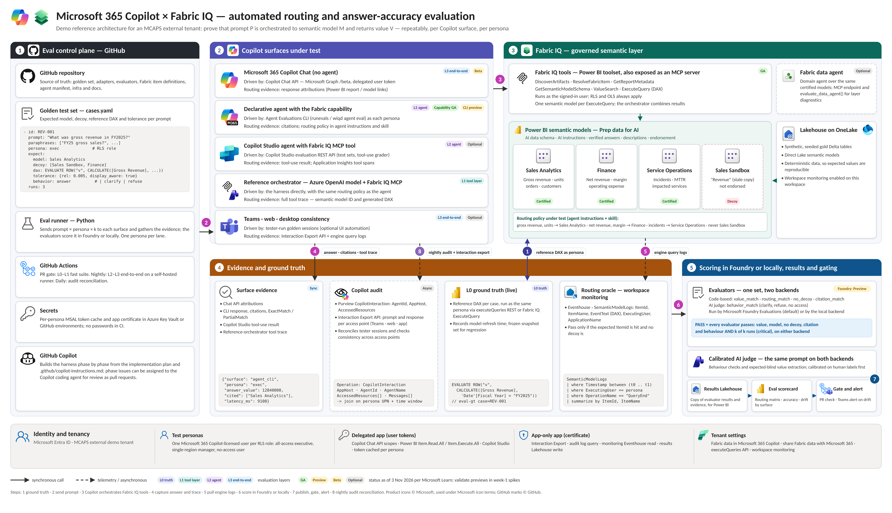
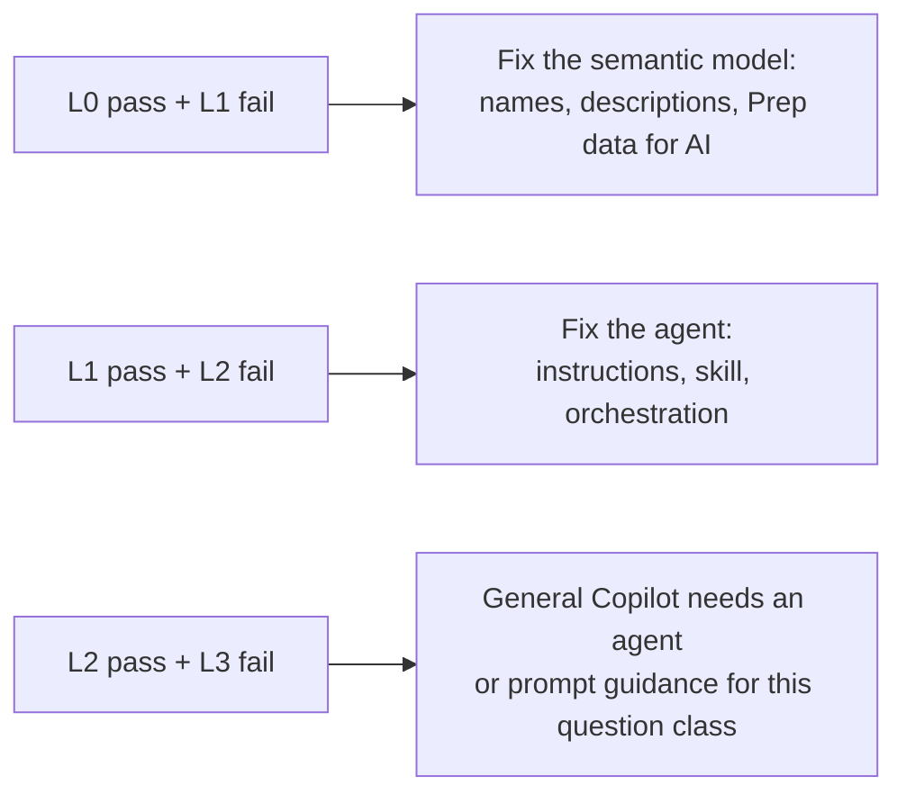

# Copilot × Fabric IQ evaluation harness

[](../../actions/workflows/ci.yml)
[](LICENSE)


Automated, evidence-based proof that **Microsoft 365 Copilot answers business questions from the right certified Power BI semantic model, with the right value**: on every change, and every night. Every verdict comes from one set of evaluators that runs in **Microsoft Foundry Evaluations** or **locally in GitHub Actions**: the same checks and the same verdicts, on the platform you choose.

When a user asks Copilot a question *P*, does Copilot

1. **route** to the intended semantic model *M*, and not to a decoy model or an unofficial document?
2. **return** the value *V* within a defined tolerance?
3. do this **consistently** across repeated runs, personas (row-level security) and Copilot surfaces?

This repository holds the harness that answers those questions automatically, and the demo that shows it, built on fictional Contoso data in a dedicated demo tenant.

> [!IMPORTANT]
> **Status: Phase 0 (spikes).** The repository foundation is in place, and the harness is being built task by task from the [implementation plan](docs/PLAN.md) with GitHub Copilot. Several Microsoft services it exercises, including Foundry custom evaluators, are in preview or beta, so Phase 0 confirms their behaviour before any code depends on it. See [What's here today](#whats-here-today).

<p align="center">
  <a href="docs/architecture/copilot-fabric-iq-eval-architecture.svg">
    
  </a>
</p>

## Contents

- [Why this exists](#why-this-exists)
- [What the harness proves](#what-the-harness-proves)
- [How it works](#how-it-works)
- [Two evaluation paths](#two-evaluation-paths)
- [What's here today](#whats-here-today)
- [Repository layout](#repository-layout)
- [Getting started](#getting-started)
- [Deploy the demo environment](#deploy-the-demo-environment)
- [Building with GitHub Copilot](#building-with-github-copilot)
- [Roadmap](#roadmap)
- [Documentation](#documentation)
- [Contributing](#contributing)
- [Trademarks](#trademarks)
- [Disclaimer](#disclaimer)

## Why this exists

Organisations that put Microsoft 365 Copilot in front of governed Power BI data ask a simple question: *how do we know Copilot used the certified model (not the sandbox copy, not last quarter's draft) and got the number right?*

No single Microsoft product proves that end to end today. Copilot is a closed orchestrator: its APIs expose answers and, at best, citations, but not which semantic model a query hit. The evidence exists, in three different places:

| Evidence | Where it comes from |
|---|---|
| **What Copilot said** | The surface under test: a declarative agent driven by the Agent Evaluations CLI, the Copilot Chat API, or tester sessions. |
| **Which model was queried** | Fabric workspace monitoring (`SemanticModelLogs`): the only documented record that names the model (`ItemId`) and its DAX together. |
| **What the right answer is** | The semantic model itself: a reference DAX query run live as the same user, so row-level security applies. |

The harness joins the three for every attempt and hands them to one set of evaluators, run in Microsoft Foundry or locally, which turn them into a verdict a customer can trust. The research behind this design is in [docs/research](docs/research).

## What the harness proves

| # | Claim | Measured by |
|---|---|---|
| 1 | The answer value is right | Evaluator `value_match` against a live reference DAX result (L0) |
| 2 | The right semantic model was used | Evaluator `routing_match` over engine query logs, plus surface evidence |
| 3 | No decoy model or unofficial document was used | Evaluator `no_decoy`: the decoy model and the document decoy are never hit or cited |
| 4 | Results are consistent across runs | pass^k with k = 3 per case |
| 5 | Results are consistent across surfaces and personas | Cross-surface value agreement; RLS persona cases |
| 6 | Regressions are caught automatically | The PR gate fails on injected regressions; nightly drift alert |
| 7 | Every verdict can be explained | A Foundry report page per run (or the run's artifacts on the local path), plus per-attempt evidence: answer, extracted and expected value, observed models and DAX, citations, latency |
| 8 | Questions that need data **and** a document use the right source for each | Evaluator `work_source_match` (the approved document is cited), with `value_match` (actual and target both stated) and `no_decoy` (never the draft): the joint Work IQ + Fabric IQ cases ([ADR-010](docs/decisions/ADR-010-joint-work-iq-fabric-iq-evaluation.md)) |

## How it works

### Who does what

| | Role | Never does |
|---|---|---|
| **GitHub + Python** (the thin layer) | Sends each prompt to each Copilot surface as each persona; gathers the expected value from Fabric and the engine-log evidence; hands one row per attempt to the evaluation backend; applies the gate to the results; publishes them to Fabric | Score an answer |
| **The evaluators** ([`evals/evaluators/`](evals/evaluators/README.md)) | Decide every verdict: code-based checks for the right number, the right model, no decoy and citations, and an AI judge for clarify, refuse and no access | Depend on where they run |
| **Microsoft Foundry Evaluations** (the default backend) | Runs the evaluators in your Azure subscription and keeps every verdict, with a report page per run | Talk to Copilot: no evaluation framework can |
| **The local backend** (no Foundry needed) | Runs the same evaluators in the harness process, on the GitHub Actions runner or your machine | Add checks of its own |
| **Microsoft Fabric** (the truth and the business view) | Semantic models that produce the expected values; engine logs that show which model answered; the Lakehouse and Power BI scorecard | Decide pass or fail |

### Four evaluation layers

| Layer | System under test | Driver | A failure means |
|---|---|---|---|
| **L0** Data truth | The semantic model itself | Reference DAX per case, run live as the persona | A data or measure defect, not an AI problem |
| **L1** Tool layer | Fabric IQ tools and the model's AI readiness | Reference orchestrator: an Azure OpenAI model with the Fabric IQ MCP server and the same routing policy as the agent | The model is hard for AI to use: names, descriptions, Prep data for AI |
| **L2** Agent | Microsoft 365 Copilot orchestration in a declarative agent with the Fabric capability | Agent Evaluations CLI, per persona | Agent instructions, skill or orchestration |
| **L3** Copilot surfaces | Copilot Chat with no agent; Teams, web and desktop | Copilot Chat API; tester sessions harvested by the Interaction Export API | General Copilot routing without an agent; access-point inconsistency |

**Failure triage** is the most useful output for a customer, because it says *where* to invest:



### One run, end to end

1. **Ground truth.** Run each case's reference DAX as the persona, tagged `// eval-gt`, and record the expected value and the model's refresh time.
2. **Ask.** Send the prompt to the surface as the persona: attempt *i* of *k*, one persona per lane so time windows never overlap.
3. **Orchestrate.** Copilot (or the agent) calls Fabric IQ tools; the query runs as the user, so RLS and OLS apply.
4. **Capture.** Record the answer, citations, any tool trace and the window *t0*–*t1*.
5. **Collect evidence.** Send a heartbeat query, wait until the engine logs contain it, then read which semantic models the persona queried in the window.
6. **Score.** Write one dataset row per attempt (question, answer, citations, expected value, observed models) and hand the rows to the evaluation backend. Microsoft Foundry Evaluations (the default) or the local backend runs the code-based evaluators and the AI judge; Foundry also keeps the results with a report page.
7. **Gate and publish.** Apply the gate to the evaluator results, fail the pull request or raise an alert, and copy the results to Fabric for the Power BI scorecard.

The full sequence diagram is in [docs/architecture](docs/architecture/README.md#one-attempt-end-to-end).

### Pass rule

An attempt passes only if **every evaluator** passes, on either backend: `behavior_match` (answer, clarify, refuse or no access, as expected), `value_match` (within tolerance of the live expected value), `routing_match` (the expected models were queried), `no_decoy` (no decoy model queried, no document decoy cited) and `citation_match` (the source is named when required). A **critical** case must pass **k of k** attempts. An evaluator that can't decide, because the engine logs are incomplete or the surface failed, raises instead of failing, so the attempt is **INCONCLUSIVE**, never a false failure.

## Two evaluation paths

This repository is a reference for both ways field teams evaluate: **with Microsoft Foundry** and **without it**. The evaluators are written once, in Foundry's own formats, and either backend runs them ([ADR-009](docs/decisions/ADR-009-two-evaluation-backends.md)):

| | Foundry path (default) | Local path |
|---|---|---|
| The evaluators run in | Microsoft Foundry Evaluations, in your Azure subscription | The harness process: GitHub Actions or your machine |
| Verdicts are kept in | Foundry, with a report page per run, and the Lakehouse | The run artifacts and the Lakehouse |
| You need | A Foundry project and the Foundry User role | A model deployment for the AI judge, or nothing at all to start |
| Service status | Custom evaluators are in preview, with no SLA | Generally available APIs only |

Choose with `[evaluation] backend` in `config/settings.toml`, `--backend` on the command line, or the `EVALS_BACKEND` repository variable in GitHub Actions. [Choosing an evaluation path](docs/evaluation-paths.md) compares the two in full. Try the local path now, with no Azure resources:

```bash
uv run evals score evals/evaluators/samples/eval-items.jsonl
```

### Why Foundry is the default

- **No framework can drive Copilot.** Foundry and every open-source option send prompts only to the models or agents they host, so the code that talks to Copilot is custom whatever is chosen. The real choice is where scoring, results and comparison live.
- **It fits the design as it is.** Foundry scores a file of answers collected elsewhere, and our checks run inside it: code-based evaluators for the number, the model, decoys and citations (no network and a 2-minute limit, so the runner gathers the evidence first), and an AI-judged evaluator for clarify and refuse behaviour.
- **Microsoft's own tooling already uses it.** The Agent Evaluations tool for Microsoft 365 agents judges with a Foundry project, so the harness has one AI judge and one results store.
- **Enterprise fit.** It runs in the customer's own Azure subscription with Entra ID sign-in and role-based access, and adds red-teaming and monitoring later. Test definitions follow the OpenAI Evals format, so they stay portable.

The full reasoning, and how its caveats are handled (preview status, no built-in routing check for Fabric data agent calls, judge token cost), is in [ADR-007](docs/decisions/ADR-007-foundry-evaluations-framework-of-record.md).

### Why there is a local path

- **Not every team can use Foundry yet:** no Foundry project, a region without batch evaluation, or a policy against preview services.
- **No lock-in:** the same evaluator files run on both backends, so moving between them is a setting, not a rewrite.
- **A fallback:** if the Foundry preview is unavailable, the gate keeps running on the same evaluators.
- **A fast inner loop:** evaluator changes can be tried offline in seconds, and CI scores the sample rows on every push.

## What's here today

| Area | Status | Where |
|---|---|---|
| Implementation plan (v1.3), research notes and architecture | Ready | [`docs/`](docs/README.md) |
| **Deployment**: `evals deploy fabric` (workspaces, data, four semantic models with RLS, permissions, validation) and `evals deploy workiq` (seeded documents) | Ready; unit-tested against a fake tenant, not yet run against a live one | [`docs/deployment.md`](docs/deployment.md) |
| Fabric notebooks: calibrated synthetic data, models as data, validation as each persona | Ready; logic unit-tested outside Fabric | [`fabric/`](fabric/README.md) |
| Work IQ content pack: three synthetic documents built from the golden-set facts | Ready | [`workiq/`](workiq/README.md) |
| Infrastructure as code: four Entra app registrations; Foundry, Key Vault and runner VM in Bicep | Ready; not yet deployed | [`infra/`](infra/README.md) |
| Phase 0 spike scripts S1, S2, S3, S6, S7 and S8 | Ready to run; results become ADRs | [`spikes/`](spikes/README.md) |
| Evaluation definition (item schema, testing criteria, extraction step), shared by both backends | Ready; spike S7 confirms Foundry's contract | [`evals/evaluators/`](evals/evaluators/README.md) |
| Evaluators `routing_match`, `no_decoy`, `citation_match`, `work_source_match` | Implemented and unit-tested | [`evals/evaluators/code/`](evals/evaluators/code) |
| Evaluator `value_match` (numeric extraction and tolerance) | Skeleton; built in P2.5 | [`value_match.py`](evals/evaluators/code/value_match.py) |
| AI judge and extraction prompts | Drafted; calibrated in P10.1 | [`evals/evaluators/prompts/`](evals/evaluators/prompts) |
| Local backend: runs the evaluators in process; `evals score` and seven sample rows | Ready; the Azure OpenAI judge client is P2.8 | [`src/copilot_evals/evaluation/`](src/copilot_evals/evaluation) |
| Data contracts (pydantic v2), including the evaluation row, and offline `evals validate` | Ready | [`src/copilot_evals/`](src/copilot_evals) |
| Seed golden set: 14 cases (4 joint Work IQ + Fabric IQ), 3 personas, 4 models, 3 documents | Ready | [`evals/golden/`](evals/golden) |
| Routing policy, gate policy, API contracts registry, engine-log KQL | Ready; contracts await Phase 0 | [`agents/policy/`](agents/policy), [`config/`](config), [`fabric/kql/`](fabric/kql) |
| GitHub Copilot instructions, issue forms, pull request template, CI | Ready | [`.github/`](.github) |
| Backlog of every plan task, ready to become GitHub issues | Ready | [`docs/backlog/`](docs/backlog/README.md) |
| PR gate, nightly and reconcile workflows | Wired, disabled until Phase 9 | [`.github/workflows/`](.github/workflows) |
| Foundry backend client, surface adapters, runner, scorecard, declarative agent | Planned | [Roadmap](#roadmap) |

## Repository layout

```text
copilot-fabriciq-evals/
├─ .github/              Copilot instructions, issue forms, PR template, CI and evaluation workflows
├─ agents/
│  ├─ policy/            routing-policy.md: the single routing policy used by every layer
│  ├─ declarative/       Microsoft 365 Copilot declarative agent with the Fabric capability (L2)
│  └─ copilot-studio/    optional Copilot Studio assets (only if spike S4 is positive)
├─ config/               settings template, API contracts registry, gate policy
├─ docs/                 plan, architecture, decisions (ADRs), backlog, research, guides
├─ evals/
│  ├─ golden/            golden cases, personas, semantic models and seeded documents (work sources and decoys)
│  ├─ evaluators/        the evaluators, AI judge prompts, eval definition and sample rows: run by Foundry or locally
│  └─ judge/             calibration set for the AI judge
├─ fabric/               deployment notebooks (built from src/), item definitions and engine-log KQL
├─ infra/                Entra ID app registrations and Azure resources (Bicep) as code
├─ scripts/              repository tooling: backlog bootstrap, notebook and document builders
├─ spikes/               Phase 0 spike scripts (outputs are gitignored)
├─ src/copilot_evals/    the thin layer: contracts, CLI, deployment, auth, ground truth, adapters, evidence, evaluation backends
├─ workiq/               the Work IQ content pack: seeded SharePoint documents for the joint cases
└─ tests/                unit and contract tests, sanitised fixtures
```

Folder READMEs explain what lives in each area and which backlog task builds it.

## Getting started

### Prerequisites

- [Python 3.12](https://www.python.org/downloads/) and [uv](https://docs.astral.sh/uv/getting-started/installation/)
- Git, and the [GitHub CLI](https://cli.github.com/) to create the backlog issues
- For live runs (from Phase 0 onwards): a demo tenant that meets the checklist in [PLAN §6](docs/PLAN.md#6-tenant-prerequisites-and-setup-checklist), plus a Microsoft Foundry project in a region that supports batch evaluations if you choose the Foundry path

### Run the checks locally

```bash
uv sync                          # create .venv with runtime and dev dependencies
uv run evals validate --strict   # golden set and evaluator definitions: schemas, references, sandbox rules
uv run evals score evals/evaluators/samples/eval-items.jsonl   # the evaluators, on the local backend
make check                       # everything CI runs: ruff, mypy --strict, pytest, validate, sample scoring
```

No tenant, Foundry project or credentials are needed for any of these.

### Next steps

[docs/getting-started.md](docs/getting-started.md) walks through creating the GitHub repository, seeding the backlog, configuring settings, preparing the tenant, choosing and preparing an evaluation path, and enabling the live workflows.

## Deploy the demo environment

Five commands build the environment the harness tests against; [docs/deployment.md](docs/deployment.md) explains each step, what stays manual, and how to check it worked.

```bash
./infra/entra/New-EvalAppRegistrations.ps1 -TenantId <tenant-id> -GitHubRepository <owner>/copilot-fabriciq-evals
infra/azure/deploy.sh --resource-group rg-copilot-evals --location eastus2 --ci-principal-id <id>
uv run evals deploy fabric       # workspaces, data, four semantic models with RLS, permissions, validation
uv run evals deploy workiq       # the documents for the joint Work IQ + Fabric IQ cases
uv run python spikes/s1_chat_api.py --case REV-001   # then the other Phase 0 spikes
```

Every command prints its plan first (`--dry-run` or `--what-if` stops there) and is safe to re-run. Prep data for AI, endorsement, the reports and admin consent have no API and stay manual.

## Building with GitHub Copilot

This repository is designed to be built by GitHub Copilot, one reviewed pull request at a time:

1. **Every plan task is an issue.** [`scripts/bootstrap_github.py`](scripts/bootstrap_github.py) creates one issue per task from [`docs/backlog/tasks.yaml`](docs/backlog/tasks.yaml), with the plan's goal, its Copilot prompt and the acceptance criteria as a checklist, under a milestone per phase.
2. **Copilot follows the repository's rules.** [`.github/copilot-instructions.md`](.github/copilot-instructions.md) sets the non-negotiables: verdicts come only from the evaluators, on either backend, and no other code scores an answer; never invent an API contract; no secrets or tenant IDs; UTC and `Decimal` everywhere. [Path-specific instructions](.github/instructions) add rules for Python, evaluators, the golden set, Fabric assets and agent assets.
3. **Assign or pair.** Assign a `copilot-ready` issue to the Copilot cloud agent and review its pull request, or work it in VS Code agent mode. [`copilot-setup-steps.yml`](.github/workflows/copilot-setup-steps.yml) gives the cloud agent the same toolchain as CI.
4. **People do the `[MANUAL]` parts.** Licences, admin settings, consent and UI-only configuration are `type:manual` issues.
5. **Decisions are recorded.** Every Phase 0 spike ends in an [ADR](docs/decisions/README.md), and confirmed API contracts move into [`config/contracts.yaml`](config/contracts.yaml), the only place adapters read them from.

## Roadmap

| Phase | Days | Outcome |
|---|---|---|
| 0 Spikes | 1–3 | Preview contracts confirmed (Chat API, engine logs, CLI, Copilot Studio, audit, Fabric IQ MCP, Foundry evaluations, joint Work IQ + Fabric IQ answers); ADR-001 to ADR-006, ADR-008 and ADR-011 |
| 1 Fabric foundation | 3–6 | `evals deploy fabric` and `evals deploy workiq` run in the demo tenant: synthetic Contoso data, three certified Direct Lake models and one decoy, seeded documents; Prep data for AI; expected snapshot |
| 2 Harness core | 5–9 | Contracts, auth, live ground truth, evaluators, both evaluation backends, runner with persona lanes, gate |
| 3 L1 reference orchestrator | 8–11 | Azure OpenAI model + Fabric IQ MCP with full tool traces |
| 4 L2 declarative agent | 10–14 | Agent with the Fabric capability, driven per persona by the Agent Evaluations CLI |
| 5 Evidence and correlation | 12–15 | Engine-log routing evidence with heartbeat completeness |
| 6 L3 surfaces | 14–17 | Copilot Chat API; Teams, web and desktop consistency |
| 7 Optional adapters | 16–18 | Copilot Studio (if ADR-004 allows) and Fabric data agent diagnostics |
| 8 Results and reporting | 17–20 | Evaluation results copied to OneLake, Power BI scorecard, alerts |
| 9 CI/CD | 19–22 | PR gate, nightly and reconcile workflows on a self-hosted runner |
| 10 Demo hardening | 21–25 | Judge calibration, scripted regression injections, runbook |

The demo is done when at least 40 golden cases run unattended (L0–L1 on every pull request in under 15 minutes, L2 every night), every verdict is recorded with its evaluator version (in a Foundry run on the Foundry path), the scorecard shows pass rates, a routing confusion matrix and drift, and the three scripted regressions in [PLAN §12](docs/PLAN.md#12-demo-runbook-customer-facing-story-about-25-minutes) are detected and explained.

## Documentation

| Document | What it covers |
|---|---|
| [Implementation plan](docs/PLAN.md) | The specification: objectives, architecture, data design, golden set, phases, component specs, CI/CD, identity, demo runbook, risks |
| [Architecture](docs/architecture/README.md) | The reference architecture, who does what, evaluation layers and the end-to-end sequence of one attempt |
| [Choosing an evaluation path](docs/evaluation-paths.md) | Foundry or local: what each needs, gives and costs, and how to switch |
| [Evaluators](evals/evaluators/README.md) | The evaluators, the AI judge, the dataset row and how each backend runs them |
| [Getting started](docs/getting-started.md) | Creating the repository and backlog, local setup, tenant preparation, choosing an evaluation path, enabling live workflows |
| [Deploying the demo environment](docs/deployment.md) | Entra apps, Azure resources, the Fabric estate and the Work IQ documents, in order, with checks, teardown and troubleshooting |
| [Architecture decisions](docs/decisions/README.md) | ADR index and template; ADR-007 and ADR-009 explain Foundry as the default and the local alternative; ADR-010 the joint Work IQ + Fabric IQ cases |
| [Backlog](docs/backlog/README.md) | Every plan task and how it becomes a GitHub issue |
| [Research](docs/research) | The research notes behind the design (3 November 2026) |
| [Demo runbook](docs/runbook.md) | The customer-facing demo script (completed in Phase 10) |
| [Open-source release checklist](docs/open-source-release.md) | What to check before this repository becomes public |

## Contributing

This project welcomes contributions and suggestions. Most contributions require you to agree to a Contributor License Agreement (CLA) declaring that you have the right to, and actually do, grant us the rights to use your contribution. For details, visit <https://cla.opensource.microsoft.com>.

When you submit a pull request, a CLA bot will automatically determine whether you need to provide a CLA and decorate the PR appropriately (e.g., status check, comment). Simply follow the instructions provided by the bot. You will only need to do this once across all repos using our CLA.

This project has adopted the [Microsoft Open Source Code of Conduct](https://opensource.microsoft.com/codeofconduct/). For more information see the [Code of Conduct FAQ](https://opensource.microsoft.com/codeofconduct/faq/) or contact [opencode@microsoft.com](mailto:opencode@microsoft.com) with any additional questions or comments.

See [CONTRIBUTING.md](CONTRIBUTING.md) for the development workflow, and [SECURITY.md](SECURITY.md) to report a vulnerability.

## Trademarks

This project may contain trademarks or logos for projects, products, or services. Authorized use of Microsoft trademarks or logos is subject to and must follow [Microsoft's Trademark & Brand Guidelines](https://www.microsoft.com/en-us/legal/intellectualproperty/trademarks/usage/general). Use of Microsoft trademarks or logos in modified versions of this project must not cause confusion or imply Microsoft sponsorship. Any use of third-party trademarks or logos are subject to those third-party's policies.

## Disclaimer

This repository is a field-built reference implementation and demo. It is not a Microsoft product or service and is provided "as is", without warranty or support commitment, under the [MIT License](LICENSE). It uses only fictional, synthetic data (Contoso). Several of the Microsoft services it exercises are in preview or beta and may change; statements about their status reflect Microsoft Learn as of 3 November 2026.
