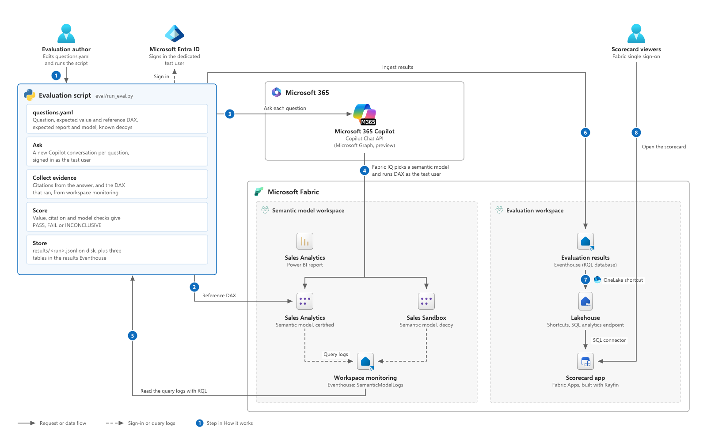

# Microsoft 365 Copilot and Fabric IQ: check the answer and its source

This learning accelerator shows how to check a sales figure against reference DAX and investigate its source using the cited Power BI report and Fabric workspace monitoring. In the synthetic Contoso example, Sales Sandbox gives **$12.33M** for FY2025 gross revenue; the authoritative Sales Analytics model gives **$12.84M**.

[Replay the sample](#replay-the-saved-answers) · [Build an eval with Q02](#work-through-q02-fy2025-gross-revenue) · [Deploy in a demo tenant](docs/deployment-guide.md)

## Solution architecture

[](docs/images/solution-architecture.svg "Open the full-size solution architecture diagram")

The Python runner works locally, not in a Fabric notebook or a hosted service. It writes each run to `results/<run-id>.jsonl`. If you also publish to an Eventhouse, the Rayfin scorecard reads those results through OneLake availability, Lakehouse shortcuts and a SQL analytics endpoint.

## Replay the saved answers

From the repository root, score the two synthetic Contoso samples with Python 3.10 or later. No sign-in, Fabric capacity or Microsoft Foundry is needed.

```bash
python -m pip install -r requirements.txt
python eval/run_eval.py --answers sample/answers-before.jsonl --label "Before model fixes" --no-publish
python eval/run_eval.py --answers sample/answers-after.jsonl --label "After model fixes" --no-publish
```

You should see **2 of 8 pass** before model fixes and **7 of 8 pass** after; “latest quarter” still fails. These are validated Replay results, not measurements from a live tenant.

## Work through Q02: FY2025 gross revenue

Choose the measure and period before scoring the answer. Contoso wants revenue *before* discounts and returns for FY2025. The question leaves the report unnamed; its entry in [questions.yaml](questions.yaml) identifies the source to trust and the sandbox copy to reject:

```yaml
questions:
  - id: Q02
    question: What was gross revenue in FY2025?
    expected: 12840000
    unit: currency
    reference_dax: EVALUATE ROW("v", CALCULATE([Gross Revenue], 'Date'[Fiscal Year] = "FY2025"))
    expected_report: Sales Analytics
    expected_model: Sales Analytics
    decoys: [Sales Sandbox]
```

Replay uses `expected`. In Live, set `SEMANTIC_MODEL_ID` to the ID of **Sales Analytics** so `reference_dax` supplies the expected value. Q02 uses the default `tolerance` of `0.005` (0.5% relative), with an allowance for display rounding capped at 1%.

Compare the Q02 record in the [before](sample/answers-before.jsonl) and [after](sample/answers-after.jsonl) files. Live captures the answer and citations, then matches `SemanticModelLogs` by test user and question time window. Run one evaluation at a time: correlation is evidence, not proof of which query produced the reply.

| Evidence | Before model fixes | After model fixes |
| --- | --- | --- |
| Value in `answer` vs. reference DAX | **$12.33M** (4.0% low) | **$12.84M** (matches) |
| Report named in `citations[].title` | Sales Sandbox (decoy) | Sales Analytics |
| Model in `queries[].semantic_model` | Sales Sandbox (decoy) | Sales Analytics |


[Compare runs in the Overview screenshot](docs/images/scorecard-overview.png) · [See how scoring works](docs/images/how-scoring-works.svg)

Q02 goes from **FAIL** (any check fails) to **PASS** (all required checks pass). Try setting only Q02’s `queries` to `[]` in a copy of the after file and replaying that copy. The number and report still match, but no model log means **INCONCLUSIVE**, not a pass. **ERROR** means the Copilot request failed.

For the sandbox failure, certify **Sales Analytics**, restrict access to the sandbox and repeat the unchanged questions (`--repeats 3` in Live). Don’t widen the tolerance to make the answer pass. If you add a question, Replay needs a saved answer with the same `id`.

Read the answer as well as the verdict. The scorer can credit a secondary figure because it picks the number closest to the reference. A matching refusal phrase is not proof that Copilot actually declined.

## Run live in a demo tenant

Without `--answers`, the runner calls Microsoft 365 and Fabric live. Follow the [deployment guide](docs/deployment-guide.md) for a dedicated Copilot-licensed test user with Power BI Build access, an Entra app with admin-consented delegated permissions, and Fabric capacity (F2 or larger) with monitoring. Budget for licenses and capacity, including monitoring and the Eventhouse. Live is tenant-dependent: the Graph beta Copilot Chat API does not guarantee Fabric IQ grounding. The [optional scorecard app](app/README.md) uses Fabric Apps (preview); its connector reads as the app owner by default. Review the [Transparency FAQ](TRANSPARENCY_FAQ.md) and [security guidance](SECURITY.md) before sharing answers or DAX.

For response and tool-call quality, the [Microsoft 365 Copilot Evaluations CLI](https://github.com/microsoft/m365-copilot-eval) complements these data checks. For coding help, start with the core `fabric-skills` plugin in [microsoft/skills-for-fabric](https://github.com/microsoft/skills-for-fabric); `powerbi-authoring` is a separate, optional plugin. These tools are not runtime dependencies of this learning sample.

*Community accelerator: [MIT](LICENSE). Artwork: [Microsoft Fabric icon pack](https://learn.microsoft.com/en-us/fabric/fundamentals/icons); Microsoft Entra and Microsoft 365 artwork via [DamoBird365 / aidevme](https://github.com/aidevme/microsoft-cloud-product-icons) ([CC BY 4.0](https://creativecommons.org/licenses/by/4.0/)).*
