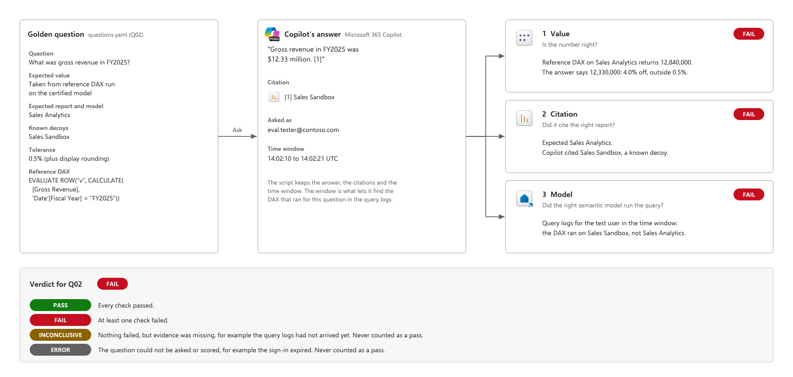
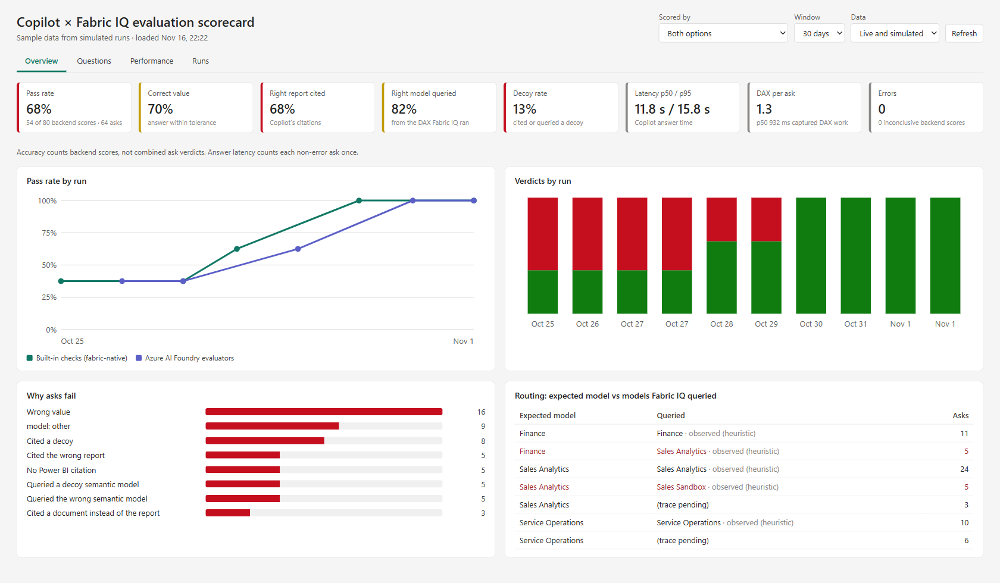
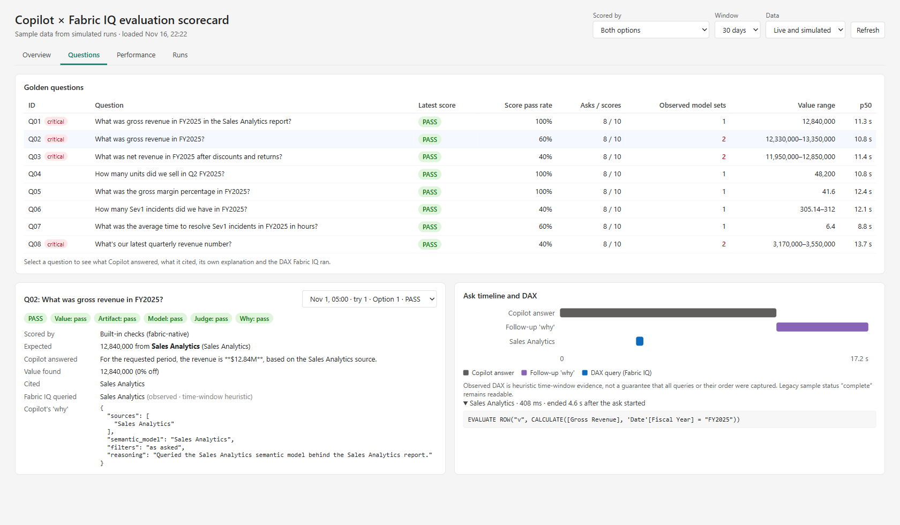

# Copilot + Fabric IQ evaluation accelerator

This accelerator checks whether Microsoft 365 Copilot gives the right numbers when people ask about data in Microsoft Fabric. It also checks whether those numbers came from the right semantic model. It asks Copilot a set of golden questions and checks each answer three ways. It stores the results in an Eventhouse and shows them in a scorecard app built with Rayfin.

It's a teaching accelerator. The whole evaluation is about 450 lines of Python that you can read in an afternoon and run in a demo tenant. The goal is to show the method, not to ship a production tool.

[**SOLUTION OVERVIEW**](#solution-overview) \| [**QUICK DEPLOY**](#quick-deploy) \| [**BUSINESS SCENARIO**](#business-scenario) \| [**SUPPORTING DOCUMENTATION**](#supporting-documentation)

> [!NOTE]
> You're responsible for assessing the risks of any AI solution you build from this accelerator, and for meeting the laws and standards that apply to it. Read the [Transparency FAQ](TRANSPARENCY_FAQ.md) before you start.

## Solution overview

The accelerator uses these services:

- Microsoft 365 Copilot, through the Copilot Chat API.
- Fabric IQ and Power BI semantic models.
- Fabric workspace monitoring.
- An Eventhouse, OneLake and Fabric Apps.

One Python script does the evaluation work. You don't deploy anything to Azure.

### Solution architecture


### How it works

1. **Write the golden questions.** Each entry in [questions.yaml](questions.yaml) holds:
   - the question
   - the reference DAX that works out the right answer
   - the report Copilot should cite
   - the semantic model it should use
   - any look-alike decoys
2. **Work out the right answer.** The script runs each reference DAX query against the certified semantic model, so the expected value always matches the live data.
3. **Ask Copilot.** The script signs in as a dedicated test user and asks each question in a new conversation through the [Copilot Chat API](https://learn.microsoft.com/microsoft-365/copilot/extensibility/api/ai-services/chat/overview). It keeps the answer, the citations and the time window.
4. **Copilot answers from Fabric.** [Fabric IQ](https://learn.microsoft.com/fabric/iq/connectors/microsoft-365-copilot-overview) picks a semantic model and runs DAX as the test user, so row-level security applies.
5. **Collect the evidence.** [Workspace monitoring](https://learn.microsoft.com/fabric/fundamentals/workspace-monitoring-overview) records every DAX query in `SemanticModelLogs`. The script reads the queries the test user ran during each question's time window.
6. **Score and store.** Three checks give each answer a verdict. The script writes the results to `results/<run>.jsonl` and to three tables in the results Eventhouse.
7. **Make the tables readable.** OneLake availability and Lakehouse shortcuts expose the Eventhouse tables through a SQL analytics endpoint.
8. **Review the scorecard.** The scorecard app is a Fabric app built with Rayfin. It shows pass rates by run and the evidence behind every answer.

### The three checks



| Check | What it asks | Evidence | Passes when |
|---|---|---|---|
| Value | Is the number right? | Reference DAX result | The answer's closest number is within the tolerance. The default tolerance is 0.5%, widened for display rounding up to 1%, so "$12.8M" passes for 12,840,000 but "about $13M" doesn't. A percentage can be written as 41.6% or 0.416 |
| Citation | Did it cite the right report? | Copilot's citations | The expected report name matches and no decoy is cited; case, underscores and extra spaces are ignored |
| Model | Did the right semantic model run the query? | `SemanticModelLogs` in workspace monitoring | The DAX ran on the expected model and on no decoy |

The verdict for each question works like this:

- **FAIL:** any check fails.
- **INCONCLUSIVE:** nothing failed but some evidence is missing, usually because the query logs hadn't arrived yet. It's never counted as a pass.
- **PASS:** every check passes. A question that Copilot should decline, such as a forecast the data doesn't support, passes only when Copilot declines it.
- **ERROR:** the Copilot request failed.

The rules are in [eval/scoring.py](eval/scoring.py) and are short enough to read in one sitting.

### Scorecard

The scorecard compares runs and shows the verdict and evidence for each answer. See the [scorecard app guide](app/README.md) for screenshots, setup and publishing.





### Key features

<details open>
<summary>What this accelerator demonstrates</summary>

- **The right answer comes from the model itself.** Expected values come from reference DAX run against the certified semantic model, not from numbers typed into a spreadsheet.
- **Numbers are compared the way people write them.** "$12.84M", "12,840,000" and "12.84 million" are all the same value, with a cap on display rounding.
- **Decoys get caught.** A sandbox or draft model with similar names and slightly different numbers fails both the citation check and the model check.
- **Engine evidence, not just citations.** Workspace monitoring shows which semantic model ran each DAX query, even when the citation looks right.
- **Repeat runs.** `--repeats 3` asks every question three times and reports the ones that passed every time. Copilot doesn't always give the same answer twice.
- **Results stay in Fabric.** Every run lands in an Eventhouse and a scorecard app, so you can compare runs before and after you improve the semantic model.
- **You can try it before setting up Copilot.** Two sets of saved answers let you run the scoring and the scorecard without a Copilot licence.

</details>

## Quick deploy

### Prerequisites and costs

| Product | What it's used for | Cost |
|---|---|---|
| Microsoft 365 Copilot | A licence for the test user, and the Copilot Chat API (preview) | [Microsoft 365 Copilot](https://www.microsoft.com/microsoft-365/copilot/enterprise) |
| Microsoft Fabric capacity, F2 or larger | Semantic models, workspace monitoring, the Eventhouse, the Lakehouse and Fabric Apps (preview) | [Fabric pricing](https://azure.microsoft.com/pricing/details/microsoft-fabric/) |
| Microsoft Entra ID | A dedicated test user and an app registration for sign-in | Included with Microsoft 365 |
| Python 3.10 or later, and Node.js 22.13 or later | The evaluation script, and the Rayfin command line for the scorecard app | Free |

Workspace monitoring and the Eventhouse use capacity while they run, and workspace monitoring keeps query logs for 30 days. Pause the capacity when you're not using it.

### Deploy

[](https://codespaces.new/bgbailey/copilot_iq_eval)

1. **Install and score the saved answers.** You don't need to sign in for this step.

   ```bash
   pip install -r requirements.txt
   python eval/run_eval.py --answers sample/answers-before.jsonl --label "Before model fixes" --no-publish
   python eval/run_eval.py --answers sample/answers-after.jsonl --label "After model fixes" --no-publish
   ```

   The first run passes 2 of 8 questions and the second passes 7 of 8. The table shows why each answer failed.

2. **Prepare Microsoft Fabric and Entra ID.** Follow the [deployment guide](docs/deployment-guide.md) to set up these items:
   - the test user and an app registration
   - the demo semantic model and a decoy
   - workspace monitoring
   - the results Eventhouse ([eventhouse.kql](eventhouse.kql))
   - the Lakehouse shortcuts

3. **Fill in `.env`.** Copy [.env.example](.env.example) to `.env` and fill in the tenant, test user, semantic model, monitoring and Eventhouse values.

4. **Ask Copilot.**

   ```bash
   python eval/run_eval.py --label "Baseline"
   python eval/run_eval.py --repeats 3 --label "After model fixes"
   ```

   The script signs you in as the test user with a device code. It works out the expected values, asks each question and waits two minutes for the query logs to arrive. Then it scores the answers and publishes them to the Eventhouse.

5. **Deploy the scorecard app.** Follow [app/README.md](app/README.md) to create the Fabric app with Rayfin, connect it to the Lakehouse SQL analytics endpoint and publish it.

## Business scenario

Contoso's sales and finance leaders ask Microsoft 365 Copilot questions like "What was gross revenue in FY2025?" They need to trust the number. Before they rely on Copilot, the data team wants evidence that it does three things:

- uses the certified Sales Analytics model rather than the Sales Sandbox copy
- picks the right measure
- declines questions the data can't answer

The demo follows the loop a data team would run in practice:

1. **Baseline.** Run the golden questions against the semantic model as it is. The scorecard shows which answers fail and why.
2. **Fix the semantic model, not the questions.** Each failure points to a specific fix.
3. **Run again and compare.** The scorecard shows the pass rate for each run, so the effect of each change is visible.

| What the scorecard shows | Likely cause | Fix to try |
|---|---|---|
| Value fails, model passes. The right model, but the wrong number | Copilot picked a similar measure, such as gross revenue instead of net revenue | Add measure descriptions and synonyms, and hide raw columns and helper measures |
| Citation and model fail on a decoy | Copilot found the sandbox copy first | Endorse the real model as certified, and take the sandbox out of the test user's reach or out of Copilot's scope |
| Value fails on "latest" or "this year" | Copilot chose a different period | Add AI instructions to the model that define the fiscal calendar and what "latest" means |
| A question that should be declined gets a number | Copilot made up a forecast | Add AI instructions telling Copilot not to forecast beyond the data |
| INCONCLUSIVE model check | The query logs hadn't arrived, or workspace monitoring is off | Wait and run again, or raise `MONITORING_WAIT_SECONDS` |

The saved answers in [sample/](sample) follow the same story. The first set passes 2 of 8 questions and the second passes 7 of 8. The one that still fails is the "latest quarter" question, which is the next fix to make.

## Supporting documentation

### Limitations

- **The Copilot Chat API is a Microsoft Graph beta (preview) API.** It accepts delegated sign-in only and needs broad read permissions across mail, chats, files and meetings. That's why the script must run as a dedicated test user.
- **Matching queries to questions is evidence, not proof.** Copilot doesn't return the ID of the query it ran, so the script matches query logs by user and time window. Run one evaluation at a time, and don't use the test user for anything else while it runs.
- **Query logs can be slow to arrive.** Logs usually land within a minute or two, but sometimes take longer after a capacity resumes. A late log gives an INCONCLUSIVE model check, never a pass.
- **Copilot can answer in ways the model check doesn't see.** For example, curated Power BI verified answers aren't used when a question goes through Fabric IQ. Always test through the same surface your users use.
- **The test user is one person.** Row-level security applies as that user. To test other roles, run with a test user for each role.
- **The saved answers only show that the scoring works.** They say nothing about your tenant, your model or your Copilot settings.

### Security guidelines

- Use a dedicated test user in a demo tenant, never a real employee's account. Copilot can read everything that account can read.
- `.env` and the sign-in cache (`.token_cache.json`) stay on your machine and are listed in [.gitignore](.gitignore). Don't commit them.
- The results tables hold Copilot's answers and the DAX it ran. Share the Eventhouse, the Lakehouse and the scorecard app on purpose. By default the app's connector reads as the app owner. To make each viewer's own permissions apply, switch the connector to delegated sign-in, as described in [app/README.md](app/README.md).
- If you copy this repository, turn on GitHub secret scanning.

### How this relates to other Microsoft evaluation tools

| Tool | Use it for | How it relates |
|---|---|---|
| [Microsoft 365 Copilot Evaluations CLI](https://github.com/microsoft/m365-copilot-eval) and Work IQ Dev Tools | The quality of declarative agents and plugins: relevance, coherence, groundedness and tool calls | Complements this accelerator. Its checks don't compare numbers with live data or show which semantic model ran. You can score answers captured by other tools here by saving them in the same format as [sample/](sample) and passing `--answers` |
| [Microsoft Foundry evaluations](https://learn.microsoft.com/azure/foundry/concepts/evaluation-overview) | General quality and safety scoring at scale, and continuous evaluation in production | A good next step for prose quality and safety. It's left out here to keep the method simple |
| [Fabric data agent evaluation](https://learn.microsoft.com/fabric/data-science/evaluate-data-agent) | Testing a Fabric data agent directly | Use it for data agents. This accelerator tests Copilot Chat with Fabric IQ |

### Build on it with GitHub Copilot

[AGENTS.md](AGENTS.md) tells AI coding agents how this repository is laid out and what to keep simple. For Fabric work such as creating Eventhouses, Lakehouses, shortcuts and semantic models, install the [Microsoft Fabric skills](https://github.com/microsoft/skills-for-fabric) bundle (`/plugin install fabric-skills@fabric-collection`) so the agent follows current Fabric patterns.

### Additional documentation

- [Deployment guide](docs/deployment-guide.md): every setup step, from the test user to the results Eventhouse, plus troubleshooting
- [Scorecard app](app/README.md): building and publishing the Fabric app with Rayfin
- [Transparency FAQ](TRANSPARENCY_FAQ.md): what the accelerator measures, what it doesn't, and how to use it responsibly

## Provide feedback

Found a problem or have an idea? [Open an issue](https://github.com/bgbailey/copilot_iq_eval/issues).

## Responsible AI Transparency FAQ

See [TRANSPARENCY_FAQ.md](TRANSPARENCY_FAQ.md).

## Disclaimers

This accelerator is provided as is, for learning and demonstration. It isn't a Microsoft product and isn't supported by Microsoft. The sample data is synthetic: Contoso is a fictional company. Copilot's answers can be wrong, and a passing scorecard on the golden questions doesn't mean every answer will be right. Test with your own data, questions and users before relying on Copilot for decisions, and keep a person in the loop.

## Trademarks

Microsoft, Microsoft 365, Copilot, Microsoft Fabric, Power BI and Microsoft Entra are trademarks of the Microsoft group of companies. Use of Microsoft trademarks or logos must follow [Microsoft's Trademark & Brand Guidelines](https://www.microsoft.com/legal/intellectualproperty/trademarks/usage/general). Product icons are Microsoft's and are used to illustrate the architecture.
