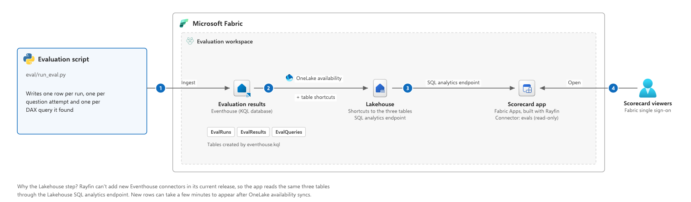

# Security

Please don’t report security problems in public issues. Use **Report a vulnerability** on the repository’s **Security** tab if available; otherwise contact a maintainer privately to arrange a reporting channel. Include the affected commit, steps to reproduce and impact, but not tokens, real tenant IDs or customer data.

## Using this accelerator safely

- For a live run, use a dedicated test user in a demo or test tenant, never an employee’s account. The Copilot Chat API needs broad delegated read permissions; limit what the test user can access. The [deployment guide](docs/deployment-guide.md) lists the required permissions.
- Keep `.env`, `.token_cache.json` and `results/` on your machine and out of source control. `--no-publish` skips Eventhouse writes; it does not prevent the runner from saving answers and evidence locally.
- Turn on GitHub secret scanning in any copy of this repository.

## Who can read published results?

*The read-only connector prevents writes, not disclosure. By default, scorecard viewers see the results the app owner can read.*

Published records include the test user, answers, cited report names and logged DAX. Review access to the Eventhouse, Lakehouse and app before sharing them. To apply each viewer’s own Lakehouse permissions, configure `auth.type: delegated` on the `evals` connector before publishing. See [Who can see what in the scorecard](app/README.md#who-can-see-what).
