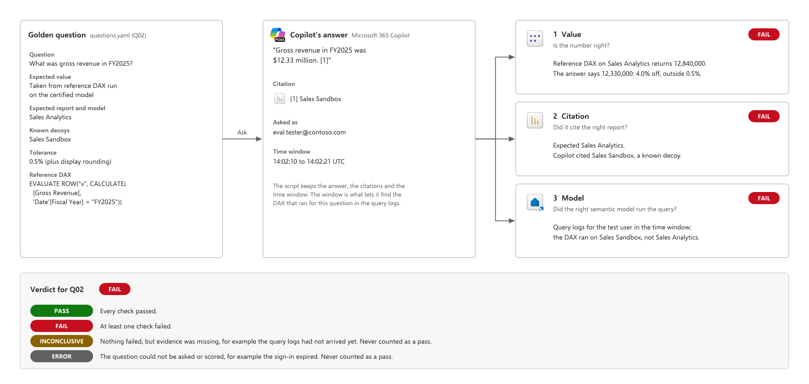

# Responsible AI Transparency FAQ

## What is this accelerator?

A learning sample for data teams evaluating Microsoft 365 Copilot answers over Fabric data. A local Python runner scores a fixed set of business questions. It writes evidence to local JSONL files and can also publish results to an Eventhouse for the Rayfin scorecard.

## What can it do?

Compare a reported number with a DAX reference, check the citation for the expected report, and look for the expected semantic model in workspace monitoring. Use these checks to spot a sandbox copy or compare repeated answers before and after a model change.

*In this synthetic baseline, Q02 fails all three checks. Even a correct number would not clear the two decoy checks.*

## What doesn’t it measure?

The scorer does not judge prose quality, helpfulness or safety. It does not monitor production traffic. A live run reflects the dedicated test user’s access, including row-level security; it does not represent every user or role.

## How was it evaluated?

**Replay (verified).** The [scoring rules](eval/scoring.py) pass 2 of 8 questions on the [before records](sample/answers-before.jsonl) and 7 of 8 on the [after records](sample/answers-after.jsonl). These are synthetic answers, citations and query logs, not observations from a customer tenant.

**Live (tenant validation outstanding).** Confirm sign-in, reference DAX, chat attributions and monitoring in a demo tenant. A Graph beta Copilot Chat API request does not guarantee Fabric IQ grounding. If you publish results, also verify connector discovery and scorecard reads in the deployed app.

## What are the limitations?

- **Value.** The numeric check picks the token closest to the expected value. It can credit a secondary number rather than the answer’s main claim. For a refusal question it looks for a phrase; that is not proof that the answer actually declined to give a forecast.
- **Citation.** The live collector saves an attribution’s `providerDisplayName` as `citations[].title`. A provider display name is not guaranteed to be a report title. A failed name match is not proof that the wrong report was used; inspect the attribution and its URL when available.
- **Model.** The runner matches query logs by test user and time window, not by a query ID from Copilot. Other activity can fall in that window. If a required model log is missing or late, the model check is inconclusive; the overall verdict is **INCONCLUSIVE** unless another check fails, never **PASS**.

## How should it be used responsibly?

Use one dedicated account in a demo tenant and run one evaluation at a time. Limit access to the local files, published answers and DAX as described in the [security guidance](SECURITY.md). Use a pass to inform review of that question, not as a guarantee about future answers.
