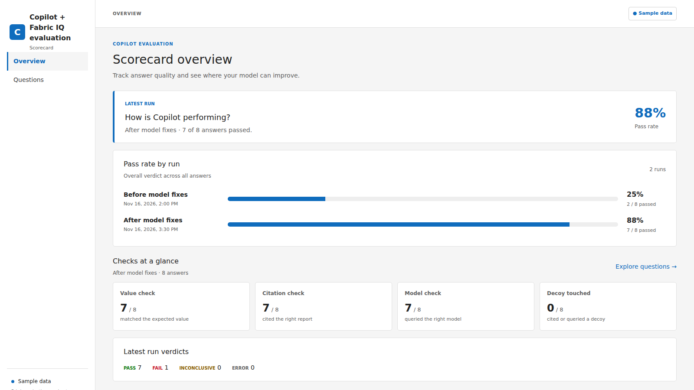
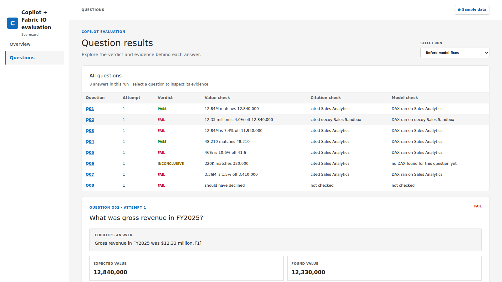

# Scorecard app

The scorecard reads the three results tables from the Eventhouse through OneLake availability, Lakehouse shortcuts and a SQL analytics endpoint. The [Rayfin](https://rayfin.ai/docs/connectors) app connects to that endpoint with a read-only `fabric-sqlanalytics` connector named `evals`, not directly to the Eventhouse. See step 7 of the [deployment guide](../docs/deployment-guide.md#7-make-the-results-readable-by-the-scorecard-app).


**Without a tenant:** [replay the saved answers with the CLI](../README.md#replay-the-saved-answers) and use the [scorecard screenshots below](#overview-compare-runs). After setup, the app can display its bundled sample without sign-in. Installing the overlay in a fresh project is different: `apply.mjs` checks `rayfin/connectors/evals/metadata.json` for all three tables, even if you only want sample mode.

## Prerequisites

The bundled sample has been checked locally. Hosted sign-in, connector schema discovery and live reads from a deployed app remain unverified; validate them in your demo tenant.

- Fabric Apps (preview) is turned on for your tenant and region, and you can create items in the evaluation workspace.
- The Lakehouse SQL analytics endpoint lists `EvalRuns`, `EvalResults` and `EvalQueries`.
- Node.js 22.13 or later.

## Create and publish the app

1. **Create a Rayfin project** in a folder outside this repository, and choose the evaluation workspace when asked.

   ```bash
   npm create @microsoft/rayfin@latest copilot-eval-scorecard
   cd copilot-eval-scorecard
   ```

2. **Add the connector.** Use the item ID of the Lakehouse containing the shortcuts. Rayfin's connector catalog discovers Lakehouses; verify schema discovery in your Fabric tenant.

   Set `WORKSPACE_ID` and `LAKEHOUSE_ID` to those IDs, then run:

   ```bash
   npx rayfin connector add --type fabric-sqlanalytics --workspace-id "$WORKSPACE_ID" --item-id "$LAKEHOUSE_ID" --name evals --operations read
   ```

   Then run the `npm install` command the CLI prints.

3. **Add the scorecard pages** from this repository:

   Replace `/path/to/copilot_iq_eval` with the path to this repository:

   ```bash
   node /path/to/copilot_iq_eval/app/apply.mjs --project .
   ```

   The script copies the pages into the project and wires them to the `evals` connector.

4. **Try it locally** with the bundled sample data:

   ```bash
   npx rayfin dev
   ```

   Connectors don't run under `rayfin dev`, so live data requires a deployed app and connector.

5. **Publish** to the evaluation workspace, then open the app from its item in the Fabric portal and sign in to use live data:

   ```bash
   npx rayfin up
   ```

## Who can see what

By default the connector reads the tables as the app's owner, so anyone you share the app with sees every result. To apply each viewer's own Lakehouse permissions instead, set `auth.type: delegated` on the `evals` connector in `rayfin/rayfin.yml` before you publish. The results include Copilot's answers and the DAX it ran, so share the app on purpose.

## Sample data

`VITE_EVAL_DATA` controls where the app reads data from:

| Value | Data shown |
|---|---|
| `auto` (default) | Live data after sign-in, with a button to switch to the sample |
| `live` | Live data only |
| `sample` | The bundled sample only. No sign-in needed |

### Overview: compare runs

Compare the two runs from the [saved sample](../sample). Before model fixes, 2 of 8 answers pass; after model fixes, 7 of 8 pass. The latest run also breaks out value, citation and model checks and counts answers that touched a decoy.



### Questions: trace one answer

Choose **Before model fixes**, then select **Q02**. The answer gives $12.33M rather than $12.84M, and the citation and logged model both name **Sales Sandbox**. Inspect the answer, expected and found values, cited reports and logged DAX rather than relying on the run's pass rate alone.


