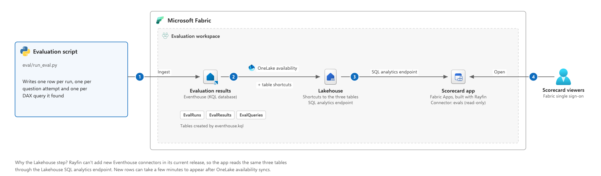

# Scorecard app

The scorecard app is a Fabric app built with [Rayfin](https://rayfin.ai/docs/connectors). It shows how Copilot did on the golden questions in each run, and the evidence behind every answer.

| Page | What it shows |
|---|---|
| Overview | Pass rate per run, so you can compare the baseline with later runs. For the latest run, how many answers passed the value, citation and model checks, and how many touched a decoy |
| Questions | Every question in a run: the verdict and the reason for each check. Select a question to see Copilot's answer, the expected and found values, the cited reports and the DAX that ran |



The app reads the three results tables through a Lakehouse SQL analytics endpoint, using a read-only `fabric-sqlanalytics` connector named `evals`. Rayfin can't add new Eventhouse connectors in its current release, so the tables reach the endpoint through OneLake availability and Lakehouse shortcuts. See step 7 of the [deployment guide](../docs/deployment-guide.md#7-make-the-results-readable-by-the-scorecard-app).

## Prerequisites

- Fabric Apps (preview) is turned on for your tenant and region, and you can create items in the evaluation workspace.
- The Lakehouse SQL analytics endpoint lists `EvalRuns`, `EvalResults` and `EvalQueries`.
- Node.js 20, 22 or 24.

## Create and publish the app

1. **Create a Rayfin project** in a folder outside this repository, and choose the evaluation workspace when asked.

   ```bash
   npm create @microsoft/rayfin@latest copilot-eval-scorecard
   cd copilot-eval-scorecard
   ```

2. **Add the connector.** Use the item ID of the Lakehouse's SQL analytics endpoint, which is shown in the endpoint's settings. If schema discovery finds no tables, check that you used the endpoint's ID rather than the Lakehouse's.

   ```bash
   npx rayfin connector add --type fabric-sqlanalytics --workspace-id <workspace id> --item-id <SQL analytics endpoint id> --name evals --operations read
   ```

   Then run the `npm install` command the CLI prints.

3. **Add the scorecard pages** from this repository:

   ```bash
   node <path to this repository>/app/apply.mjs --project .
   ```

   The script copies the pages into the project and wires them to the `evals` connector.

4. **Try it locally** with the bundled sample data, then with live data after you sign in:

   ```bash
   npx rayfin dev
   ```

5. **Publish** to the evaluation workspace, then open the app from its item in the Fabric portal:

   ```bash
   npx rayfin up
   ```

## Who can see what

By default the connector reads the tables as the app's owner, so anyone you share the app with sees every result. To apply each viewer's own Lakehouse permissions instead, set `auth.type: delegated` on the `evals` connector in `rayfin/rayfin.yml` before you publish. The results include Copilot's answers and the DAX it ran, so share the app on purpose.

## Sample data

`VITE_EVAL_DATA` controls where the app reads data from:

| Value | Data shown |
|---|---|
| `auto` (default) | Live data after sign-in, with a button to switch to the sample |
| `live` | Live data only |
| `sample` | The bundled sample only. No sign-in needed |

The sample data matches the two runs in [sample/](../sample): "Before model fixes" passes 2 of 8 questions and "After model fixes" passes 7 of 8.
