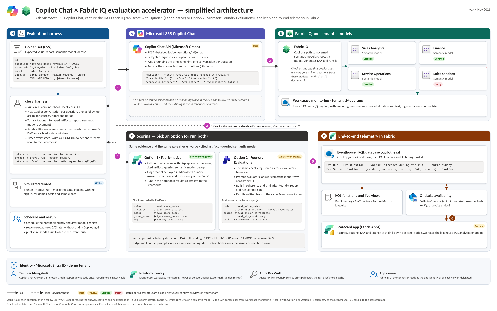

# Architecture



The accelerator has four parts: a **harness** that asks Copilot Chat and gathers evidence, **DAX capture** from
workspace monitoring, a **scoring backend** (Option 1 or Option 2), and **telemetry** in a Fabric Eventhouse that a
Fabric app and KQL read. One Python package (`src/cfeval`) runs the harness in a Fabric notebook, locally or in CI.

## Components

| Component | What it does | Built on |
|---|---|---|
| Golden set | Questions, expected values, the report and semantic model each answer should come from, and decoys | CSV in the repo or a lakehouse |
| Harness | Asks each question in a new Copilot conversation, asks a follow-up "why", extracts citations, records latency | Microsoft 365 Copilot Chat API (Microsoft Graph beta, delegated) |
| DAX capture | Finds the DAX queries Fabric IQ ran for each ask | Workspace monitoring Eventhouse, table `SemanticModelLogs` |
| Option 1 scoring | Deterministic checks in Python plus a judge model | A chat model deployed in Microsoft Foundry |
| Option 2 scoring | Foundry evaluation runs with code, prompt and built-in evaluators | Microsoft Foundry Evaluations |
| Telemetry | Seven tables keyed by `RunId` and `AskId` | Fabric Eventhouse (KQL database), plus a JSONL copy per run |
| Scorecard app | Accuracy, routing, DAX and latency views with drill-down per ask | Fabric Apps (Rayfin SDK) reading a lakehouse SQL analytics endpoint |
| KQL | Functions for run summaries, ask timelines, routing and stage timings; live queries | KQL queryset or Real-Time Dashboard |

## One run, step by step

The demo route is `tools/setup_demo.py` followed by **one** `tools/rehearse_demo.py` Option 1 run. It reuses the
helpers below, adds explicit per-run submission limits and zero Chat/judge retries, and rejects an existing run ID.
No native-agent/MCP infrastructure framework or synthetic estate deployment is required.

1. **Snapshot the golden set** to `EvalQuestion`.
2. **Ask Copilot.** For each question: create a conversation, send the question with web grounding off and the
   test user's time zone, then (by default) send a follow-up asking for the sources, measure, filters and period it
   used. The reply's attributions and links become typed artifacts (Power BI report, semantic model, SharePoint
   file and so on). Each ask streams to `EvalAsk` as it finishes, so you can watch a run live in KQL.
3. **Pause between questions** (`PAUSE_SECONDS`, default 20 s) so each ask's DAX falls in its own time window.
4. **Capture DAX.** After the last ask, the harness runs a tiny marker query (`EVALUATE ROW("cfeval_watermark", ...)`)
   in each configured model/decoy workspace. A visible marker is an ingestion progress signal, **not an ordering
   fence**. The harness keeps reading the test user's `QueryEnd` events until a quiet interval
   (`TRACE_SETTLE_SECONDS`, default 40 s) or the overall trace deadline. New queries reset the interval. Events
   are assigned to the ask whose window (padded by 5 s) contains them, nearest start first. Nonempty settled
   captures are `observed`; empty or unsettled captures remain `pending`. Results go to `FabricIqQuery`.
5. **Score** with Option 1, Option 2 or both (details below), writing one `EvalScore` row per check and one
   `EvalResult` row per ask per option.
6. **Publish** stage timings to `EvalEvent` and the run summary to `EvalRun`, submitted last. This means the harness
   finished, not that every independently ingested/mirrored table is visible. The app marks incomplete populations.
   A `summary.md` lands in the run folder.

If workspace monitoring hasn't caught up within `TRACE_WAIT_SECONDS`, asks without DAX are marked `pending`
and their model check is inconclusive. That is incomplete demo evidence. Low-level `cfeval rescore` is an explicit
new trace/scoring operation, **not** the demo's resume. The demo's `--verify-only` only observes publication of the
original immutable record; it never asks, fetches traces, rescores or republishes.

## Scoring

Three **gate checks** decide the verdict. They are deterministic, so a run is repeatable and explainable:

| Check | Pass when | Source |
|---|---|---|
| `value` | The first number in the answer that fits the unit is within tolerance of the expected value | Answer text |
| `artifact` | A cited Power BI item matches the expected report or semantic model, and no decoy is cited | Citations |
| `model` | Fabric IQ queried the expected semantic model and no decoy model | Captured DAX |

Any failed gate fails the ask; an inconclusive or missing required gate (including disabled DAX capture) makes it
`INCONCLUSIVE`; an API
error is `ERROR`. Judge and Foundry prompt scores are reported alongside and don't change the verdict unless you
set `JUDGE_GATES_VERDICT=true` (Option 1).

**Option 1 · Fabric-native** runs the gate checks in Python and calls a Foundry-hosted chat model twice per ask:
is the answer correct against the reference answer, and does Copilot's explanation agree with what it cited and
the DAX that ran.

**Option 2 · Foundry Evaluations** registers the same scorer module as three **code evaluators**
(`cfeval_value_match`, `cfeval_artifact_match`, `cfeval_model_match`), two **prompt evaluators**
(`cfeval_answer_correctness`, `cfeval_why_consistency`, scored 1 to 5) and adds the built-in **coherence** and
**similarity** evaluators. Definitions are read back, versions are pinned, and the cache is project-scoped.
Each harness run becomes one
Foundry evaluation run over the asks; its output items map back to `EvalScore` and `EvalResult` with
`Backend = foundry`, and the report link goes to `EvalRun.FoundryReportUrl`. Missing or errored Foundry checks
are backend ERROR; local replay can explain a returned code score but never supply a missing Foundry score.
Option 2 is optional; retain service failures and original IDs and stop rather than substituting local grades.

## Telemetry and the app's data path

```
Harness ──streaming ingestion──▶ Eventhouse (copilot_eval)
                                   ├─ KQL functions and queries  ◀── live views during a run
                                   └─ OneLake availability (Delta, five-minute minimum setting)
                                        └─ lakehouse shortcuts ─▶ SQL analytics endpoint ─▶ Fabric app connector
```

* The harness ingests with streaming ingestion and falls back to queued ingestion. A run folder of JSONL files is
  always written too. The demo compares exact seven-table Eventhouse and five-table SQL counts to that record.
  Ambiguous ingest needs reconciliation, not automatic `cfeval publish` duplication.
* The Fabric app reads the five app tables (`EvalRun`, `EvalQuestion`, `EvalResult`, `FabricIqQuery`, `EvalEvent`)
  through a `fabric-sqlanalytics` connector, because the app's KQL connector isn't available for new projects
  yet. When it is, `app/overlay/src/eval/dataSource.ts` is the one file to change.
* The SQL analytics endpoint shows strings as `varchar(8000)`, so `EvalResult` stores answer and explanation
  previews; full text stays in `EvalAsk` (KQL).

## Identities

| Call | Identity |
|---|---|
| Copilot Chat API | The test user, delegated (device code once, then a cached refresh token in a file or Key Vault) |
| Workspace monitoring and telemetry Eventhouse | The explicitly configured, identity-checked notebook user; an explicitly bound CLI profile/subscription locally |
| DAX watermark and golden refresh (Power BI `executeQueries`) | The same checked operator identity, not an ambient account |
| Judge model (Option 1) | API key (from Key Vault in Fabric) or Microsoft Entra ID |
| Foundry Evaluations (Option 2) | Microsoft Entra ID: Azure CLI locally, a service principal (secret in Key Vault) in Fabric |
| Scorecard app | Viewers sign in with Fabric SSO; the connector reads the lakehouse as the app identity (or each viewer, if you choose delegated) |

## Design choices

* **Harness separate from the evaluation framework.** No evaluation framework can call Copilot; the Chat API is
  delegated-only and has no agent or source selection. Keeping collection separate lets either option score the
  same evidence.
* **Deterministic gates, AI-judged context.** Values, citations and queried models are facts that code can check.
  Judges add signal on correctness wording and explanation quality without making verdicts flaky.
* **"Why" is self-reported.** The Chat API exposes no reasoning trace. The follow-up turn records what Copilot says
  it used; the DAX capture is the independent evidence it is compared with.
* **Correlation by user and time.** Workspace monitoring has no field that marks a query as coming from Copilot.
  Use a low-traffic test user, pause between questions, collect every relevant workspace and allow settling.
  This supports observed routing, not a guarantee of exhaustive capture.
* **One schema.** `src/cfeval/schema.py` defines every table. The KQL setup script, the app's TypeScript contract
  and the app's connector entities are generated from it; CI checks the generated files without a unit-test suite.
