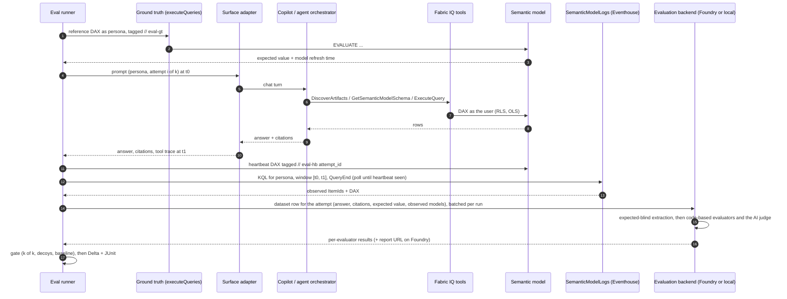

# Microsoft 365 Copilot × Fabric IQ — automated evaluation harness

**Implementation plan for a GitHub Copilot–built demo on an MCAPS external tenant**

| | |
|---|---|
| Version | 1.3 — 3 November 2026 (see *Changes in 1.3*, *1.2* and *1.1* below) |
| Owner | Brendan Bailey (Principal Solution Engineer) |
| Builder | GitHub Copilot (agent mode in VS Code, or the Copilot coding agent on GitHub issues) |
| Architecture diagram | `docs/architecture/copilot-fabric-iq-eval-architecture.png` (and `.svg`) |
| Fact base | Microsoft Learn and official repos, checked 3 Nov 2026. Anything in preview or undocumented is marked **SPIKE** and must be confirmed in Phase 0 before code depends on it. |

**Changes in 1.3 (3 November 2026).** The repository becomes deployable, and the demo gains joint Work IQ + Fabric IQ questions (ADR-010). `evals deploy fabric` builds and validates the Fabric estate from three notebooks (synthetic data calibrated to the cent, four Direct Lake models with RLS, a validation and snapshot run); `evals deploy workiq` seeds three SharePoint documents whose figures come from the golden set; Bicep and an Entra script create the Azure resources and app registrations; the Phase 0 spike scripts are written, including the new S8 (which surfaces answer joint questions; ADR-011). A sixth evaluator, `work_source_match`, checks that joint answers cite the document they rely on. Changed: §1, §2.1 (findings 12–14), §4.2, §4.4 (new), §5.2, §5.3, §6 (T17, T19, T20–T21), §7, §8 (S8, P0.1, P1.1–P1.4, P1.7, P1.9–P1.10, P4.1), §9.6.1, §9.6.3, §9.7, §12–§14, §16 and Appendix C.

**Changes in 1.2 (3 November 2026).** The harness becomes a reference for two evaluation paths (ADR-009). The evaluators in `evals/evaluators/` (renamed from `evals/foundry/`) are written once and run on either backend: Microsoft Foundry Evaluations (the default, ADR-007) or a local backend that runs the same files in the harness process, with no Foundry project. Both return the same results, so the gate, the Lakehouse and the scorecard are unchanged. Changed: §1, §2.1 (finding 12, new), §2.3, §3.1–§3.4, §6 (T5, T18, T19), §7, §8 (S7, P2.5–P2.8, P3.2, P4.3, P8.1, P8.2, P9.1, P9.3, P10.1), §9.1, §9.6, §9.8–§9.11, §9.12 (new), §10–§16 and Appendices A and C.

**Changes in 1.1 (3 November 2026).** Microsoft Foundry Evaluations replaces the custom Python scorers as the evaluation framework of record (ADR-007). GitHub and Python remain only the thin layer that sends prompts to the Copilot surfaces and gathers evidence; Fabric keeps the expected values and the business scorecard. Changed: §1, §2.1 (finding 11), §2.3, §3.2–§3.4, §6 (T5, T18), §7, §8 (S7, P0.1, P2.2, P2.5–P2.7, P3.4, P4.3, P5.2, P5.3, P8.1, P8.2, P9.3, P10.1), §9.1, §9.6, §9.8–§9.10, §9.11 (new), §10–§16 and Appendices A and C.

---

## 0. How to use this plan with GitHub Copilot

1. Create a private repo named `copilot-fabriciq-evals`. Commit this file as `docs/PLAN.md` and the diagram under `docs/architecture/`.
2. Paste **Appendix A** into `.github/copilot-instructions.md`. It gives Copilot repo-wide rules: stack, conventions, and the instruction not to invent API contracts.
3. Create one GitHub issue per task in §8 (IDs `P0.x` to `P10.x`). Put the task's **Copilot prompt** in the issue body and its **acceptance criteria** as a checklist.
4. Work each issue in VS Code with Copilot agent mode, or assign it to the Copilot coding agent and review the pull request. Tasks tagged **[MANUAL]** need a person in the tenant: licences, admin settings, consent, UI-only configuration.
5. Record every Phase 0 spike result as an ADR in `docs/decisions/` before building on it. Adapters must read endpoints, scopes and field names from `config/contracts.yaml`, which is filled in from §9 and the ADRs, never from memory.

---

## 1. Objective and success criteria

**The customer question.** When a user asks Copilot prompt *P*, does Copilot:

1. route to the intended semantic model *M*, and not to a decoy model or an unofficial document,
2. return value *V* within a defined tolerance,
3. do this consistently across repeated runs, personas (RLS) and Copilot surfaces?

And can we prove all three **automatically**, on every change and every night?

**What the demo must prove**

| # | Claim | Measured by |
|---|---|---|
| 1 | The answer value is right | Evaluator `value_match` against a live reference DAX result (L0) |
| 2 | The right semantic model was used | Evaluator `routing_match` over engine query logs, plus surface evidence |
| 3 | No decoy model or unofficial document was used | Evaluator `no_decoy`: decoy model and document decoy never hit or cited |
| 4 | Results are consistent across runs | pass^k with k = 3 per case |
| 5 | Results are consistent across surfaces and personas | cross-surface value agreement; RLS persona cases |
| 6 | Regressions are caught automatically | the PR gate fails on injected regressions; nightly drift alert |
| 7 | Every verdict can be explained | a Foundry report page per run (Foundry path) or the run's job summary and artifacts (local path), plus per-attempt evidence: answer, extracted value, expected value, observed models and DAX, citations, latency |

**Demo exit criteria**

- At least 40 golden cases (12 or more intents with paraphrases) across 3 certified models, 1 decoy model, 1 document decoy, 2 seeded work sources and 3 personas.
- The L0–L1 suite runs unattended on every pull request in under 15 minutes.
- The L2 suite (a declarative agent driven by the Agent Evaluations CLI) runs unattended every night on a self-hosted runner.
- A Power BI scorecard shows pass rates by surface and persona, a routing confusion matrix and drift over time.
- The three scripted regression injections in §12 are detected and explained.
- Every verdict is recorded with the evaluator version that produced it: in a Microsoft Foundry evaluation run with a report page (Foundry path) or in the run's artifacts (local path), and in the Lakehouse on both paths.
- The same evaluators give the same verdicts on both backends for the same evaluation rows.

---

## 2. Research summary: what is possible on 3 Nov 2026

### 2.1 Key findings

1. **Fabric IQ is how Copilot reaches semantic models.** Data answering from Power BI content in Microsoft 365 Copilot Chat is generally available. Copilot searches for relevant reports and uses their semantic models with the user's own permissions, so RLS and OLS apply. Users can steer it by naming content, pasting a report or semantic-model URL, or attaching a report, but an attachment does not limit the answer to that report. Data agents and ontologies cannot answer in Copilot Chat unless they are published as a Microsoft 365 agent. [S9]
2. **Fabric IQ's Power BI tools are also exposed as a GA MCP server for any agent.** The Fabric IQ MCP server at `https://fabriciq.svc.cloud.microsoft/v1/mcp/fabriciq` provides DiscoverArtifacts, ResolveFabricItem, GetReportMetadata, GetSemanticModelSchema, ValueSearch and ExecuteQuery.
   - It accepts delegated sign-in only (Power BI `Item.Read.All` + `Item.Execute.All`); service principals are not supported.
   - It has no natural-language answer tool: the calling agent writes the DAX.
   - Each ExecuteQuery targets one semantic model.
   - Pin the tool contract with the header `X-Variants: Fabric.Routing.FabricIQ.V1`. [S10]
3. **Declarative agents have a GA Fabric capability.** In manifest v1.9 it is `{"name": "Fabric"}`; in Agent Builder it is "Fabric" under *Work content*. No property pins specific models, so routing is steered by instructions, v1.9 `agent_skills` and the user's access. The agent runs as the signed-in user, so RLS and OLS apply. [S7, S8]
4. **The Copilot Chat API cannot target an agent.** `POST /beta/copilot/conversations/{id}/chat` is preview and delegated-only.
   - The request takes `message`, `locationHint`, `additionalContext` and `contextualResources` (OneDrive or SharePoint files, plus a web-grounding toggle).
   - The response carries `attributions`.
   - Whether it triggers Power BI data answering is **undocumented** (SPIKE S1). [S1–S4]
5. **The Agent Evaluations CLI drives a deployed declarative agent through Microsoft 365 Copilot.** It ships as `@microsoft/m365-copilot-eval` (command `runevals`), or through Work IQ Dev Tools as `wiqd agent eval`.
   - Evaluators: Relevance, Coherence, Groundedness, Similarity, RetrievalQuery, RetrievalResult, Citations, ExactMatch and PartialMatch.
   - LLM judging runs in a Microsoft Foundry project; reports come out as HTML, JSON or CSV.
   - It is in preview and consumes Copilot credits.
   - **No evaluator asserts which semantic model was queried.** [S11–S13]
6. **Copilot Studio has evaluation built in, with caveats.** It offers test sets, a *Tool use* grader and a Power Platform REST API that runs test sets from CI; the Copilot Studio Kit (now documented as the Copilot Agent Kit) adds Plan Validation. The caveat: the current Fabric data agent tool needs the newer GitHub Copilot harness, while the evaluation REST API, the tool-use grader and the Agents SDK CopilotClient are documented for the standard harness (SPIKE S4). [S14–S17]
7. **Fabric data agents have changed recently.**
   - The Python client moved off the OpenAI Assistants API (sunset 26 Aug 2026) to an MCP endpoint, `https://api.fabric.microsoft.com/v1/mcp/workspaces/{ws}/dataagents/{id}/agent`, which accepts a user or a service principal.
   - `evaluate_data_agent()` (preview SDK) writes summary and `_steps` tables.
   - The DAX generation tool ignores data-agent-level instructions; Prep data for AI on the model is what matters.
   - The Foundry Fabric data agent tool is deprecated on 6 Nov 2026; use the Fabric IQ tool instead. [S18–S22]
8. **The engine log is the only documented record of which model ran which query.** Workspace monitoring writes `SemanticModelLogs` with ItemId, ItemName, EventText (the DAX), ExecutingUser, ApplicationName, ApplicationContext, Timestamp, DurationMs and CorrelationId. No documented value marks a query as Copilot-generated, so the harness correlates on persona, time window and ItemId, and characterises ApplicationName per surface (SPIKE S2). [S23]
9. **Copilot telemetry exists but arrives late.** Purview `CopilotInteraction` audit records carry AppHost, AgentId, AgentName and AccessedResources. The Interaction Export API (`getAllEnterpriseInteractions`, app-only) returns prompt and response pairs by app. Both suit nightly reconciliation and Teams/web/app consistency checks, not inline gating. [S24–S26]
10. **Ground truth must come from the model itself.** Use Power BI `executeQueries` (one query per call, 120 requests per minute per user; service principals are not supported on RLS models; `impersonatedUserName` is available) or Fabric IQ `ExecuteQuery`. [S27, S10]
11. **Microsoft Foundry Evaluations can score answers collected elsewhere, with our own checks.**
   - Cloud evaluation scores a JSONL dataset of answers you already have (`jsonl` data source), or answers that a Foundry model or agent generates at run time (`azure_ai_target_completions`). It can't send prompts to Microsoft 365 Copilot.
   - Custom evaluators (preview, no SLA) are code-based (a Python `grade(sample, item)` returning 0.0–1.0, run in a sandbox with no network access, 2 minutes per call, code under 256 KB and a fixed package list; an exception records 0.0 and marks the row as an error), prompt-based (an LLM judge returning `result` and `reason`), or endpoint-based (your own HTTP endpoint, answering within 30 seconds).
   - Each run returns per-row results (score, label, threshold, passed, reason), pass rates per testing criterion and a portal `report_url`; results stay in the Foundry project.
   - Built-in tool-call evaluators don't support Fabric data agent calls.
   - Limits: 2 MB per row and 100,000 rows per run; run creation is rate-limited. The identity that runs evaluations needs the Foundry User role (formerly Azure AI User), at the Foundry account scope when a run calls a model deployment. [S33–S40]
12. **The same evaluators can run without Foundry, on generally available APIs only.** A code-based evaluator is a plain Python `grade(sample, item)` function, so any Python process can run it as the sandbox does. The AI judge needs only a chat model: the Azure OpenAI v1 API takes the standard `OpenAI()` client with `base_url` `https://<resource>.openai.azure.com/openai/v1/` (a Foundry resource's `services.ai.azure.com` address also works), no `api-version`, and Microsoft Entra ID through a bearer-token provider for the scope `https://ai.azure.com/.default`; the caller needs Foundry User on a Foundry (AIServices) resource, or Cognitive Services OpenAI User on an Azure OpenAI resource. [S41, S38]
13. **Work IQ grounds answers in Microsoft 365 content, not in Power BI.** The Work IQ API (REST, MCP and A2A) takes delegated sign-in only (`WorkIQAgent.Ask`), accepts OneDrive and SharePoint files as context, returns attributions, and is subject to the limits of the Microsoft 365 Copilot semantic index. It documents no Power BI or Fabric source. Answers that combine data with files are documented for Microsoft 365 Copilot Chat itself, so joint questions are tested through the surfaces that can reach both, and spike S8 measures which do. Newly uploaded documents become findable only after indexing, which has no documented service level. [S42–S44]
14. **The Fabric estate can be built by API, except for a few governance steps.** Fabric REST creates workspaces, lakehouses and notebooks and runs notebooks with typed parameters and a default lakehouse (long-running operations return 202 with `Location` and `Retry-After`); workspace monitoring has a preview API; Power BI REST grants Read and Build (`ReadExplore`) on a semantic model; semantic-link-labs builds Direct Lake models, measures, relationships and RLS from a notebook. Endorsement and Prep data for AI have no API and stay manual. [S45–S50]

### 2.2 Paths evaluated

| Path | What it exercises | Automation | Routing evidence | Identity | Status | Role in this demo |
|---|---|---|---|---|---|---|
| Copilot Chat API (Graph `/beta`) | Base Copilot Chat orchestration | Full | `attributions` + engine logs | Delegated only | Preview | L3 probe and negative control (document decoy). Becomes primary for base Chat if S1 shows Fabric answering |
| **Declarative agent with the Fabric capability, run by the Agent Evaluations CLI** | The Microsoft 365 Copilot orchestrator in an agent, plus Fabric IQ | Full (CLI) | Citations + engine logs | Delegated | Capability GA; CLI preview | **Primary end-to-end path (L2)** |
| Copilot Studio agent with the Fabric IQ MCP tool or data agent tool | Copilot Studio orchestration | Evaluation REST API (standard harness) | Tool-use grader, App Insights spans, engine logs | Delegated | Mixed (S4) | Optional L2; mirrors MCP proofs of concept |
| **Reference orchestrator (Azure OpenAI model + Fabric IQ MCP)** | The Fabric IQ tool layer and each model's AI readiness | Full | Complete tool trace (model ID, DAX) | Delegated | MCP GA | **L1 CI gate and diagnostics** |
| Fabric data agent (MCP or `evaluate_data_agent`) | Data agent NL-to-DAX | Full | `_steps` table + engine logs | User or SP (preview) | Preview SDK | Optional diagnostics |
| Teams / web / desktop UI | Real access points | Tester-run sessions; UI automation optional and fragile | Interaction Export + engine logs | Delegated (UI); app-only (export) | GA APIs | Optional L3 consistency check |
| `executeQueries` or Fabric IQ `ExecuteQuery` | Ground truth | Full | n/a | Delegated (RLS) or SP (non-RLS) | GA | **L0** |
| Workspace monitoring (`SemanticModelLogs`) | Engine evidence | Full (KQL) | ItemId + DAX + user | Workspace member | — | **Routing oracle** |

### 2.3 Evaluation framework decision

No evaluation framework can drive Microsoft 365 Copilot: Foundry and every open-source option send prompts only to models or agents they host. The code that talks to Copilot is custom whatever is chosen, so the real choice is where scoring, results and comparison live.

| Option | Strength | Gap for this use case | Decision |
|---|---|---|---|
| **Microsoft Foundry Evaluations** | Scores a dataset of answers collected elsewhere; our checks run inside it as custom evaluators (code-based and AI-judged) in one run; a report page per run; results retrievable for the CI gate and Power BI; runs in the customer's Azure subscription with Entra ID and role-based access; test definitions in the OpenAI Evals format | Can't drive Copilot; custom evaluators are preview with no SLA; built-in tool-call evaluators don't support Fabric data agent calls; the AI judge costs tokens | **Default evaluation backend** (ADR-007, ADR-009): every verdict, the AI judge, run reports and results |
| **Local backend: the same evaluators in the harness process** | Needs no Foundry project or preview service; the same evaluator files, thresholds and judge prompts, so the same verdicts; runs in GitHub Actions or on a laptop | No portal report page; the runner makes the judge calls itself | **Alternative evaluation backend** (ADR-009) for teams without Foundry |
| Thin Python layer in GitHub Actions | Drives every Copilot surface as each persona; gathers live ground truth and engine-log evidence | Has to be built, whichever framework scores | **Driver and evidence collector**; it never adds scoring logic of its own |
| M365 Agent Evaluations CLI | The only first-party way to drive a deployed declarative agent through Microsoft 365 Copilot; it already judges with a Foundry project | No routing evaluator; preview | **Driver for L2**; ExactMatch and Citations kept as secondary signals |
| Copilot Studio evaluation and Kit | Tool use, Plan Validation | Copilot Studio only; harness caveats | Optional L2 driver |
| Fabric data agent SDK `evaluate_data_agent` | Data agent accuracy against live ground truth, in Fabric notebooks | Data agents only; LLM-judged; preview | Optional diagnostics |
| promptfoo, DeepEval, Inspect AI, MLflow | Good runners, repeats, CI | Can't drive Copilot either; a second judge and results store; adds stack | Not the core |

**Decision (1.2).** One set of evaluators, two backends. Microsoft Foundry Evaluations is the default backend and the reference implementation (ADR-007); a local backend runs the same evaluators in the harness process for teams that don't use Foundry (ADR-009). The custom Python scorers of version 1.0 stay retired: no code outside `evals/evaluators/` scores an answer.

- **The evaluators decide.** Each check is an evaluator whose source lives in `evals/evaluators/`: code-based evaluators for the right number (`value_match`), the right semantic model (`routing_match`), no decoy (`no_decoy`) and citations (`citation_match`), and an AI-judged evaluator for the clarify, refuse and no-access behaviours (`behavior_match`). Foundry runs them as custom evaluators; the local backend runs the same files and prompts (§9.11, §9.12).
- **Python gathers.** Code-based evaluators have no network access, so the runner first collects everything they need: the live expected value from Fabric and the engine-log hits. It writes one dataset row per attempt, hands the rows to the configured backend, and passes the results to the CI gate and Power BI. It never scores an answer.
- **Fabric keeps the truth and the business view:** the semantic models that produce expected values, the engine logs, and the Lakehouse and Power BI scorecard.
- **The AI judge** is used only where code can't decide: classifying behaviour, and extracting a value from ambiguous prose without seeing the expected value.
- **Endpoint-based evaluators** (your own HTTP endpoint, 30-second limit) are held in reserve for a check that ever needs a live lookup.

---

## 3. Target architecture

### 3.1 Evaluation layers

| Layer | System under test | Driver | What a failure means |
|---|---|---|---|
| **L0 Data truth** | The semantic model itself | Reference DAX per case, run live as the persona | A data or measure defect, not an AI problem |
| **L1 Tool layer** | Fabric IQ tools and the model's AI readiness | Reference orchestrator: an Azure OpenAI model + Fabric IQ MCP, with the **same routing policy** as the agent. It is a controlled proxy, not a replica: public docs don't describe Copilot's internal tool calls | The model is hard for AI to use: names, descriptions, Prep data for AI, ambiguous measures |
| **L2 Agent** | Microsoft 365 Copilot orchestrator in a declarative agent with the Fabric capability (optionally a Copilot Studio agent) | Agent Evaluations CLI per persona (Copilot Studio evaluation API optional) | Agent instructions, skill or orchestration; compare with L1 to isolate |
| **L3 Copilot surfaces** | Copilot Chat with no agent; Teams, web and desktop | Copilot Chat API; tester-run sessions harvested by the Interaction Export API | General Copilot routing without an agent; access-point inconsistency |

**Failure triage.** L0 pass + L1 fail means fix the semantic model. L1 pass + L2 fail means fix the agent. L2 pass + L3 fail means general Copilot needs an agent or prompt guidance for this question class. This triage is the most useful output for the customer: it tells them *where* to invest.

### 3.2 Components

See the architecture diagram. Zones 1–5 map to the repository as follows.

- **(1) GitHub control plane:** golden set, evaluator source, thin Python runner (and, on the local path, the local evaluation backend), GitHub Actions, secrets, GitHub Copilot.
- **(2) Surfaces under test:** Chat API, declarative agent through the CLI, Copilot Studio (optional), reference orchestrator, tester sessions.
- **(3) Fabric IQ:** Fabric IQ tools, three certified Direct Lake semantic models plus one decoy, Prep data for AI, Lakehouse on OneLake, optional data agent.
- **(4) Evidence and ground truth:** surface evidence (synchronous), engine logs (near real time), Copilot audit (asynchronous), live ground truth.
- **(5) Scoring, results and gating:** one set of evaluators (code-based evaluators and the calibrated AI judge), run either by Microsoft Foundry Evaluations (default: a report page per run, results kept in Foundry) or by the local backend in the harness process; the gate over the evaluator results; a copy in the results Lakehouse for the Power BI scorecard; PR gate; Teams alert.

### 3.3 One attempt, end to end



### 3.4 Pass rule

An attempt **passes** only if every evaluator passes, whichever backend runs them:

- `behavior_match`: the behaviour matches (answer, clarify, refuse or no_access).
- `value_match`: for `answer`, the extracted value is within tolerance of the live expected value.
- `routing_match`: the expected model(s) were queried (`route_mode`).
- `no_decoy`: no decoy model was queried and no document decoy was cited.
- `citation_match`: the citation requirement is met when `citation: required`.

An evaluator that can't decide (engine logs incomplete, surface error) raises, which the backend records as an error. The attempt is then INCONCLUSIVE, unless another evaluator failed it.

A case passes on a surface only if **k of k** attempts pass when it is `critical`. Otherwise it needs a pass rate at or above the suite threshold. The gate computes both from the evaluator results.

---

## 4. Demo scenario and data design

### 4.1 Domain

Contoso (fictional) with synthetic, seeded data (seed `20261103`) so that expected values are reproducible. The fiscal year runs July to June: FY2025 = 1 Jul 2024 – 30 Jun 2025.

**Gold tables** in Lakehouse `lh_gold`, workspace `ws-eval-certified`:

| Table | Grain | Key columns |
|---|---|---|
| `dim_date` | day, 2023-01-01 to 2026-12-31 | Date, Fiscal Year, Fiscal Quarter, Month, Calendar Year |
| `dim_region` | 4 rows | Region (East, West, Central, International) |
| `dim_product` | 40 rows | Product, Category (5) |
| `dim_customer` | 2,000 rows | Customer, Segment, Region |
| `fact_sales` | about 500k rows | Date, Product, Customer, Region, Units, GrossAmount, DiscountAmount, ReturnsAmount |
| `fact_gl` | daily × region × account | Date, Region, Account (Revenue, COGS, OpEx), Amount; net revenue = gross − discounts − returns |
| `dim_service` | 25 rows | Service, Tier |
| `fact_incident` | about 6k rows | OpenedAt, ClosedAt, Severity, Service, Region, ImpactedCustomers |
| `fact_sales_snapshot_2025q1` | stale copy, data to 2025-03-31 | in workspace `ws-eval-sandbox` |

### 4.2 Semantic models (Direct Lake)

| Model | Workspace | Endorsement | Key measures | Purpose in tests |
|---|---|---|---|---|
| **Sales Analytics** | ws-eval-certified | Certified (or Promoted) | `[Gross Revenue]`, `[Units]`, `[Orders]`, `[Avg Order Value]`, `[Gross Revenue FYTD]`, `[Gross Revenue PY]`, `[Gross Revenue YoY %]` | Owner of "revenue" (gross) and sales volume |
| **Finance** | ws-eval-certified | Certified | `[Net Revenue]`, `[COGS]`, `[Gross Margin]`, `[Gross Margin %]`, `[Operating Expense]`, `[Operating Margin %]` | Owner of net revenue and margin; deliberate "revenue" ambiguity |
| **Service Operations** | ws-eval-certified | Certified | `[Incidents]`, `[Sev1 Incidents]`, `[MTTR Hours]`, `[Impacted Customers]` | Third domain; cross-model questions |
| **Sales Sandbox** (decoy) | ws-eval-sandbox | None | `[Revenue]`, `[Units]` on stale data | Must never be used; personas can see it, so it is a real risk |

- **Friendly names:** the semantic models expose business names (`Date`, `Region`, `Product`, `Customer`, `Service`, `Sales`, `GL`, `Incident`) rather than lakehouse table names; all DAX in this plan uses them.
- **RLS:** role `RegionScope` on `Region` in all three certified models, driven by a `security_user_region` table (UPN → Region). An all-access role is used for the executive persona.
- **Prep data for AI** (certified models only, **[MANUAL]**):
  - AI data schema: curated tables, columns and measures only.
  - AI instructions, for example: "Revenue means Gross Revenue unless the user says net. The fiscal year runs July–June. FY2025 = Jul 2024–Jun 2025. Always state the period and the model used."
  - Three to five verified answers per model.
  - A description on every measure and column.
  - Check the effect of the Q&A retirement (December 2026) on synonyms before relying on them.
- **Reports:** one simple report per model. Copilot discovers data through reports as well as models.
- **Document decoy:** `FY2025 revenue - DRAFT.docx` in a SharePoint library every persona can read. It states a deliberately wrong FY2025 revenue figure ($13.6M), so tests can show Copilot does not answer from drafts. `evals deploy workiq` uploads it with the work sources (§4.4).
- **Built by `evals deploy fabric` (P1.9):** workspaces, lakehouses, workspace monitoring, the three notebooks and their runs, persona roles and Read + Build permissions. FY2025 gross revenue is calibrated to $12,840,000.00 ($4.2M East, $3.6M West, $2.94M Central, $2.1M International) and the FY2025 Sev1 mean time to resolve to 7.2 hours, so the seeded documents can quote real comparisons. Direct Lake models default to the SQL analytics endpoint so that Viewer personas can query with single sign-on (§13).

### 4.3 Personas (Entra ID test users)

| Key | UPN (example) | Access | Purpose |
|---|---|---|---|
| `exec` | `eval.exec@<tenant>` | All regions, certified and sandbox workspaces | Baseline; decoy exposure |
| `east` | `eval.east@<tenant>` | East only (RLS), certified workspace | RLS correctness |
| `noaccess` | `eval.noaccess@<tenant>` | Sandbox workspace only | Must not answer "revenue" from the decoy |

Every persona needs a Microsoft 365 Copilot licence, and a Power BI Pro licence if the capacity is smaller than F64.

`personas.yaml` records each persona's RLS role (`rls_role`) and regions; the deployment derives role members and the `security_user_region` rows from them.

### 4.4 Work IQ content (joint Work IQ + Fabric IQ cases, ADR-010)

Business questions often need a figure from a certified model **and** context from a document: "Did we hit our FY2025 revenue target?" needs the actual (Sales Analytics) and the approved target (a planning memo). The joint cases test that Copilot takes each from the right source and cites both.

| Document (synthetic) | Site, folder | Readers | Role | Facts (in `models.yaml`) |
|---|---|---|---|---|
| `FY2025 Revenue Targets - APPROVED.docx` | Contoso Planning, `Planning/FY2025` | exec, east | source | company target $12.5M; East $4.0M, West $3.8M, Central $2.9M, International $1.8M |
| `FY2025 Service Level Objectives.docx` | Contoso Planning, `Planning/FY2025` | exec, east | source | Sev1 MTTR objective 6 hours; Sev2 16 hours |
| `FY2025 revenue - DRAFT.docx` | Contoso All Company, `Finance Drafts` | all personas | decoy | "about $13,600,000" (wrong) |

- **One source of truth for every figure.** `workiq/content.yaml` holds the text with `{fact}` placeholders; the values come from `evals/golden/models.yaml`. `scripts/build_workiq_documents.py` renders the `.docx` files, and a unit test fails if a committed document, a fact, a title or a site's readers drift.
- **The story is consistent by construction.** Actual $12.84M beats the $12.5M target (+2.7%); East $4.2M beats $4.0M; Sev1 MTTR 7.2 h misses the 6 h objective; the draft disagrees with the certified figure.
- **Permission trimming is part of the test.** The `noaccess` persona cannot read the planning site, so JNT-004 checks that neither the memo nor the figures leak.
- **Seeding:** create the two sites by hand with the readers as members (T20), set `[workiq.sites]`, then run `evals deploy workiq`. Allow for semantic-index latency before the first joint run (§13); spike S8 measures it.

---

## 5. Golden set design

### 5.1 Case schema (`evals/golden/cases.yaml`)

```yaml
- id: REV-001                     # stable, never reused
  intent: gross_revenue_fy        # groups paraphrases
  prompt: "What was gross revenue in FY2025?"
  paraphrases:
    - "How much did we sell in FY25 before discounts and returns?"
    - "FY2025 gross sales total?"
  persona: exec                   # key in personas.yaml
  surfaces: [ref_mcp, agent_cli, chat_api]   # omit = all enabled surfaces
  expect:
    behavior: answer              # answer | clarify | refuse | no_access
    models: [sales_analytics]     # keys in models.yaml (ItemIds resolved at runtime)
    route_mode: includes          # exclusive | includes | any_of
    decoys: [sales_sandbox, finance]   # models that must not be queried
    doc_decoys: [fy25_revenue_draft]
    citation: required            # required | optional
    value:
      reference_dax: |
        EVALUATE ROW("v", CALCULATE([Gross Revenue], 'Date'[Fiscal Year] = "FY2025"))
      unit: currency_usd          # currency_usd | count | percent | ratio | hours
      tolerance: {rel: 0.005, abs: 0, display_aware: true, max_display_rel: 0.05}
  runs: 3
  criticality: critical           # critical | standard
  tags: [single-model, fiscal-time]
  notes: "Policy: revenue = gross unless 'net' is stated"
```

For a value per key (by region, product and so on), replace `value` with `table`. Its `reference_dax` returns `(key, value)` rows and it adds `match: all_keys | top_n`.

Two companion files:

- `personas.yaml`: key → UPN, Key Vault token-cache secret name, RLS description.
- `models.yaml`: key → display name, workspace, owner, endorsement, plus report and model URLs.

### 5.2 Case categories (target 48 cases)

| Category | Purpose | Example | Count |
|---|---|---|---|
| Direct single-model | Baseline | "Gross revenue FY2025" | 6 |
| Paraphrase groups | Robustness | "FY25 sales before discounts?" | 8 |
| Disambiguation | Gross vs net revenue, Sales vs Finance | "What was revenue in FY2025?" → Sales Analytics per policy | 4 |
| Decoy avoidance | Sandbox model and draft document | "What's our latest revenue number?" | 4 |
| Time intelligence | Fiscal vs calendar, FYTD, prior year, YoY | "Gross revenue YoY growth for FY2025" | 6 |
| RLS persona | Same prompt, different persona | `east` must see East only | 6 |
| Cross-model | Two models combined by the orchestrator | "In Q2 FY2025, which region had the most Sev1 incidents, and what was its gross revenue?" → both models; checks per component | 4 |
| Clarification expected | Ambiguous metric or period | "How are we doing?" | 2 |
| Refuse or out of scope | No model holds the data | "What was revenue in 1999?" / "What's our headcount?" | 2 |
| No access | `noaccess` persona | Must not answer from the decoy | 2 |
| Joint Work IQ + Fabric IQ | Actual from a certified model, target or objective from a seeded document; both cited | "Did we hit our FY2025 gross revenue target?" → Sales Analytics + the approved targets memo, never the draft | 4 |

### 5.3 Ground-truth modes

- **Live (default):** the runner executes `reference_dax` as the persona before each case and records the model refresh time.
- **Frozen:** `evals/golden/expected_snapshot.json` holds the values at data freeze. `evals deploy fabric` writes it to `runs/deploy/expected_snapshot.json` (nb_03); it names personas by key, never by user name, so it can be committed. If live and frozen disagree, the run raises `MODEL_CHANGED`, which is useful in itself.

---

## 6. Tenant prerequisites and setup checklist

| # | Item | Where | Notes | Phase |
|---|---|---|---|---|
| T1 | Microsoft 365 Copilot licences: 3 personas + builder | M365 admin | Fabric IQ in Chat and the Fabric capability need a Microsoft 365 Copilot (premium) licence | P0 |
| T2 | Power BI Pro for personas (if capacity < F64) | M365 admin | E5 includes Pro | P0 |
| T3 | Fabric capacity F2 or larger (F8 recommended for nightly runs) | Azure + Fabric admin | Data agents need F2+/P1+; workspace monitoring needs capacity | P0 |
| T4 | Copilot credits / usage-based billing for the Agent Evaluations CLI | M365 admin / Azure | The CLI consumes Copilot credits — **confirm** for an MCAPS tenant | P0 |
| T5 | Azure subscription: a model deployment (e.g., `gpt-5-mini`) in an Azure OpenAI or Foundry resource, Key Vault, VM for the self-hosted runner, optional Application Insights; on the Foundry path, a Foundry project | Azure | The deployment serves the L1 orchestrator on both paths and the local backend's AI judge. On the Foundry path, the project hosts the evaluator catalog, the AI judge, runs and results; pick a region that supports Foundry batch evaluations. The CLI defaults to `gpt-5-mini` as judge | P0 |
| T6 | "Fabric data available in Microsoft 365 Copilot" | M365 admin center | On by default; verify | P0 |
| T7 | "Share Fabric data with your Microsoft 365 services" | Fabric admin portal | Discoverability; on by default when geos match | P0 |
| T8 | Cross-geo processing for Azure OpenAI | Fabric admin | Only for tenants outside the US or EU | P0 |
| T9 | "Dataset Execute Queries REST API" | Fabric admin | Ground truth | P0 |
| T10 | "Service principals can use Fabric APIs" | Fabric admin | Daemon writes results and reads monitoring | P0 |
| T11 | Endorsement: certification enabled for the builder | Fabric admin | Otherwise use Promoted | P1 |
| T12 | Custom app upload / agent sharing allowed for personas | Teams / M365 admin | Sideloading the declarative agent | P4 |
| T13 | Purview audit on (default) | Purview | CopilotInteraction records | P6 |
| T14 | Copilot Studio licence or trial (optional path) | Power Platform admin | Only if S4 is positive | P7 |
| T15 | Data agent tenant setting (optional path) | Fabric admin | Only for P7.2 | P7 |
| T16 | Personas created, licensed, MFA registered | Entra | See §11 | P0 |
| T17 | App registrations + admin consent | Entra | See §11. `infra/entra/New-EvalAppRegistrations.ps1` creates `copilot-eval-public`, `copilot-eval-setup` (for `evals deploy`), `copilot-eval-daemon` and `copilot-eval-ci`; consent stays a deliberate step | P0 |
| T18 | Foundry path only: Foundry User role (formerly Azure AI User) for the builder and the runner identity, at the Foundry account scope | Azure | Needed to register evaluators and create runs; a project-only assignment doesn't let a run call the judge deployment | P0 |
| T19 | Model access for the builder and the runner identity: Foundry User on a Foundry resource, or Cognitive Services OpenAI User on an Azure OpenAI resource | Azure | The L1 orchestrator (both paths) and the local backend's AI judge call the deployment with Microsoft Entra ID. `infra/azure` assigns the right role for the resource kind [S41, S38] | P0 |
| T20 | SharePoint sites for the Work IQ content: Contoso Planning (members exec, east) and Contoso All Company (all personas) | SharePoint admin | URLs go to `[workiq.sites]`; `evals deploy workiq` uploads the documents (§4.4) | P1 |
| T21 | Work IQ enabled for the tenant, with usage-based billing, for the Work IQ API surface in spike S8 | M365 admin / Azure | Only for the `workiq` surface; the Chat API and agent surfaces don't need it [S42] | P0 |

---

## 7. Repository layout

```text
copilot-fabriciq-evals/
├─ .github/
│  ├─ copilot-instructions.md            # Appendix A
│  └─ workflows/  ci.yml  pr-gate.yml  nightly.yml  reconcile.yml
├─ docs/
│  ├─ PLAN.md                            # this file
│  ├─ architecture/                      # diagram png + svg
│  ├─ decisions/                         # ADR-000, -007, -009, -010; ADR-001..-006, -008, -011 from Phase 0
│  ├─ deployment.md                      # deploy order: Entra → Azure → Fabric → Work IQ → spikes
│  └─ runbook.md                         # demo script (§12)
├─ config/
│  ├─ settings.example.toml              # tenant ids, workspace ids, endpoints (no secrets)
│  └─ contracts.yaml                     # endpoints/scopes/field names confirmed by spikes
├─ evals/
│  ├─ golden/  cases.yaml  personas.yaml  models.yaml  expected_snapshot.json (frozen mode, §5.3)
│  ├─ evaluators/                        # one set of evaluators, run by Foundry or locally (ADR-007, ADR-009)
│  │  ├─ evaluators.yaml  eval-definition.yaml
│  │  ├─ code/     value_match.py  routing_match.py  no_decoy.py  citation_match.py  work_source_match.py
│  │  ├─ prompts/  behavior_match.md  value_extraction.md
│  │  └─ samples/  eval-items.jsonl     # sample rows: `evals score` runs them with no Azure resources
│  ├─ judge/   calibration_set.jsonl  rubric.md
│  └─ generated/                         # evaluation datasets, CLI datasets, CSV for Copilot Studio (gitignored)
├─ agents/
│  ├─ policy/routing-policy.md           # single routing policy shared by L1 and L2
│  ├─ declarative/                       # Agents Toolkit project (manifest v1.9, Fabric capability)
│  │  ├─ appPackage/declarativeAgent.json  instructions.md  manifest.json
│  │  └─ appPackage/skills/fabric-routing/SKILL.md
│  └─ copilot-studio/                    # optional: test-set CSV, notes
├─ fabric/
│  ├─ notebooks/ nb_01_generate_data.ipynb  nb_02_build_models.ipynb  nb_03_validate_and_snapshot.ipynb
│  │  └─ src/   nb_*.py                  # notebook sources; scripts/build_notebooks.py builds the .ipynb files
│  ├─ items/                             # Git-integration export (TMDL, reports)
│  └─ kql/ semantic_model_logs.kql  heartbeat.kql
├─ workiq/   content.yaml  documents/*.docx   # Work IQ content pack (§4.4); scripts/build_workiq_documents.py
├─ spikes/   _common.py  s1_chat_api.py  s2_engine_logs.py  s3_cli_probe.sh|.ps1  s6_fabriciq_mcp.py
│           s7_foundry_eval.py  s8_workiq_grounding.py
├─ src/copilot_evals/
│  ├─ cli.py  config.py  schemas.py
│  ├─ setup/       rest.py  auth.py  fabric.py  graph.py  fabric_deploy.py  workiq.py  commands.py   # evals deploy
│  ├─ auth/        delegated.py  app_only.py  keyvault_cache.py
│  ├─ ground_truth/ dax.py  refresh.py
│  ├─ targets/     base.py  ref_mcp.py  agent_cli.py  chat_api.py  copilot_studio.py  data_agent.py  interaction_export.py
│  ├─ evidence/    engine_logs.py  correlate.py  audit.py  normalize.py
│  ├─ evaluation/  definitions.py  backend.py  local.py  dataset.py  verdict.py   # backend-neutral; the local backend
│  ├─ foundry/     catalog.py  runs.py  results.py   # the Foundry backend: submit and read Foundry runs; never scores
│  ├─ sinks/       onelake.py  junit.py  summary.py
│  ├─ gate.py
│  └─ runner.py
├─ tests/ unit/  contract/  fixtures/
├─ infra/ entra/New-EvalAppRegistrations.ps1   azure/ (main.bicep + modules, deploy.sh, register-runner.sh, cloud-init)
├─ pyproject.toml  uv.lock  ruff.toml  Makefile
└─ README.md
```

---

## 8. Phase plan

Each task gives its goal, a **Copilot prompt** to paste into the issue, and acceptance criteria. The estimates assume one engineer working with Copilot.

### Phase 0 — Spikes (days 1–3): de-risk before building

Run each spike with a short script under `spikes/`. Record the outcome as an ADR.

| ID | Question | Procedure | Exit (ADR) |
|---|---|---|---|
| **S1** | Does the Copilot Chat API trigger Fabric IQ / Power BI answering? | As `exec`: create a conversation and send three variants: (a) plain question, (b) question with the semantic-model URL, (c) question with the routing policy in `additionalContext`. Capture `text` and `attributions`, then query `SemanticModelLogs` for the window. | ADR-001: Chat API role is either *primary base-Chat test* or *negative control only* |
| **S2** | What does a Copilot-issued query look like in the engine log, and how fast is it ingested? | For each surface, run 3 known prompts. Record ApplicationName, ApplicationContext, ExecutingUser and OperationName values, and ingestion delay (p50/p95). Test the heartbeat-marker idea (§9.5). | ADR-002: correlation rules, poll budget, heartbeat on/off |
| **S3** | Can the Agent Evaluations CLI run headless as different personas, and what does its JSON contain? | Install the CLI, configure environment variables, run against the declarative agent, try separate per-persona profile directories, inspect the output JSON (response text, citations, timestamps). | ADR-003: invocation pattern, auth caching, output mapping |
| **S4** | Can Copilot Studio evaluation (REST API + Tool use grader) test an agent that uses the Fabric IQ MCP or data agent tool? | Build a minimal agent, author a test set, run through REST, and check whether Application Insights tool spans include arguments. | ADR-004: include or drop the Copilot Studio path |
| **S5** | Do Purview audit and Interaction Export show Fabric usage per access point? | Run prompts in Teams, web and desktop as `exec`; after 24 hours, query audit and export (AgentId, AppHost, AccessedResources). | ADR-005: reconciliation fields |
| **S6** | Fabric IQ MCP from our own client | Register the app with delegated `Item.Read.All` + `Item.Execute.All`; MCP `initialize` → `tools/list` with `X-Variants`; one `ExecuteQuery` round trip; capture the exact argument names. | ADR-006: tool argument names in `contracts.yaml` |
| **S8** | Which surfaces answer joint Work IQ + Fabric IQ questions, and how well? | After `evals deploy fabric` and `evals deploy workiq`: optionally wait until Microsoft Search finds the memo (indexing latency); then ask JNT-001 as `exec` and JNT-004 as `noaccess` through the Chat API (with and without the memo as a contextual file) and the Work IQ API. Record memo citation, target and actual stated, Power BI attribution, permission trimming and latency. The declarative-agent surface uses S3 with the P4.1 agent. | ADR-011: which surfaces run the joint cases, and the indexing wait |
| **S7** | Does our Foundry project run the evaluation design end to end? (Foundry path only) | In the chosen region, register the evaluators in `evals/evaluators/` under a `spike_` prefix and run `eval-definition.yaml` on three sanitised rows (a pass, a fail and a row with incomplete evidence). Record how an evaluator that raises appears in the output items, whether `item` holds the whole row and `sample.output_text`, whether `testing_criteria` can pin evaluator versions, threshold semantics, nested and nullable item-schema fields, the sandbox's Python version, and cost per 100 rows. | ADR-008: the Foundry evaluation contract in `contracts.yaml` |

**Status (v1.3):** P0.1 is delivered: the scripts are in `spikes/` (README there), written against `config/contracts.yaml`, with S8 added. S7 reuses the repository's own evaluator definitions and sample rows instead of separate fixtures. They have not yet been run against a tenant; their ADRs record the results.

**Copilot prompt (P0.1, as originally specified):**
> Create `spikes/` with five standalone Python scripts: `s1_chat_api.py`, `s2_engine_logs.py`, `s6_fabriciq_mcp.py`, `s7_foundry_eval.py` and `s3_cli_probe.ps1`/`.sh`. Use msal PublicClientApplication with device-code flow and a file token cache per persona under `.cache/` (gitignored). For S1, follow §9.3.3 exactly and print the response `text` and every `attributions[]` item. For S6, follow §9.3.1: connect with `mcp.client.streamable_http.streamablehttp_client`, send headers `Authorization` and `X-Variants: Fabric.Routing.FabricIQ.V1`, print `tools/list` names and input schemas, then call `DiscoverArtifacts` with the query "Sales Analytics". For S2, use `azure-kusto-data` against the monitoring Eventhouse query URI from settings and run the KQL in §9.5 for a given UPN and window. For S7, follow §9.11: register the evaluators in `evals/evaluators/` under a `spike_` name prefix, upload three sanitised rows from `spikes/fixtures/s7_items.jsonl` (create them: a pass, a fail and a row with incomplete evidence), run `eval-definition.yaml`, and save the run, the output items and the report URL. No secrets in code; read settings from `config/settings.toml`.

Acceptance: each script runs from the command line; outputs are saved to `spikes/out/` as JSON; ADR templates are filled in.

### Phase 1 — Fabric foundation (days 3–6)

| Task | Description |
|---|---|
| P1.1 | **Automated by `evals deploy fabric` (P1.9).** Create workspaces `ws-eval-certified`, `ws-eval-sandbox` and `ws-eval-results` on the F capacity. **Enable workspace monitoring on certified and sandbox**, so decoy hits are visible. Add the daemon SP as Contributor on results, and with the minimum role that can query the monitoring Eventhouse on certified and sandbox (confirm in S2). Grant personas access per §4.3. |
| P1.2 | **Delivered in v1.3.** `nb_01_generate_data`: seeded synthetic data → Delta tables (§4.1), plus the stale snapshot table in sandbox; FY2025 figures calibrated for §4.4. |
| P1.3 | **Delivered in v1.3.** `nb_02_build_models`: create the four Direct Lake models, relationships, measures with descriptions, and RLS roles using semantic-link-labs (`sempy_labs`). |
| P1.4 **[MANUAL]** | Prep data for AI on certified models (AI data schema, AI instructions, verified answers); endorsement; one report per model. The document decoy is now seeded by P1.10. |
| P1.5 | Connect the workspaces to Git (Fabric Git integration) and commit item definitions (TMDL) under `fabric/items/`. |
| P1.6 | Add `fabric/kql/semantic_model_logs.kql` and `heartbeat.kql` (§9.5). |
| P1.7 | **Delivered in v1.3.** `nb_03_validate_and_snapshot`: check the calibrated figures as `exec` and `east` (the RLS test), run every single-model `reference_dax` in `cases.yaml` as its persona with semantic link (`effective_user_name`), and write `expected_snapshot.json`. |
| P1.9 | **Delivered in v1.3.** `evals deploy fabric`: P1.1 plus importing and running nb_01–nb_03 and granting Read + Build per persona, idempotently, with a `--dry-run` plan; unit-tested against a fake tenant. |
| P1.10 | **Delivered in v1.3.** Work IQ content (§4.4): `workiq/content.yaml`, the built documents, and `evals deploy workiq` to upload them to the sites in `[workiq.sites]` (T20). |

**Copilot prompt (P1.2):**
> Write a Fabric PySpark notebook `fabric/notebooks/nb_01_generate_data.ipynb` that builds the tables in PLAN §4.1 with numpy seed 20261103 and writes them as Delta tables to the attached Lakehouse `lh_gold`. Requirements:
> - The fiscal year starts 1 July, with a `Fiscal Year` label like "FY2025" and a `Fiscal Quarter` label like "FY2025 Q2".
> - `fact_sales` has about 500k rows spread over 2023-01-01 to 2026-10-31, with seasonality and region and category mix.
> - `fact_gl` is derived from `fact_sales` so that Net Revenue = Gross − Discount − Returns exactly, with COGS = 58–62% of net by category and OpEx by region per month.
> - `fact_incident` has about 6k incidents, Sev1 at about 5%, and MTTR lognormal by severity.
> - Add `security_user_region(UserPrincipalName, Region)` with rows for the personas in `personas.yaml` (parameterized).
> - Write `fact_sales_snapshot_2025q1` (rows to 2025-03-31, plus a 3% uplift so the decoy differs) to a second Lakehouse `lh_sandbox`, whose path comes from a notebook parameter.
> - End with a cell that prints row counts and FY2025 totals.

**Copilot prompt (P1.3):**
> Write `fabric/notebooks/nb_02_build_models.ipynb` using semantic-link-labs:
> - Use `sempy_labs.directlake.generate_direct_lake_semantic_model` to create the "Sales Analytics", "Finance" and "Service Operations" models from `lh_gold` tables, and "Sales Sandbox" from `lh_sandbox`.
> - Use `sempy_labs.tom.connect_semantic_model(..., readonly=False)` to rename tables to business-friendly names (`Date`, `Region`, `Product`, `Customer`, `Service`, `Sales`, `GL`, `Incident`; keep `security_user_region` hidden), add relationships (star schema), mark `Date` as a date table, and add the measures in PLAN §4.2 with a business description on each. FYTD and PY use fiscal year-end "6/30". All DAX in `cases.yaml` uses these friendly names.
> - Add RLS role `RegionScope` on the `Region` table with the filter `'Region'[Region] IN SELECTCOLUMNS(FILTER(security_user_region, security_user_region[UserPrincipalName] = USERPRINCIPALNAME()), "r", security_user_region[Region])`, plus an `AllRegions` role.
> - Set column and table descriptions, and hide technical keys.
> - Make every step idempotent: re-running updates rather than duplicates.
> - Print a model summary at the end.

Acceptance: models query correctly; RLS verified for `east`; `expected_snapshot.json` committed; monitoring Eventhouse shows `SemanticModelLogs` rows for validation queries.

### Phase 2 — Harness core (days 5–9)

| Task | Description |
|---|---|
| P2.1 | Scaffold: Python 3.12, `uv`, `src/` layout, Typer CLI `evals`, ruff, mypy (strict on `src/`), pytest, pre-commit. |
| P2.2 | `schemas.py` (pydantic v2) for Case, Persona, ModelRef, Attempt, Evidence, EvalItem, EvaluatorResult and CaseResult (§9.1); `evals validate` checks the golden files and resolves model keys to ItemIds through the Fabric REST API. |
| P2.3 | `auth/`: delegated tokens per persona (MSAL public client, cache in Key Vault, §11); app-only certificate credential; a scope registry in `contracts.yaml`. |
| P2.4 | `ground_truth/dax.py`: `executeQueries` with the `// eval-gt` marker (§9.4) and a Fabric IQ `ExecuteQuery` fallback; `refresh.py` for last refresh time. |
| P2.5 | Evaluators in `evals/evaluators/` (§9.6), run unchanged by both backends: code-based `value_match` (numeric extraction and tolerance), `routing_match`, `no_decoy` and `citation_match`; the prompt-based `behavior_match` judge and the expected-blind `value_extraction` prompt; full unit tests that execute each evaluator file as the sandbox does. |
| P2.6 | `runner.py`: case × persona × surface × k scheduler with **one lane per persona** (serial within a lane, parallel across lanes); one `EvalItem` per attempt; scores the rows on the configured backend (Foundry, P2.7, or local, P2.8); `gate.py` turns the evaluator results into JUnit, a Markdown summary and the gate's exit code. |
| P2.7 | The Foundry backend, `foundry/`: `evals foundry sync` registers the evaluators in `evals/evaluators/evaluators.yaml` under content-addressed names; create the eval from `eval-definition.yaml`, upload the dataset, start and poll the run, and read the output items and report URL (§9.11), behind a protocol so tests can use a fake. |
| P2.8 | The local backend, `evaluation/local.py` (§9.12): runs the same evaluators in the harness process. The in-process runner, `evals score` and the sample rows exist; add the Azure OpenAI judge client and the parity tests. |

**Copilot prompt (P2.5, `value_match`):**
> Implement the code-based evaluator `evals/evaluators/code/value_match.py` exactly per PLAN §9.6.1. Foundry uploads the file as-is and the local backend executes it the same way, so keep it self-contained: standard library only (or the sandbox packages in §9.11), no imports from `copilot_evals`, no network, under 256 KB.
> - `grade(sample, item) -> float` returns 1.0 or 0.0, and raises `InconclusiveError` when the row can't be scored.
> - `parse_numbers(text) -> list[ParsedNumber]` with Decimal values, unit, scale, displayed decimals and percent flag. Ignore years and fiscal labels (FY2025, Q2, 2025-06-30, "June 2025"), and handle currency symbols, thousands separators (`,`, NBSP, narrow NBSP), K/M/B/bn/mm/thousand/million/billion, %, and negatives as `-`, `−` or parentheses.
> - `display_step(p)`.
> - `within_tolerance(expected, parsed, tol) -> (bool, reason)` implementing display-aware tolerance with `max_display_rel`.
> - `select_candidate(parsed, unit) -> ParsedNumber | None` using unit compatibility only. Never use the expected value to choose. When several candidates remain, use `read_extraction(item)` and accept the extraction only if it matches a parsed candidate.
> - Declare every row field the code reads in `evals/evaluators/evaluators.yaml`; `uv run evals validate --strict` checks it.
>
> Write `tests/unit/test_value_match.py` with the 30 fixtures in `tests/fixtures/numbers.yaml` (create them), including `$1.2M`, `$1,234,567.89`, `(1,234)`, `12.5%`, `0.125`, `€3.4 bn`, `3.4 billion`, `−5%`, `FY2025`, `2025-06-30`, `about 12.8 million dollars`, `12,840 thousand` and `1.28e7`. Load the evaluator the way `tests/unit/test_evaluators.py` does (execute the file, then call `grade`). Reach 100% branch coverage of `value_match.py`.

**Copilot prompt (P2.6, runner and gate):**
> Implement `runner.py`, `gate.py` and the `evals run` command:
> - Options: `--suite {pr,nightly,full}`, `--layers L0,L1,L2,L3`, `--surfaces`, `--personas`, `--k`, `--case-filter`, `--backend {foundry,local}` (default `settings.evaluation.backend`), `--out`.
> - For each persona lane (asyncio task), execute cases serially. Run ground truth first (L0), then each surface attempt k times. Record t0 and t1 in UTC and send the heartbeat (§9.5).
> - Collect evidence with `evidence.correlate`, then build one `EvalItem` per attempt (§9.1) and write `out/eval_items.jsonl` with `evaluation.dataset.write_eval_items`. Python never scores an answer.
> - Score the rows through the `EvaluationBackend` protocol (`copilot_evals.evaluation.backend`): the Foundry backend (P2.7) or the local backend (P2.8). Save the result with `evaluation.dataset.write_evaluation_run` (`out/evaluator_results.jsonl`, `out/evaluation_run.json`).
> - `gate.py`: turn the evaluator results into attempt verdicts with `evaluation.verdict.attempt_outcome` (any failed evaluator → FAIL; otherwise any errored evaluator → INCONCLUSIVE; otherwise PASS) and into case results; write `out/attempts.jsonl`, `out/evidence.jsonl`, `out/case_results.jsonl`, `out/junit.xml` (one testcase per case × surface × persona) and `out/summary.md` (pass rates, failures with reasons, Wilson 95% CI, the backend used and, on Foundry, the report link).
> - Exit with code 1 when the gate policy in `config/gates.yaml` fails.
> - Adapters implement the `Target` protocol in §9.3 and backends implement `EvaluationBackend`; use dependency injection so unit tests can use fakes.

**Copilot prompt (P2.7, Foundry backend):**
> Implement `src/copilot_evals/foundry/` per PLAN §9.11 as an `EvaluationBackend` (`copilot_evals.evaluation.backend`), reading every call and field name from `config/contracts.yaml` (`foundry_evaluations`):
> - `catalog.py` and `evals foundry sync`: for each entry in `evals/evaluators/evaluators.yaml`, compute its name with `evaluation.definitions.catalog_name` (`<name_prefix><key>_<first 8 hex digits>` of the SHA-256 of the source and the entry); if the catalog has no evaluator by that name, create it with `project_client.beta.evaluators.create_version(...)` (`code_text` or `prompt_text`, `init_parameters`, `metrics`, `data_schema`, and metadata `content_sha256` and `git_sha`). Make it idempotent.
> - `runs.py`: substitute the placeholders in `eval-definition.yaml` (`{judge_deployment}`, `{dataset_id}`, `{catalog:<key>}`, `{file:<path>}`), upload the dataset with `project_client.datasets.upload_file`, create or reuse the eval named `<eval_name_prefix>-<suite>-<definition hash>`, start the run, poll until `completed`, `failed` or `canceled` (honour Retry-After on 429; stop after `settings.foundry.run_timeout_s`), and return the run, its output items and `report_url`.
> - `results.py`: map output items to `EvaluatorResult` (passed → PASS, failed → FAIL, errored → INCONCLUSIVE) using the field mapping that ADR-008 records.
> - Support `evals score --backend foundry`. Put the Foundry SDK calls behind a protocol with a fake for unit tests; add contract tests that replay sanitised output items from `tests/fixtures/foundry/`, and a parity test that scores the same rows on the local backend and expects the same outcome for every code-based evaluator.

**Copilot prompt (P2.8, local backend):**
> Finish the local backend in `src/copilot_evals/evaluation/local.py` per PLAN §9.12. The in-process runner already applies `eval-definition.yaml` to each row; add the AI judge:
> - `AzureOpenAIJudge`, a `JudgeClient` that calls `settings.azure_openai.endpoint` with the `openai` package's `OpenAI` client and Microsoft Entra ID (`get_bearer_token_provider(DefaultAzureCredential(), "https://ai.azure.com/.default")` as `api_key`), exactly as `config/contracts.yaml` (`azure_openai_v1`) records. Use the Responses API with `settings.azure_openai.judge_model`, honour `max_output_tokens`, apply `settings.azure_openai.timeout_s`, retry on 429 and 5xx honouring Retry-After (tenacity), and log each call as structured JSON with attempt_id and criterion.
> - Build it in `evals score` and `evals run` when the backend is `local` and `settings.azure_openai.endpoint` is set; otherwise run without a judge and say so in the output. Use `settings.azure_openai.judge_max_workers` for parallel rows.
> - Add contract tests that replay sanitised judge replies from `tests/fixtures/azure_openai/`, and a test that the rendered judge and extraction prompts for the sample rows match recorded snapshots, so a template change is always visible in review.

Acceptance: `evals run --suite pr --surfaces fake` runs end to end with fake adapters on both backends (the local backend with a fake judge, the Foundry backend with a fake client); against a real Foundry project the run produces a report page, and the local backend gives the same outcome for every code-based evaluator on the same rows; all unit tests pass; mypy is clean.

### Phase 3 — L1 reference orchestrator (days 8–11)

| Task | Description |
|---|---|
| P3.1 | `targets/ref_mcp.py`: MCP client wrapper (streamable HTTP, bearer + `X-Variants`, cached `tools/list`, retry with backoff on throttling). |
| P3.2 | Orchestrator loop on the Azure OpenAI Responses API (v1 API, §9.12) with function tools mapped from MCP tools (§9.3.1). The system prompt is `agents/policy/routing-policy.md` plus the answer contract. Max 12 tool calls; temperature 0 where the model supports it. |
| P3.3 | Trace capture: every tool call with name, args (including the semantic-model identifier), duration and an error flag; DAX extracted from ExecuteQuery args. |
| P3.4 | The runner fills `observed_models` from the tool trace **and** the engine logs, and keeps both in `observed_by_source`, so the `routing_match` evaluator scores L1 routing from the trace and cross-checks it against the logs. |

**Copilot prompt (P3.2):**
> Implement `ReferenceOrchestrator` in `src/copilot_evals/targets/ref_mcp.py` following PLAN §9.3.1:
> - Use the `mcp` SDK for the Fabric IQ server and the `openai` SDK Responses API against `settings.azure_openai.endpoint` and deployment `settings.azure_openai.orchestrator_model`, signed in as `config/contracts.yaml` (`azure_openai_v1`) records.
> - Convert each MCP tool (`name`, `description`, `inputSchema`) into a Responses API function tool. Loop: create a response; if it contains `function_call` items, call the MCP tool, append a `function_call_output` with the same `call_id`, and continue; stop when there are no tool calls.
> - Return `AttemptResult(answer_text, tool_trace, t0, t1, usage)`.
> - Read semantic-model argument names from `contracts.yaml` (set by ADR-006) rather than hard-coding them.
> - Add contract tests that replay recorded MCP responses from `tests/fixtures/mcp/`.

Acceptance: 10 golden cases run at L1 for `exec` and `east`; the trace shows the model ID used; routing is scored from both trace and logs.

### Phase 4 — L2 declarative agent and Agent Evaluations CLI (days 10–14)

| Task | Description |
|---|---|
| P4.1 | `agents/declarative/`: Agents Toolkit project, manifest **v1.9** with `capabilities: [{"name": "Fabric"}, {"name": "OneDriveAndSharePoint", "items_by_url": [<the Contoso Planning site>]}]` (the second for the joint cases, §4.4), instructions, an agent skill `skills/fabric-routing/SKILL.md` built from `routing-policy.md`, conversation starters, and `behavior_overrides.special_instructions.discourage_model_knowledge: true` (§9.7). Validate with `wiqd agent validate`. |
| P4.2 **[MANUAL]** | Provision or sideload the agent, share it with the personas, and record `M365_TITLE_ID` / `M365_AGENT_ID`. |
| P4.3 | `targets/agent_cli.py`: generate a per-case dataset (schema 1.6.0) and invoke `runevals` **once per attempt**, so each attempt has its own time window for log correlation; parse the JSON report (mapping from ADR-003). |
| P4.4 | Agent variants for an A/B demo: `agent-v1` (instructions only) and `agent-v2` (instructions + skill + editorial answers for 3 high-value questions). The scorecard shows the routing lift. |

**Copilot prompt (P4.1):**
> Create `agents/declarative/appPackage/declarativeAgent.json` for schema v1.9:
> - `$schema`: `https://developer.microsoft.com/json-schemas/copilot/declarative-agent/v1.9/schema.json`, `version` "v1.9", name "Contoso Certified Metrics".
> - The description states the domains and the certified sources.
> - `instructions` are generated from `agents/policy/routing-policy.md` and stay under 8,000 characters.
> - `capabilities`: `[{"name":"Fabric"}]`.
> - `agent_skills`: `[{"folder":"./skills/fabric-routing"}]`.
> - `behavior_overrides`: `{"special_instructions":{"discourage_model_knowledge":true}}`.
> - Five conversation starters.
>
> Write `skills/fabric-routing/SKILL.md` in Agent Skills format with front matter (name, description). It must contain the routing table (business term → certified model → report URL), disambiguation rules (revenue = gross unless net is stated; fiscal year July–June), "never use Sales Sandbox or draft documents", and the answer contract (state the value, period, filters, and the model and report used). Add `scripts/build_agent.py`, which regenerates the instructions from the policy and fails if the policy and manifest drift.

**Copilot prompt (P4.3):**
> Implement `AgentCliTarget` in `targets/agent_cli.py`:
> - For an attempt, write `evals/generated/cli/{case_id}-{persona}-{i}.json` with `schemaVersion` "1.6.0".
> - The single item has `testId` = `{case_id}#{i}`, `category` = the first tag, `prompt`, and `expected_response` = the certified model display name (so ExactMatch acts as a cheap "states its source" signal).
> - Evaluators: `{"ExactMatch":{"case_sensitive":false},"Citations":{}}` with `evaluators_mode` "replace".
> - Run `runevals --prompts-file <file> --output <json>` as a subprocess with the environment variables `TENANT_ID`, `AZURE_AI_PROJECT_ENDPOINT`, `AZURE_AI_MODEL_NAME` and `M365_AGENT_ID`, plus the persona profile setting from ADR-003. Use a 10-minute timeout and capture t0/t1.
> - Parse the report into `AttemptResult` (answer text, citations, CLI scores) using the field mapping in `contracts.yaml`.
> - Never treat the CLI's pass/fail as the verdict; it is stored as a secondary signal. Verdicts come from the evaluators (§9.6), on the configured backend.

Acceptance: the nightly suite runs every L2 case for all personas without interaction; engine-log routing evidence is attached to each attempt.

### Phase 5 — Evidence and correlation (days 12–15)

| Task | Description |
|---|---|
| P5.1 | `evidence/engine_logs.py`: Kusto client for the monitoring Eventhouses (certified and sandbox), app-only. |
| P5.2 | `evidence/correlate.py`: per-attempt window query with heartbeat-based completeness, ground-truth exclusion and ItemId → model-key mapping (§9.5). |
| P5.3 | `evidence/normalize.py`: Chat API attributions, CLI citations and tool traces → `Evidence` rows (source, item, url, kind), and the `citations`, `observed_models` and `observed_by_source` fields of each `EvalItem` (§9.1). |
| P5.4 | ApplicationName signature table from S2 stored in `contracts.yaml`. When stable, it becomes an extra filter, never the only one. |

**Copilot prompt (P5.2):**
> Implement `correlate.py` per PLAN §9.5:
> - `collect_engine_evidence(attempt, persona_upn, workspaces) -> list[Evidence]`.
> - After the attempt, send a heartbeat DAX (`EVALUATE ROW("hb", 1) // eval-hb {attempt_id}`) to one certified and one sandbox model as the persona.
> - Poll each workspace's `SemanticModelLogs` (KQL from `fabric/kql/semantic_model_logs.kql`, parameterised) every 20 seconds until the heartbeat row is present or `settings.evidence.max_wait_s` (default 900) expires. Then return QueryEnd rows for the UPN in `[t0 − 5s, t1 + 30s]`, excluding EventText containing `eval-gt` or `eval-hb`.
> - Mark `complete=False` if the heartbeat never arrives. The row's `evidence_complete` is then false, and the `routing_match` and `no_decoy` evaluators raise rather than fail, so the attempt is INCONCLUSIVE, never FAIL.
> - Add unit tests with a fake Kusto client.

### Phase 6 — L3: Copilot Chat API and access-point consistency (days 14–17)

| Task | Description |
|---|---|
| P6.1 | `targets/chat_api.py` (beta): one conversation per attempt; variants `plain`, `model_url` and `policy_context` (policy text in `additionalContext`); web grounding off; parse `attributions` (§9.3.3). Its role comes from ADR-001. |
| P6.2 | `targets/interaction_export.py`: app-only harvest of tester sessions. Testers run `docs/runbook.md` prompt cards in Teams, web and desktop; the harvester matches prompts to cases by persona, time window and normalized prompt text, then scores them like any attempt with `surface = ui_<appClass>`. |
| P6.3 | `evidence/audit.py`: daily Purview audit query (CopilotInteraction) for personas; attaches AppHost, AgentId and AccessedResources to attempts; flags missing or unexpected agents. |

**Copilot prompt (P6.1):**
> Implement `ChatApiTarget` per PLAN §9.3.3 using httpx with tenacity (retry on 429, 502, 503, 504 honoring Retry-After; 180-second read timeout).
> - Create a conversation with `POST {graph}/beta/copilot/conversations` and body `{}`, then send `POST .../conversations/{id}/chat` with `message.text`, `locationHint.timeZone` from settings, `contextualResources.webContext.isWebEnabled=false`, and `additionalContext` for the `policy_context` variant.
> - Return the last response message's `text` and `attributions`.
> - Keep every field name in `contracts.yaml` (confirmed by ADR-001).
> - Never send more than one request per second per persona.

### Phase 7 — Optional adapters (days 16–18)

| Task | Description |
|---|---|
| P7.1 | `targets/copilot_studio.py` (only if ADR-004 is positive): generate a CSV test set ("Question", "Expected response") for one-time import **[MANUAL]**; run it through the Power Platform evaluation REST API (§9.3.4); map per-case `metricsResults` (tool use, exact match) to attempts; correlate engine logs per run window, because individual test timestamps may not be available. |
| P7.2 | `targets/data_agent.py`: data agent MCP endpoint (§9.3.5), plus `nb_04_data_agent_eval.ipynb` using `evaluate_data_agent()` with a numeric-tolerance `critic_prompt`; results ingested as layer `L1-DA`. |

### Phase 8 — Results and reporting (days 17–20)

| Task | Description |
|---|---|
| P8.1 | `sinks/onelake.py`: copy each run to Delta tables in `ws-eval-results / lh_eval` (§9.8): the attempts and evidence from the runner, plus the evaluator results from either backend, the backend name and, on Foundry, the run ID and report URL; `deltalake` with a OneLake bearer token. On the Foundry path, Foundry stays the record; on both, Fabric holds the business view. |
| P8.2 | Power BI report "Copilot × Fabric IQ Eval Scorecard" (Direct Lake on `lh_eval`), pages in §9.9; every run links to its Foundry report (Foundry path) or its GitHub Actions run (local path). |
| P8.3 | Alerts: GitHub Actions posts a summary to a Teams channel through a Workflows webhook when a gate fails; optional Fabric Activator rule on `Critical Pass Rate` < 100%. |

### Phase 9 — CI/CD (days 19–22)

| Task | Description |
|---|---|
| P9.1 | Workflows in §10: `ci.yml`, `pr-gate.yml`, `nightly.yml`, `reconcile.yml`; the backend comes from the `EVALS_BACKEND` repository variable. |
| P9.2 **[MANUAL]** | Self-hosted runner VM (Azure, MCAPS subscription), labels `copilot-evals`; Node 24 for the CLI; Python via `uv`; managed identity with access to Key Vault. |
| P9.3 | `config/gates.yaml` and baseline handling (§9.10): baseline = last green nightly; regressions are computed per case from the evaluator results. |

### Phase 10 — Demo hardening (days 21–25)

| Task | Description |
|---|---|
| P10.1 | Judge calibration (§9.6.6): run the `behavior_match` evaluator and the `value_extraction` prompt over about 60 labelled pairs on each backend in use (a Foundry evaluation, or the local backend with its judge deployment); promote a prompt version only if it meets the thresholds. |
| P10.2 | Regression injection scripts (§12): `scripts/inject_*.py` with an automatic revert. |
| P10.3 | `docs/runbook.md`: demo script, tester prompt cards, troubleshooting, re-bootstrap of tokens. |

---

## 9. Component specifications

### 9.1 Data contracts

**Attempt record** (one per surface call):

```json
{
  "attempt_id": "uuid", "run_id": "uuid", "case_id": "REV-001", "surface": "agent_cli",
  "variant": "default", "persona": "exec", "persona_upn": "eval.exec@contoso.onmicrosoft.com",
  "attempt_no": 1, "t0_utc": "2026-11-04T07:01:02.120Z", "t1_utc": "2026-11-04T07:01:14.940Z",
  "latency_ms": 12820, "status": "ok", "answer_text": "...",
  "citations": [{"title": "Sales Analytics", "url": "https://app.powerbi.com/...", "kind": "powerbi"}],
  "tool_trace": [], "surface_scores": {"ExactMatch": true, "Citations": 1}, "error": null
}
```

**Evaluation item** (one dataset row per attempt, the same for both backends; model `EvalItem` in `schemas.py`, schema in `evals/evaluators/eval-definition.yaml`). Decimals are strings so no precision is lost. `expected_value`, `expected_table` and `tolerance` are `judge_blind_fields`: only code-based evaluators read them.

```json
{
  "attempt_id": "uuid", "run_id": "uuid", "case_id": "REV-001", "intent": "gross_revenue_fy", "surface": "agent_cli",
  "variant": "default", "layer": "L2", "persona": "exec", "attempt_no": 1, "criticality": "critical",
  "status": "ok", "latency_ms": 12820, "query": "What was gross revenue in FY2025?", "response": "...",
  "citations": [{"title": "Sales Analytics", "url": "https://app.powerbi.com/...", "kind": "powerbi"}],
  "expected_behavior": "answer", "expected_shape": "scalar", "expected_unit": "currency_usd",
  "expected_value": "12840000.00", "expected_table": [], "table_match": null, "table_n": null,
  "tolerance": {"rel": "0.005", "abs": "0", "display_aware": true, "max_display_rel": "0.05"},
  "expected_models": ["sales_analytics"], "route_mode": "includes",
  "decoy_models": ["sales_sandbox", "finance"], "doc_decoy_patterns": ["FY2025 revenue - DRAFT"],
  "citation_required": true, "expected_sources": ["Sales Analytics", "https://app.powerbi.com/..."],
  "observed_models": ["sales_analytics"], "observed_by_source": {"engine_log": ["sales_analytics"]},
  "evidence_complete": true
}
```

**Delta tables** in `lh_eval`:

| Table | Grain | Key columns |
|---|---|---|
| `eval_run` | run | run_id, started_utc, ended_utc, trigger (pr/nightly/manual), git_sha, suite, golden_hash, policy_hash, agent_version, evaluation_backend (foundry/local), evaluator_versions, ci_run_url; on the Foundry path also foundry_eval_id, foundry_run_id, report_url |
| `eval_case` | case version | case_id, golden_hash, intent, persona, behavior, expected_models, decoys, unit, tolerance_json, criticality, tags |
| `eval_expected` | run × case × persona | expected_value or expected_table_json, reference_dax_hash, model_refresh_utc, frozen_value, model_changed |
| `eval_attempt` | attempt | as above (flattened) |
| `eval_evidence` | evidence row | attempt_id, source (engine_log, attribution, citation, tool_trace, audit, export), item_id, item_name, model_key, is_expected, is_decoy, event_text_hash, application_name, ts_utc, raw_json |
| `eval_score` | attempt × evaluator (from either backend) | attempt_id, evaluator, evaluator_version, outcome (PASS/FAIL/INCONCLUSIVE), score, threshold, reason |
| `eval_case_result` | run × case × surface × persona | k, passes, pass_rate, pass_all_k, value_consistent, routing_hits, decoy_hits, verdict |

### 9.2 Routing policy (single source: `agents/policy/routing-policy.md`)

Used verbatim by the L1 system prompt, the L2 agent instructions and skill, and (as a variant) the Chat API `additionalContext`. This guarantees that differences between layers come from the orchestrator, not from different instructions. Contents:

- domain → certified model → report URL table
- disambiguation rules
- forbidden sources
- answer contract
- clarification rules

### 9.3 Surface adapters

All adapters implement:

```python
class Target(Protocol):
    name: str            # "ref_mcp" | "agent_cli" | "chat_api" | "copilot_studio" | "data_agent" | "ui_export"
    layer: str           # "L1" | "L2" | "L3"
    async def attempt(self, case: Case, persona: Persona, i: int, variant: str = "default") -> AttemptResult: ...
```

#### 9.3.1 Reference orchestrator: Fabric IQ MCP (L1)

- Endpoint `https://fabriciq.svc.cloud.microsoft/v1/mcp/fabriciq`; with private links, `https://api.fabric.microsoft.com/v1/mcp/fabriciq`.
- Headers: `Authorization: Bearer <persona token>` and `X-Variants: Fabric.Routing.FabricIQ.V1` on `initialize`, `tools/list` and `tools/call`.
- Token: delegated, resource `https://analysis.windows.net/powerbi/api`, scopes `Item.Read.All` and `Item.Execute.All`. No service principal.
- Call `tools/list` at runtime; do not hard-code schemas. Argument names come from ADR-006.

```python
import json
from mcp import ClientSession
from mcp.client.streamable_http import streamablehttp_client

FABRIC_IQ = "https://fabriciq.svc.cloud.microsoft/v1/mcp/fabriciq"

async def run_reference(question: str, token: str, llm, deployment: str, policy: str, max_calls: int = 12):
    headers = {"Authorization": f"Bearer {token}", "X-Variants": "Fabric.Routing.FabricIQ.V1"}
    trace: list[dict] = []
    async with streamablehttp_client(FABRIC_IQ, headers=headers) as (read, write, _):
        async with ClientSession(read, write) as session:
            await session.initialize()
            tools = (await session.list_tools()).tools
            fn_tools = [{"type": "function", "name": t.name, "description": t.description or "",
                         "parameters": t.inputSchema} for t in tools]
            items: list = [{"role": "system", "content": policy}, {"role": "user", "content": question}]
            for _ in range(max_calls):
                resp = llm.responses.create(model=deployment, input=items, tools=fn_tools)
                calls = [o for o in resp.output if o.type == "function_call"]
                if not calls:
                    return resp.output_text, trace
                items += resp.output
                for c in calls:
                    args = json.loads(c.arguments or "{}")
                    result = await session.call_tool(c.name, args)
                    text = "\n".join(getattr(p, "text", "") for p in result.content)
                    trace.append({"tool": c.name, "args": args, "is_error": bool(result.isError),
                                  "output_preview": text[:4000]})
                    items.append({"type": "function_call_output", "call_id": c.call_id, "output": text})
    raise RuntimeError("tool-call budget exceeded")
```

#### 9.3.2 Declarative agent through the Agent Evaluations CLI (L2)

- Package `@microsoft/m365-copilot-eval`; command `runevals`. Alternatively, Work IQ Dev Tools: `wiqd agent eval`, with `wiqd agent validate` for the manifest.
- Environment variables: `TENANT_ID`, `AZURE_AI_PROJECT_ENDPOINT`, `AZURE_AI_MODEL_NAME` (default `gpt-5-mini`), and `M365_TITLE_ID` or `M365_AGENT_ID`.
- Useful flags: `--prompts-file <json>`, `--output <path>` (the harness reads JSON; HTML and CSV reports are also supported), `--prompts "<p>" --expected "<e>"`.
- Dataset schema 1.6.0 (per-attempt file):

```json
{
  "schemaVersion": "1.6.0",
  "items": [{
    "testId": "REV-001#1", "category": "single-model",
    "prompt": "What was gross revenue in FY2025?",
    "expected_response": "Sales Analytics",
    "evaluators": {"ExactMatch": {"case_sensitive": false}, "Citations": {}},
    "evaluators_mode": "replace"
  }]
}
```

- **SPIKE S3:** per-persona sign-in and token caching for headless runs; output JSON field mapping; whether citations include Power BI URLs.

#### 9.3.3 Copilot Chat API (L3, beta)

```http
POST https://graph.microsoft.com/beta/copilot/conversations
{}

POST https://graph.microsoft.com/beta/copilot/conversations/{conversationId}/chat
{
  "message": { "text": "What was gross revenue in FY2025?" },
  "locationHint": { "timeZone": "America/New_York" },
  "additionalContext": [ { "text": "<routing-policy.md text for the policy_context variant>" } ],
  "contextualResources": { "webContext": { "isWebEnabled": false } }
}
```

- The response is a `copilotConversation` with `messages[]`. Take the last response message's `text` and `attributions[]` (attributionType, attributionSource, providerDisplayName, seeMoreWebUrl).
- Delegated permissions: all of Sites.Read.All, Mail.Read, People.Read.All, OnlineMeetingTranscript.Read.All, Chat.Read, ChannelMessage.Read.All and ExternalItem.Read.All. Requires a Microsoft 365 Copilot licence.
- `chatOverStream` (SSE) is optional.
- No agent selection is possible.
- **SPIKE S1** decides whether this path reaches Fabric IQ.

#### 9.3.4 Copilot Studio evaluation REST API (optional L2)

```http
POST https://api.powerplatform.com/copilotstudio/environments/{envId}/bots/{botId}/api/makerevaluation/testsets/{testSetId}/run?api-version=2024-10-01
{ "evaluationRunName": "nightly-2026-11-04", "runOnPublishedBot": true, "mcsConnectionId": "<user-profile connection>" }

GET https://api.powerplatform.com/copilotstudio/environments/{envId}/bots/{botId}/api/makerevaluation/testruns/{runId}?api-version=2024-10-01
```

- Requires a delegated user token (Copilot Studio maker-operation scopes).
- Test sets are authored or imported in Copilot Studio first; the connection for authenticated runs is created interactively.
- Graders include Tool use, Exact match and Compare meaning.
- **SPIKE S4** checks harness compatibility for agents with Fabric tools.

#### 9.3.5 Fabric data agent (optional)

- MCP endpoint: `https://api.fabric.microsoft.com/v1/mcp/workspaces/{workspaceId}/dataagents/{dataAgentId}/agent`. Token scope `https://api.fabric.microsoft.com/.default` (user, or a service principal in preview). It exposes one tool whose description is the publish description; call `tools/list` and pass the question per its schema.
- In a notebook: `evaluate_data_agent(df, data_agent_name, workspace_name=..., table_name="eval_da", data_agent_stage="production", critic_prompt=...)`, then `get_evaluation_summary` / `get_evaluation_details`. The critic prompt must contain `{query}`, `{expected_answer}` and `{actual_answer}`; put the numeric tolerance rules in the prompt text.

#### 9.3.6 Interaction Export harvester (L3 tester sessions)

```http
GET https://graph.microsoft.com/v1.0/copilot/users/{userId}/interactionHistory/getAllEnterpriseInteractions?$filter=createdDateTime gt 2026-11-04T13:00:00Z and createdDateTime lt 2026-11-04T15:00:00Z&$top=100
```

- App-only `AiEnterpriseInteraction.Read.All`; both date bounds required; page with `@odata.nextLink`.
- Pair `userPrompt` and `aiResponse` items by `requestId`. Use `appClass` to identify the access point.
- It does not return interactions with Copilot Studio-built agents.

### 9.4 Ground truth

```python
async def reference_value(http, token, ws_id, model_id, dax, case_id, impersonate_upn=None):
    url = f"https://api.powerbi.com/v1.0/myorg/groups/{ws_id}/datasets/{model_id}/executeQueries"
    body = {"queries": [{"query": f"// eval-gt case={case_id}\n{dax}"}],
            "serializerSettings": {"includeNulls": True}}
    if impersonate_upn:
        body["impersonatedUserName"] = impersonate_upn
    r = await http.post(url, json=body, headers={"Authorization": f"Bearer {token}"}, timeout=120)
    r.raise_for_status()
    rows = r.json()["results"][0]["tables"][0]["rows"]
    return rows  # single value: rows[0]["[v]"]; tables: list of dicts
```

- Delegated scope `https://analysis.windows.net/powerbi/api/Dataset.Read.All`; tenant setting T9 must be on.
- Limits: one query per call, 120 requests per minute per user. Cache per run × case × persona.
- Run ground truth **before** t0 so it falls outside the attempt window, and tag it `// eval-gt` so correlation excludes it.
- Record the last refresh time: `GET https://api.powerbi.com/v1.0/myorg/groups/{ws}/datasets/{id}/refreshes?$top=1`. Direct Lake framing time is also acceptable.

### 9.5 Engine-log correlation (routing oracle)

```kusto
// fabric/kql/semantic_model_logs.kql   parameters: t0, t1, upn
SemanticModelLogs
| where Timestamp between (datetime({t0}) - 5s .. datetime({t1}) + 30s)
| where ExecutingUser =~ "{upn}"
| where OperationName == "QueryEnd"
| where EventText !contains "eval-gt" and EventText !contains "eval-hb"
| project Timestamp, WorkspaceId, ItemId, ItemName, ApplicationName, ApplicationContext,
          DurationMs, CorrelationId, EventText
| order by Timestamp asc
```

```kusto
// fabric/kql/heartbeat.kql — completeness check
SemanticModelLogs
| where Timestamp > datetime({t1})
| where ExecutingUser =~ "{upn}" and EventText contains "eval-hb {attempt_id}"
| take 1
```

Rules:

1. Use one persona per lane, serialized, so windows never overlap for the same UPN.
2. Query **both** monitoring Eventhouses (certified + sandbox). A decoy hit is only visible in the sandbox workspace's logs.
3. **Completeness:** after t1, issue the heartbeat DAX in each workspace the persona can access (for example, `noaccess` has no certified workspace) and wait until it appears, with a budget of about 15 minutes. If it never appears, the evidence is `INCONCLUSIVE`; never FAIL on missing logs. **SPIKE S2** validates that heartbeat arrival implies earlier rows are ingested; otherwise use a fixed delay from the measured p95.
4. Map ItemId to model key through `models.yaml`; an unknown ItemId is recorded and treated as "other model".
5. Use ApplicationName / ApplicationContext only as an extra filter once S2 proves a stable signature per surface.

### 9.6 Evaluators (one set, run by Foundry or locally)

Each check below is an evaluator whose source lives in `evals/evaluators/`. Microsoft Foundry Evaluations runs it as a custom evaluator (§9.11), or the local backend runs the same file or prompt in the harness process (§9.12). Code-based evaluators are deterministic `grade(sample, item)` functions that return 1.0 (pass) or 0.0 (fail) and raise when they can't decide; the AI judge is a prompt-based evaluator. Everything an evaluator needs is in the dataset row (§9.1), because evaluators have no network access on either backend.

#### 9.6.1 Numeric extraction and tolerance (`value_match`)

- **Parse:** currency (`$`, `€`, `£`, "USD"), thousands separators, decimals, scale words and suffixes (K, M, MM, B, bn, thousand, million, billion), percent, negatives (`-`, `−`, parentheses). Strip dates, years, fiscal labels and quarter labels first. Use `Decimal` throughout.
- **Display step:** `step = 10^(−decimals) × scale`; for percentages, divide by 100 when comparing as a ratio.
- **Allowed error:** `allowed = max(abs_tol, rel_tol × |expected|)`; when `display_aware`, `allowed = max(allowed, step / 2)`.
- **Over-rounding:** if `(step / 2) / |expected| > max_display_rel`, return FAIL "answer too coarsely rounded". For example, "$13M" for 12.84M fails at a 5% cap.
- **Candidate selection** uses unit compatibility only (currency for currency cases, % for percent, plain numbers for counts). If more than one compatible candidate remains, use the extraction that the backend generated for the row (`item["sample"]["output_text"]`, from the `value_extraction` prompt, which sees the question and the answer **but not the expected value**), and accept it only if it matches one of the parsed candidates. Code-based evaluators return only a score, so the extraction stays visible in the run's generated output for that row.
- **Table answers:** parse Markdown tables first; otherwise use the extraction's `rows`; compare per key with the same tolerance; `match: all_keys` requires every expected key.
- **Document facts (joint cases):** when `item["expected_facts"]` is set, each fact (for example the approved target, $12.5M) must also match a parsed number of a compatible unit within the same tolerance. Facts are checked by presence, because the answer states the actual and the target side by side.

#### 9.6.2 Routing and decoys (`routing_match`, `no_decoy`)

The runner turns the engine logs and any tool trace into `observed_models` before the run (§9.5), and sets `evidence_complete` once the attempt's heartbeat has arrived.

```python
# evals/evaluators/code/routing_match.py (abridged)
def grade(sample: dict, item: dict) -> float:
    require_usable_attempt(item)                  # surface error: raise, so the attempt is INCONCLUSIVE
    if item["expected_behavior"] != "answer":
        return 1.0                                # behaviour and decoys are scored by other evaluators
    expected, observed = set(item["expected_models"]), set(item["observed_models"])
    complete, mode = item["evidence_complete"], item["route_mode"]
    if mode == "exclusive" and observed - expected:
        return 0.0                                # another model was queried; later logs can't undo it
    satisfied = {"includes": expected <= observed, "any_of": bool(expected & observed),
                 "exclusive": observed == expected}[mode]
    if satisfied and (complete or mode != "exclusive"):
        return 1.0                                # positive evidence is enough, except for exclusive
    if complete:
        return 0.0                                # includes "no Fabric query observed"
    raise InconclusiveError("engine-log evidence incomplete")
```

`no_decoy` fails the attempt if a decoy model appears in `observed_models` (even before the logs are complete), if a citation or attribution matches a document decoy ("unofficial document cited"), or if an `answer` states a figure with no Fabric query and only non-Fabric citations ("answered from non-Fabric source"). It passes only when the evidence is complete. This is the governance check customers care about most. Foundry's built-in tool-call evaluators don't support Fabric data agent calls, so both checks are our own.

#### 9.6.3 Citations (`citation_match`)

When `citation: required`, pass if the answer names the expected model or report (display name or URL) through citations, attributions or text. Model owner metadata from `models.yaml` is attached to the scorecard so each answer shows the **source and its owner**.

`work_source_match` does the same for documents in joint cases: every work source in `expect.work_sources` must be cited, attributed or named, matched case-insensitively (URLs also URL-decoded) against the fragments in `models.yaml`. Rows without work sources pass. `no_decoy` still fails an answer that uses the draft, and `routing_match` still requires the certified model.

#### 9.6.4 Behaviour (`behavior_match`, the AI judge)

A prompt-based evaluator: Foundry runs it as one, and the local backend sends the same prompt to its judge deployment. The judge reads the question, the answer and the expected behaviour (never an expected value), names the behaviour it observes (answer, clarify, refuse or no_access) at the start of its reason, and rates from 1 to 5 how clearly the answer shows the expected behaviour; 4 or more passes. It runs on every row, so an `answer` case that only asks a clarifying question fails too.

#### 9.6.5 Consistency and statistics

The gate computes these from the evaluator results, from either backend; it never re-scores an answer.

- Per case × surface × persona: `pass_rate = passes / k`, `pass_all_k`, and `value_consistent` (every attempt passed `value_match`, so every value is within tolerance of the same live expected value).
- Cross-surface agreement: the same case and persona give the same value on every surface where the answer is numeric.
- Report Wilson 95% confidence intervals for suite pass rates. With small n, gate on critical cases (k of k) plus "no new failures compared with the baseline", not on raw percentages.

#### 9.6.6 AI judge (a prompt-based evaluator on either backend)

- Uses: the `behavior_match` evaluator, and the `value_extraction` prompt of the run's extraction step. Neither ever sees an expected value: `judge_blind_fields` in `eval-definition.yaml` lists the fields no LLM-facing template may reference, and `evals validate` enforces it.
- Calibration: about 60 labelled pairs covering rounding, ratio vs percent, units, list order, group-by completeness, and refuse vs fabricate, run on each backend in use: a Foundry evaluation, or the local backend with its judge deployment (P10.1).
- Promote a judge prompt version only when raw agreement ≥ 0.90, Cohen's kappa ≥ 0.70 and recall on FAIL ≥ 0.85, measured as the majority of 3 runs. Store the evaluator versions on `eval_run`.

#### 9.6.7 Verdict

`gate.py` combines the evaluator results per §3.4 (`evaluation.verdict.attempt_outcome`), whichever backend produced them: any failed evaluator makes the attempt FAIL, with the failing evaluators (and the judge's reason) as ordered reasons; otherwise any errored evaluator makes it INCONCLUSIVE; otherwise it passes. INCONCLUSIVE (evidence incomplete, throttling, surface error) never passes a gate and never counts as a regression; the runner retries the attempt once.

### 9.7 Declarative agent (L2) essentials

```json
{
  "$schema": "https://developer.microsoft.com/json-schemas/copilot/declarative-agent/v1.9/schema.json",
  "version": "v1.9",
  "name": "Contoso Certified Metrics",
  "description": "Answers sales, finance and service-operations questions from Contoso's certified Power BI semantic models.",
  "instructions": "<generated from agents/policy/routing-policy.md>",
  "capabilities": [
    { "name": "Fabric" },
    { "name": "OneDriveAndSharePoint", "items_by_url": [ { "url": "<Contoso Planning site URL>" } ] }
  ],
  "agent_skills": [ { "folder": "./skills/fabric-routing" } ],
  "behavior_overrides": { "special_instructions": { "discourage_model_knowledge": true } },
  "conversation_starters": [ { "title": "Gross revenue", "text": "What was gross revenue in FY2025?" } ]
}
```

- Keep endpoint URLs, tool names and authentication details **out** of the instructions; name business content (models and reports) instead.
- `editorial_answers` (v1.9) can hold a few verified high-value answers for the `agent-v2` variant.
- The agent runs as each user, so RLS applies.
- `OneDriveAndSharePoint` is scoped to the planning site, so joint answers can use the approved memo; the draft lives elsewhere and stays a decoy (§4.4, ADR-010).

### 9.8 Results sink

On the Foundry path, Foundry holds the results of record: per-row results and a report page for every run. On the local path, the run's `evaluator_results.jsonl`, `evaluation_run.json` and GitHub Actions artifacts are the record. On both, the sink copies each run into `lh_eval`, next to the expected values, evidence and owners, so the Power BI scorecard can show the business view. The value error % on the Accuracy page is computed from the run's extraction output with the same parser as `value_match`, for diagnosis only.

```python
from deltalake import write_deltalake
uri = f"abfss://{ws_name}@onelake.dfs.fabric.microsoft.com/{lakehouse}.Lakehouse/Tables/{table}"
write_deltalake(uri, df, mode="append",
                storage_options={"bearer_token": storage_token, "use_fabric_endpoint": "true"})
```

- Token: app-only (daemon SP) for `https://storage.azure.com/.default`; the SP is a Contributor on `ws-eval-results`.
- Fallback if `deltalake` has issues: upload JSONL to `Files/inbox/` and merge with a scheduled notebook.

### 9.9 Power BI scorecard (Direct Lake on `lh_eval`)

| Page | Visuals |
|---|---|
| Overview | Critical pass^k, suite pass rate with Wilson CI, decoy hits (must be 0), INCONCLUSIVE count, last run per surface with its backend and its Foundry report or GitHub Actions run link |
| Routing matrix | Expected model (rows) × observed model (columns), count of attempts; drill to DAX `EventText` |
| Accuracy | Value error % by case and surface; over-rounding failures; persona (RLS) split |
| Consistency | Cross-surface agreement; value spread across k runs; L1 vs L2 vs L3 comparison by intent |
| Drift | Pass rate by run date and surface; first-failing commit (git_sha) |
| Evidence | Attempt detail: prompt, answer, extracted vs expected, citations, observed models, owner, evaluator versions, and a link to the run's Foundry report or job summary |

Example measures:

```DAX
Attempts := COUNTROWS ( eval_attempt )
Critical Pass^k :=
    DIVIDE (
        CALCULATE ( COUNTROWS ( eval_case_result ), eval_case_result[pass_all_k] = TRUE (), eval_case[criticality] = "critical" ),
        CALCULATE ( COUNTROWS ( eval_case_result ), eval_case[criticality] = "critical" )
    )
Decoy Hits := CALCULATE ( COUNTROWS ( eval_evidence ), eval_evidence[is_decoy] = TRUE () )
```

### 9.10 Gate policy (`config/gates.yaml`)

The gate reads the evaluator results from either backend; it never re-scores an answer.

```yaml
pr:
  layers: [L0, L1]
  critical: {require: pass_all_k, k: 3}
  standard: {min_pass_rate: 0.90}
  decoy_hits: 0
  regressions_vs_baseline: 0          # case that passed in baseline and fails now (both runs complete)
nightly:
  layers: [L0, L1, L2, L3]
  critical: {require: pass_all_k, k: 3, surfaces: [ref_mcp, agent_cli]}
  report_only_surfaces: [chat_api, ui_export, copilot_studio]
  alert_on: [critical_fail, decoy_hit, model_changed, auth_failure]
```

### 9.11 Foundry backend: Microsoft Foundry Evaluations (default)

The default backend (ADR-007, ADR-009). Source in the repository, in the OpenAI Evals format, shared with the local backend (§9.12):

| File | Contents |
|---|---|
| `evals/evaluators/evaluators.yaml` | The evaluator catalog: type (code or prompt), source file, the row fields each evaluator reads, metric |
| `evals/evaluators/code/*.py` | Code-based evaluators: self-contained `grade(sample, item) -> float` files |
| `evals/evaluators/prompts/*.md` | The AI judge (`behavior_match`) and the expected-blind `value_extraction` prompt |
| `evals/evaluators/eval-definition.yaml` | Item schema, testing criteria and the run's data source |

Flow for one `evals run` on the Foundry backend (P2.6, P2.7):

1. `evals foundry sync` registers each evaluator with `project_client.beta.evaluators.create_version(...)`. Catalog names are content-addressed (`cfiq_<key>_<sha8>`), so a run always uses the evaluators in its commit and a pull request never changes what `main` runs (**SPIKE S7**: pin versions in `testing_criteria` instead, if that is supported).
2. The runner writes one `EvalItem` per attempt to `out/eval_items.jsonl` and uploads it with `project_client.datasets.upload_file(...)`.
3. It creates (or reuses) the eval for the suite and definition hash with `openai_client.evals.create(...)`.
4. It starts the run with the `azure_ai_target_completions` data source in `eval-definition.yaml`: Foundry sends each row's question and answer (never the expected value) to the judge deployment for the extraction, then applies every testing criterion.
5. It polls `openai_client.evals.runs.retrieve(...)` until `completed`, `failed` or `canceled`, then reads `openai_client.evals.runs.output_items.list(...)` and `run.report_url`.

```python
from azure.ai.projects import AIProjectClient
from azure.identity import DefaultAzureCredential

project_client = AIProjectClient(endpoint=settings.foundry.endpoint, credential=DefaultAzureCredential())
openai_client = project_client.get_openai_client()

dataset_id = project_client.datasets.upload_file(
    name=dataset_name, version=run_id, file_path="out/eval_items.jsonl"
).id
eval_object = openai_client.evals.create(name=eval_name, data_source_config=config, testing_criteria=criteria)
run = openai_client.evals.runs.create(eval_id=eval_object.id, name=run_name, data_source=run_data_source)
# poll openai_client.evals.runs.retrieve(run_id=run.id, eval_id=eval_object.id) until completed | failed | canceled
items = list(openai_client.evals.runs.output_items.list(run_id=run.id, eval_id=eval_object.id))
```

Contract facts (Microsoft Learn, checked 3 Nov 2026; recorded in `config/contracts.yaml`):

- **Code-based evaluators:** `grade(sample, item) -> float` from 0.0 to 1.0. The row is in `item`; a target's output is in `item["sample"]["output_text"]` (documented as subject to change). The sandbox has no network, allows 2 minutes per call, code under 256 KB and 2 GB of memory, and provides only numpy, scipy, pandas, scikit-learn, rapidfuzz, sympy, jsonschema, pydantic, deepdiff, nltk, rouge-score and pyyaml besides the standard library. An exception or timeout records 0.0 and marks the row as an error. `deployment_name` and `pass_threshold` are required initialization parameters.
- **Prompt-based evaluators** return JSON `{"result": ..., "reason": ...}` on an ordinal, continuous or binary scale; `deployment_name` and `threshold` are required.
- **Results:** per-row `score`, `label`, `threshold`, `passed` and `reason`; per-run `result_counts`, `per_testing_criteria_results` and `report_url`.
- **Limits:** 2 MB per row and 100,000 rows per run; run creation is rate-limited (429 with Retry-After).
- **Identity:** Foundry User (formerly Azure AI User) on the project, and at the account scope when a run calls a model deployment (T18).
- Custom evaluators are **preview, with no SLA**. **SPIKE S7** confirms, in our region: how errors appear in output items (so the gate can tell INCONCLUSIVE from FAIL), whether `item` holds the whole row, version pinning, threshold semantics, nested and nullable fields in the item schema, the sandbox's Python version, and the cost per 100 rows.

### 9.12 Local backend: the same evaluators in the harness process

For teams that don't use Microsoft Foundry (ADR-009). The local backend (`src/copilot_evals/evaluation/local.py`) reads the same `evals/evaluators/` definitions as the Foundry backend and applies them the same way, so a row's verdict doesn't depend on the backend.

| Step | Foundry backend (§9.11) | Local backend |
|---|---|---|
| Code-based evaluators | Registered in the catalog and run in the sandbox | Each file executed as standalone code, as the sandbox runs it; `grade(sample, item)` once per row, with a fresh copy of the row |
| Pass rule | Score against `pass_threshold` or `threshold` (semantics confirmed by S7) | At or above the threshold passes; follows ADR-008 once recorded |
| Errors | An exception or timeout marks the row as errored → INCONCLUSIVE | An exception, a score outside 0–1 or a call over 120 s → INCONCLUSIVE, with the cause as the reason |
| AI judge | Prompt-based evaluator on `{judge_deployment}` | The same prompt, filled from `data_mapping`, sent as one user message to `azure_openai.judge_model`; the reply must hold `result` and `reason` |
| Extraction | `azure_ai_target_completions` for every row | The same developer and user messages, for `answer` rows only (the only rows `value_match` reads it for); the reply arrives as `item["sample"]["output_text"]` |
| Evaluator versions | Content-addressed catalog names | The same names (`evaluation.definitions.catalog_name`) |
| Record | Foundry run, report page and output items | `out/evaluator_results.jsonl`, `out/evaluation_run.json`, the job summary and the run artifacts |

```bash
uv run evals score evals/evaluators/samples/eval-items.jsonl            # works today, no Azure needed
uv run evals run --suite pr --layers L0,L1 --backend local --out out/  # after P2.6
```

The judge client (P2.8) is a thin `JudgeClient` over the Azure OpenAI v1 API:

```python
from azure.identity import DefaultAzureCredential, get_bearer_token_provider
from openai import OpenAI

token_provider = get_bearer_token_provider(DefaultAzureCredential(), "https://ai.azure.com/.default")
client = OpenAI(base_url=settings.azure_openai.endpoint, api_key=token_provider)  # https://<resource>.openai.azure.com/openai/v1/


class AzureOpenAIJudge:  # implements copilot_evals.evaluation.local.JudgeClient
    def complete(self, messages, *, max_output_tokens=None) -> str:
        response = client.responses.create(
            model=settings.azure_openai.judge_model, input=list(messages), max_output_tokens=max_output_tokens
        )
        return response.output_text
```

Contract facts (Microsoft Learn, checked 3 Nov 2026; recorded in `config/contracts.yaml` as `azure_openai_v1`):

- **Endpoint:** `https://<resource>.openai.azure.com/openai/v1/`, or `https://<resource>.services.ai.azure.com/openai/v1/` for a Foundry resource; no `api-version` parameter.
- **Sign-in:** Microsoft Entra ID through `get_bearer_token_provider(DefaultAzureCredential(), "https://ai.azure.com/.default")`, passed to the `OpenAI()` client as `api_key`; the client refreshes tokens itself.
- **Role:** Cognitive Services OpenAI User on the resource (T19).
- **API:** the Responses API is recommended for Azure OpenAI models; chat completions remains available. [S41]

Differences from Foundry are deliberate and listed in `docs/evaluation-paths.md`: the local backend doesn't sandbox evaluators at run time (`evals validate` enforces the sandbox rules statically and the 2-minute limit is checked after each call), has no portal report page, and makes the judge calls from the runner, in parallel up to `azure_openai.judge_max_workers`.

---

## 10. CI/CD workflows

- **`ci.yml`** (GitHub-hosted, every push): lint, type-check, unit and contract tests, and `evals score` on the sample rows with the local backend, which needs no Azure.
- **`pr-gate.yml`** (self-hosted, on pull requests touching `evals/`, `agents/`, `fabric/` or `src/`): L0 + L1 suite scored on the configured backend (repository variable `EVALS_BACKEND`, default `foundry`), JUnit annotations, step summary with the backend and, on Foundry, the report link, required check.

```yaml
name: pr-gate
on:
  pull_request:
    paths: ["evals/**", "agents/**", "fabric/**", "src/**", "config/**"]
permissions: { contents: read, id-token: write, checks: write, pull-requests: write }
env:
  EVALS_BACKEND: ${{ vars.EVALS_BACKEND || 'foundry' }}   # foundry | local (ADR-009)
jobs:
  eval-l0-l1:
    runs-on: [self-hosted, copilot-evals]
    environment: eval-demo
    timeout-minutes: 30
    steps:
      - uses: actions/checkout@v4
      - uses: azure/login@v2
        with:
          client-id: ${{ vars.AZURE_CLIENT_ID }}
          tenant-id: ${{ vars.AZURE_TENANT_ID }}
          subscription-id: ${{ vars.AZURE_SUBSCRIPTION_ID }}
      - run: uv sync --frozen
      - run: uv run evals auth check --personas exec,east,noaccess
      - run: uv run evals foundry sync
        if: env.EVALS_BACKEND == 'foundry'
      - run: uv run evals run --suite pr --layers L0,L1 --k 3 --backend "$EVALS_BACKEND" --out out/
      - run: cat out/summary.md >> "$GITHUB_STEP_SUMMARY"
        if: always()
      - uses: actions/upload-artifact@v4
        if: always()
        with: { name: eval-pr-${{ github.run_id }}, path: out/ }
      - run: uv run evals publish --out out/ --sink onelake
        if: always()
```

- **`nightly.yml`**: `schedule: cron "0 7 * * *"` (02:00 Eastern Standard Time), full suite L0–L3 scored on the configured backend, publish to OneLake, Teams alert on gate failure.
- **`reconcile.yml`**: `schedule: cron "0 13 * * *"`; Purview audit and Interaction Export harvest for the previous day; updates evidence and the consistency page.
- Use the latest major versions of actions when generating; pin by SHA for production use.

---

## 11. Identity and token strategy

| Identity | Used for | Flow |
|---|---|---|
| Persona users (`exec`, `east`, `noaccess`) | Copilot Chat API, Fabric IQ MCP, executeQueries, Agent Evaluations CLI, Copilot Studio evaluation | Delegated. One-time device-code bootstrap per persona (`evals auth login --persona exec`); the MSAL serializable cache is stored as a Key Vault secret (`msal-cache-<persona>`); the runner acquires silently and writes back on change. Never use ROPC. |
| App `copilot-eval-public` (public client) | The delegated scopes in §9.3 | Admin-consented Graph scopes for the Chat API; Power BI `Item.Read.All`, `Item.Execute.All`, `Dataset.Read.All`; Copilot Studio scopes (optional) |
| App `copilot-eval-daemon` (confidential, certificate in Key Vault) | Interaction Export, audit query, monitoring KQL read, results write | App-only: `AiEnterpriseInteraction.Read.All`; audit-log query permission per the auditLogQuery reference; Fabric workspace roles; storage scope for OneLake |
| GitHub OIDC federated credential | Azure login → Key Vault, the model deployment (L1 orchestrator; the local backend's AI judge) and, on the Foundry path, Microsoft Foundry (register evaluators, upload datasets, create and read evaluation runs) | `azure/login` with federated identity; no stored client secrets; Cognitive Services OpenAI User on the model resource (T19); Foundry User at the Foundry account scope on the Foundry path (T18) |

- **MFA and Conditional Access:** register MFA for each persona during bootstrap. Daily use keeps refresh tokens alive. If a sign-in-frequency policy forces re-authentication, scope a demo-only exception for the test personas, or plan a weekly re-bootstrap. `evals auth check` fails fast and raises a "re-bootstrap" alert.
- **Least privilege:** personas hold only the workspace roles in §4.3. The daemon's roles on certified and sandbox are limited to what monitoring queries need.

---

## 12. Demo runbook (customer-facing story, about 25 minutes)

1. **The question (2 min).** Show the golden case `REV-001`: prompt, expected model, decoy, reference DAX and tolerance, and the routing policy.
2. **Last night's results (5 min).** In the scorecard, show the overview, the routing matrix (diagonal = correct routing) and consistency across L1, L2 and L3. Point out that the decoy row is empty. Open the run's record: on the Foundry path, its Foundry report page; on the local path, its job summary. Every verdict is recorded there with the evaluator version that produced it.
3. **A live run (5 min).** Run `evals run --case-filter REV-001,FIN-002,OPS-003 --surfaces ref_mcp,agent_cli --personas exec,east --k 1`. Show evidence for one attempt: answer, extracted value, the expected value from live DAX, the `SemanticModelLogs` row naming the model and its DAX, and the citation. Then show the same attempt's evaluator results and the judge's reason: in the Foundry report, or in the `evals score` output on the local path.
   - *Optional, same evaluators on two backends (3 min):* score the run's `out/eval_items.jsonl` again with `evals score --backend local` and compare with the Foundry results: the outcomes match evaluator by evaluator, because the evaluators and their versions are the same.
4. **Regression injections (10 min), each caught by the PR gate and reverted by script:**
   - *Ambiguity (scripted with semantic-link-labs):* blank the description of Sales Analytics `[Gross Revenue]` and set Finance `[Net Revenue]`'s description to "Revenue (company total)". Disambiguation cases such as REV-002 drift to Finance. L0 stays green and L1 fails, so triage points to semantic-model readiness rather than Copilot.
   - *Decoy made to look official (scripted via Fabric REST + semantic-link-labs; promotion optional and manual):* rename Sales Sandbox to "Sales Analytics – Latest" and copy the certified measure description. Decoy hits rise above zero and the gate blocks.
   - *Policy drift:* delete the "revenue means gross" rule from `routing-policy.md`. L1 and L2 regress on disambiguation while L0 stays green; the pull-request diff shows the cause.
5. **Joint question (3 min).** Ask JNT-001, "Did we hit our FY2025 gross revenue target?": the answer takes $12.84M from Sales Analytics and $12.5M from the approved memo, cites both, and ignores the $13.6M draft. Ask the same as `noaccess` (JNT-004): no memo, no figures.
6. **Governance close (3 min).** Show attribution to source and owner, the nightly audit reconciliation by access point (Teams, web, desktop) and the alert history.

---

## 13. Risks, limitations and mitigations

| Risk | Impact | Mitigation |
|---|---|---|
| The Chat API does not reach Fabric IQ (S1) | No API-driven base-Chat test | The declarative agent is primary. The Chat API stays as a negative control (document decoy, non-Fabric answers). Base Chat consistency comes from tester sessions plus Interaction Export. |
| Engine logs cannot isolate Copilot queries | Weaker routing proof | Dedicated personas, serialized lanes, ground-truth tagging, heartbeat completeness, ApplicationName signature (S2); routing is INCONCLUSIVE rather than FAIL when evidence is incomplete |
| Preview contracts change (Chat API, CLI, Copilot Studio evaluation, data agent SDK) | Breakage | Adapters plus `contracts.yaml`; contract tests on recorded fixtures; pinned versions; nightly smoke test |
| Delegated tokens expire, or MFA / Conditional Access interrupts | Missed runs | Self-hosted runner, `evals auth check`, alert, documented re-bootstrap |
| Non-determinism | Flaky gates | k = 3; pass^k on critical cases only; baseline comparison; INCONCLUSIVE retried once |
| LLM-judge bias | False passes | Deterministic code-based evaluators first; expected-blind extraction; calibrated judge, promoted only above the thresholds in §9.6.6 |
| Capacity throttling or API limits (executeQueries 120 per minute per user) | Slow or failed runs | F8 for nightly; per-run ground-truth cache; rate limiter; backoff on 429 |
| Copilot credit consumption (CLI, Copilot Studio evaluation) | Cost | PR runs L0–L1 only; nightly L2 limited to 44 cases × k = 3 |
| Data refresh between ground truth and answer | False FAIL | Static synthetic data; record refresh time; re-run ground truth if a refresh occurred in the window |
| The UI automation path is fragile and may conflict with terms of use | Unreliable | Keep UI checks to tester-run sessions harvested by API; any UI automation is optional and demo-only |
| Foundry custom evaluators are preview (no SLA) | An outage or contract change blocks scoring on the Foundry path | Evaluator source and definitions live in this repository in the OpenAI Evals format; `grade()` functions are plain Python, unit-tested in CI exactly as the sandbox runs them; content-addressed evaluator names; spike S7; nightly smoke run; switch `EVALS_BACKEND` to `local` to keep scoring with the same evaluators (ADR-009) |
| The two backends drift apart | The same row gets different verdicts | One set of evaluators and one definition; the local backend has no evaluation logic of its own; a parity test compares local results with recorded Foundry output items (P2.7); differences are listed in `docs/evaluation-paths.md` |
| Judge calls from the runner are slow or throttled on the local path | Long nightly runs | Calls in parallel (`azure_openai.judge_max_workers`); extraction only for `answer` rows; retries honouring Retry-After (P2.8) |
| Built-in tool-call evaluators don't support Fabric data agent calls | No built-in routing check | `routing_match` and `no_decoy` are our own code-based evaluators over engine-log evidence |
| AI judge token cost | Cost | The judge only where code can't decide (behaviour, ambiguous extraction); a mini model; PR runs L0–L1 only; Foundry reports the estimated target cost per run, and the local backend skips the extraction for non-`answer` rows |
| Foundry evaluation limits (2 MB per row, 100,000 rows per run, rate-limited run creation) | Failed submissions | One small row per attempt; one run per suite invocation; retry on 429 honouring Retry-After |
| Seeded documents are not yet indexed for Copilot | Joint cases fail for the wrong reason | Seed at least a day before a demo; spike S8 measures the delay; `evals deploy workiq --verify` checks the upload; a joint case without the memo cited fails `work_source_match` visibly rather than silently |
| No surface reaches both Work IQ and Fabric IQ in one answer (S8) | Joint cases cannot pass | Run them on the surfaces S8 confirms (base Chat and the agent with `OneDriveAndSharePoint`); keep the cases as a tracked gap otherwise (ADR-011) |
| Viewer personas cannot query Direct Lake over OneLake with single sign-on | Persona answers and ground truth fail | Models default to Direct Lake on the SQL analytics endpoint (`direct_lake_mode` in nb_02); nb_03 validates as each persona before anything else depends on it |
| Inline `pip install` of semantic-link-labs is blocked in non-interactive notebook runs | `evals deploy fabric` stops at nb_02 | nb_02 checks the install and stops with a clear message; attach a Fabric environment with the pinned library or run nb_02 once by hand (`fabric/README.md`) |
| Workspace monitoring API is in preview | Monitoring not enabled by the deployment | The deployment warns and continues; turn it on in Workspace settings; spike S2 confirms the tables either way |

---

## 14. Open questions to close in Phase 0

1. Does the Chat API trigger Fabric IQ, and do `attributions` carry Power BI report or model links? (S1)
2. What ApplicationName / ApplicationContext do Copilot Chat, the declarative agent, Fabric IQ MCP and data agents write, and what is the ingestion latency? (S2)
3. How does the Agent Evaluations CLI authenticate headlessly per persona, and what is its JSON shape? (S3)
4. Can Copilot Studio evaluation (REST + Tool use) run against agents with Fabric tools on the current harness? (S4)
5. Do Purview `AccessedResources` or `AISystemPlugin` record Power BI items, and what is the audit latency? (S5)
6. What are the exact ExecuteQuery argument names in Fabric IQ MCP `tools/list`? (S6)
7. Do Prep data for AI settings (AI instructions, verified answers) round-trip through Fabric Git integration (TMDL), or must they stay a manual step?
8. Do Copilot credits and usage-based billing for the CLI work in the MCAPS external tenant?
9. Foundry path, in our project and region: how do evaluator errors appear in output items, can `testing_criteria` pin evaluator versions, what are the threshold semantics, which Python runs the sandbox, and what does a run of 100 rows cost? (S7)
10. Do the Foundry and local backends give the same outcome for every code-based evaluator on the S7 rows? (P2.7 parity test)
11. Which surfaces answer joint Work IQ + Fabric IQ questions with both sources cited, and does a contextual file help? (S8)
12. How long after upload does Copilot find a seeded document, and is the Microsoft Search delay a fair proxy? (S8)
13. Do Viewer personas query Direct Lake on the SQL analytics endpoint with single sign-on, as nb_02 assumes? (nb_03 in the first deployment)

---

## 15. How the harness answers the customer's needs (generic mapping)

| Customer need | Harness feature |
|---|---|
| General questions use approved, certified models without users naming sources | `routing_match` with decoys; an L3-vs-L2 comparison quantifies the gain from an agent or shared policy |
| Answers match the certified model | Evaluator `value_match` against live reference DAX, run as the user |
| Drafts and unofficial documents are not used | Document decoy plus citation and attribution checks |
| Consistent behaviour across the Copilot app, web and Teams | Cross-surface agreement; tester sessions harvested by Interaction Export; audit AppHost |
| Drift is detected | Nightly suite, baseline regressions, alerts, drift page |
| Every answer shows its source and owner | `citation_match` plus owner metadata in the scorecard |
| Access and RLS are honoured | Persona cases, including `noaccess` against the decoy |
| Know where to fix a problem | L0/L1/L2/L3 triage |
| Every verdict is auditable | On the Foundry path, a report page per run in the customer's own Azure subscription; on the local path, the run's job summary and artifacts; on both, per-attempt evidence and evaluator versions in Fabric |
| Evaluate with or without Microsoft Foundry | The same evaluators run on Microsoft Foundry Evaluations or locally in GitHub Actions; the choice is one setting (ADR-009) |

---

## 16. Sources (Microsoft Learn unless stated; checked 3 Nov 2026)

| Ref | Source |
|---|---|
| S1 | Copilot Chat API overview (preview) — https://learn.microsoft.com/en-us/microsoft-365/copilot/extensibility/api/ai-services/chat/overview |
| S2 | Create copilotConversation — https://learn.microsoft.com/en-us/microsoft-365/copilot/extensibility/api/ai-services/chat/copilotroot-post-conversations |
| S3 | copilotConversation: chat — https://learn.microsoft.com/en-us/microsoft-365/copilot/extensibility/api/ai-services/chat/copilotconversation-chat |
| S4 | chatOverStream — https://learn.microsoft.com/en-us/microsoft-365/copilot/extensibility/api/ai-services/chat/copilotconversation-chatoverstream |
| S5 | Declarative agents: connected agents — https://learn.microsoft.com/en-us/microsoft-365/copilot/extensibility/declarative-agent-connected-agent |
| S6 | What's new in Microsoft 365 Copilot extensibility — https://learn.microsoft.com/en-us/microsoft-365/copilot/extensibility/whats-new |
| S7 | Declarative agent schema 1.9 — https://learn.microsoft.com/en-us/microsoft-365/copilot/extensibility/declarative-agent-manifest-1.9 |
| S8 | Use Fabric IQ in Microsoft 365 Agent Builder — https://learn.microsoft.com/en-us/fabric/iq/connectors/agent-builder-overview |
| S9 | Fabric IQ in Microsoft 365 Copilot Chat — https://learn.microsoft.com/en-us/fabric/iq/connectors/microsoft-365-copilot-overview |
| S10 | Get started with the Fabric IQ MCP server — https://learn.microsoft.com/en-us/fabric/iq/connectors/fabric-iq-mcp |
| S11 | Agent Evaluations CLI overview — https://learn.microsoft.com/en-us/microsoft-365/copilot/extensibility/evaluations-cli-overview |
| S12 | Dataset schema and test design — https://learn.microsoft.com/en-us/microsoft-365/copilot/extensibility/evaluations-cli-create-tests |
| S13 | Agent Evaluations CLI evaluators — https://learn.microsoft.com/en-us/microsoft-365/copilot/extensibility/evaluations-cli-evaluators |
| S14 | Copilot Studio agent evaluation overview — https://learn.microsoft.com/en-us/microsoft-copilot-studio/analytics-agent-evaluation-overview |
| S15 | Copilot Studio evaluation REST API — https://learn.microsoft.com/en-us/microsoft-copilot-studio/analytics-agent-evaluation-rest-api |
| S16 | Copilot Agent Kit test configuration (Plan Validation) — https://learn.microsoft.com/en-us/microsoft-copilot-studio/guidance/kit-configure-tests |
| S17 | Data agent as a Copilot Studio tool — https://learn.microsoft.com/en-us/fabric/data-science/data-agent-microsoft-copilot-studio-tool |
| S18 | Fabric data agent Python SDK — https://learn.microsoft.com/en-us/fabric/data-science/fabric-data-agent-sdk |
| S19 | Data agent MCP server — https://learn.microsoft.com/en-us/fabric/data-science/data-agent-mcp-server |
| S20 | Evaluate your data agent — https://learn.microsoft.com/en-us/fabric/data-science/evaluate-data-agent |
| S21 | Semantic model best practices for data agents — https://learn.microsoft.com/en-us/fabric/data-science/semantic-model-best-practices |
| S22 | Foundry Fabric tool — https://learn.microsoft.com/en-us/azure/foundry/agents/how-to/tools/fabric |
| S23 | Semantic model operation logs (workspace monitoring) — https://learn.microsoft.com/en-us/fabric/enterprise/powerbi/semantic-model-operations |
| S24 | Purview audit for Copilot — https://learn.microsoft.com/en-us/purview/audit-copilot |
| S25 | Interaction Export: getAllEnterpriseInteractions — https://learn.microsoft.com/en-us/microsoft-365/copilot/extensibility/api/ai-services/interaction-export/aiinteractionhistory-getallenterpriseinteractions |
| S26 | auditLogQuery (Graph) — https://learn.microsoft.com/en-us/graph/api/resources/security-auditlogquery?view=graph-rest-1.0 |
| S27 | Power BI executeQueries — https://learn.microsoft.com/en-us/rest/api/power-bi/datasets/execute-queries |
| S28 | Prep data for AI — https://learn.microsoft.com/en-us/power-bi/create-reports/copilot-prepare-data-ai |
| S29 | Foundry agent evaluators — https://learn.microsoft.com/en-us/azure/foundry/concepts/evaluation-evaluators/agent-evaluators |
| S30 | Foundry custom evaluators — https://learn.microsoft.com/en-us/azure/foundry/concepts/evaluation-evaluators/custom-evaluators |
| S31 | Copilot Studio environment-level telemetry — https://learn.microsoft.com/en-us/microsoft-copilot-studio/advanced-environment-level-agent-telemetry |
| S32 | τ-bench (pass^k) — https://arxiv.org/abs/2406.12045 |
| S33 | Foundry custom evaluators (preview) — https://learn.microsoft.com/en-us/azure/foundry/concepts/evaluation-evaluators/custom-evaluators |
| S34 | Introduction to cloud evaluation with the Foundry SDK — https://learn.microsoft.com/en-us/azure/foundry/observability/how-to/cloud-evaluation |
| S35 | Evaluate existing datasets — https://learn.microsoft.com/en-us/azure/foundry/observability/how-to/cloud-evaluation-datasets |
| S36 | Evaluate model and agent targets — https://learn.microsoft.com/en-us/azure/foundry/observability/how-to/cloud-evaluation-targets |
| S37 | Get cloud evaluation results — https://learn.microsoft.com/en-us/azure/foundry/observability/how-to/cloud-evaluation-results |
| S38 | Set up permissions for evaluation workflows — https://learn.microsoft.com/en-us/azure/foundry/observability/how-to/evaluation-permissions |
| S39 | Rate limits, region support and enterprise features for evaluation — https://learn.microsoft.com/en-us/azure/foundry/concepts/evaluation-regions-limits-virtual-network |
| S40 | Create an evaluator version (REST) — https://learn.microsoft.com/en-us/azure/foundry/reference/rest/evaluators-create-version |
| S41 | Azure OpenAI in Microsoft Foundry Models v1 API — https://learn.microsoft.com/en-us/azure/foundry/openai/api-version-lifecycle |
| S42 | Microsoft Work IQ API overview — https://learn.microsoft.com/en-us/microsoft-365/copilot/extensibility/work-iq/api-overview |
| S43 | Work IQ REST API overview — https://learn.microsoft.com/en-us/microsoft-365/copilot/extensibility/work-iq/rest/overview |
| S44 | Work IQ copilotConversation: chat — https://learn.microsoft.com/en-us/microsoft-365/copilot/extensibility/work-iq/rest/copilotconversation-chat |
| S45 | Fabric REST: Run On Demand Notebook — https://learn.microsoft.com/en-us/rest/api/fabric/notebook/background-jobs/run-on-demand-notebook |
| S46 | Manage and execute Fabric notebooks with public APIs — https://learn.microsoft.com/en-us/fabric/data-engineering/notebook-public-api |
| S47 | Fabric REST: Create Monitoring (preview) — https://learn.microsoft.com/en-us/rest/api/fabric/monitoring/items/create-monitoring |
| S48 | Fabric REST: Monitoring data collection, Enable (preview) — https://learn.microsoft.com/en-us/rest/api/fabric/monitoring/data-collection/enable |
| S49 | Power BI REST: Datasets - Post Dataset User In Group — https://learn.microsoft.com/en-us/rest/api/power-bi/datasets/post-dataset-user-in-group |
| S50 | semantic-link-labs `sempy_labs.directlake` (Microsoft open source; readthedocs) — https://semantic-link-labs.readthedocs.io/en/stable/sempy_labs.directlake.html |
| S51 | Quickstart: Create a Foundry resource using Bicep — https://learn.microsoft.com/en-us/azure/ai-foundry/how-to/create-resource-template |
| S52 | Quickstart: Set up Microsoft Foundry resources — https://learn.microsoft.com/en-us/azure/foundry/tutorials/quickstart-create-foundry-resources |
| S53 | Microsoft Graph: Upload or replace the contents of a driveItem — https://learn.microsoft.com/en-us/graph/api/driveitem-put-content |

The full research notes that underpin this plan are delivered alongside it: *copilot-fabric-iq-eval-harness-report.md* and *copilot-fabric-ai-eval-framework-report.md*.

---

## Appendix A — `.github/copilot-instructions.md` (paste as is)

```markdown
# Copilot instructions — copilot-fabriciq-evals

## What this repo is
An automated evaluation harness proving that Microsoft 365 Copilot surfaces route business questions to the
intended Power BI semantic model (via Fabric IQ) and return the expected value, consistently, per persona.
Read docs/PLAN.md before any task. Section numbers in issues refer to that plan.

## Non-negotiables
- Never invent API endpoints, scopes, headers or response fields. Use only config/contracts.yaml (filled from
  docs/PLAN.md §9 and docs/decisions/ADR-*.md). If something is missing, add a TODO(spike-Sx) and stop.
- Verdicts come only from the evaluators in evals/evaluators/, run by Microsoft Foundry Evaluations (the default
  backend) or by the local backend (ADR-007, ADR-009). Never add scoring logic anywhere else, and never make an
  evaluator depend on the backend that runs it. Code-based evaluators are self-contained grade() files (standard
  library and the Foundry sandbox packages only, no network). The AI judge (prompt-based evaluators) is only for
  behaviour classification and expected-blind value extraction, and never sees the expected value.
- Never commit secrets, tokens, token caches or tenant-specific IDs. Settings come from config/settings.toml
  (gitignored) and Key Vault. Use synthetic data only; no customer data or names.
- All time values are UTC (datetime with tzinfo). All numeric comparisons use decimal.Decimal.
- Every external call goes through an adapter with timeouts, retries (tenacity, honour Retry-After) and
  structured JSON logging (attempt_id, case_id, persona, surface). Missing evidence => the evaluator raises, so the
  attempt is INCONCLUSIVE, never FAIL.

## Stack and conventions
- Python 3.12, uv, src/ layout, Typer CLI `evals`, pydantic v2 models in src/copilot_evals/schemas.py,
  httpx (async), msal, azure-identity, azure-keyvault-secrets, azure-kusto-data, azure-ai-projects, mcp, openai,
  deltalake, pandas.
- ruff (line length 120), mypy --strict on src/, pytest with fakes for every adapter; tests/unit must not touch the network.
- Contract tests replay recorded fixtures under tests/fixtures/; re-record only via `evals fixtures record`.
- Evaluator definitions live in evals/evaluators/ (evaluators.yaml, eval-definition.yaml); `evals validate` checks
  them offline, `evals foundry sync` registers them in Foundry and `evals score` runs them locally. Unit-test every
  evaluator by executing its file as the sandbox does.
- Fabric notebooks: PySpark, parameter cell first, idempotent, no hard-coded workspace IDs.
- Keep agents/policy/routing-policy.md as the single routing policy; scripts/build_agent.py regenerates agent
  instructions and fails CI on drift.

## Definition of done for any task
- Acceptance criteria in the issue are met; unit tests added; `uv run ruff check && uv run mypy src && uv run pytest` pass.
- docs/ updated when behaviour or contracts change; new decisions recorded as ADRs.
```

---

## Appendix B — Example golden cases

```yaml
- id: REV-001
  intent: gross_revenue_fy
  prompt: "What was gross revenue in FY2025?"
  persona: exec
  expect: {behavior: answer, models: [sales_analytics], route_mode: includes, decoys: [sales_sandbox, finance],
           doc_decoys: [fy25_revenue_draft], citation: required,
           value: {reference_dax: "EVALUATE ROW(\"v\", CALCULATE([Gross Revenue], 'Date'[Fiscal Year] = \"FY2025\"))",
                   unit: currency_usd, tolerance: {rel: 0.005, display_aware: true, max_display_rel: 0.05}}}
  runs: 3
  criticality: critical
  tags: [single-model, fiscal-time]

- id: REV-002            # disambiguation: plain "revenue" follows policy (gross)
  intent: revenue_ambiguous
  prompt: "What was revenue in FY2025?"
  persona: exec
  expect: {behavior: answer, models: [sales_analytics], route_mode: includes, decoys: [sales_sandbox, finance],
           value: {reference_dax: "EVALUATE ROW(\"v\", CALCULATE([Gross Revenue], 'Date'[Fiscal Year] = \"FY2025\"))",
                   unit: currency_usd, tolerance: {rel: 0.005, display_aware: true}}}
  runs: 3
  criticality: critical
  tags: [disambiguation]

- id: FIN-002
  intent: net_revenue_fy
  prompt: "What was net revenue for FY2025 after discounts and returns?"
  persona: exec
  expect: {behavior: answer, models: [finance], route_mode: includes, decoys: [sales_sandbox],
           value: {reference_dax: "EVALUATE ROW(\"v\", CALCULATE([Net Revenue], 'Date'[Fiscal Year] = \"FY2025\"))",
                   unit: currency_usd, tolerance: {rel: 0.005, display_aware: true}}}
  runs: 3
  criticality: critical
  tags: [single-model, disambiguation]

- id: REV-010            # RLS persona
  intent: gross_revenue_fy
  prompt: "What was gross revenue in FY2025?"
  persona: east
  expect: {behavior: answer, models: [sales_analytics], route_mode: includes,
           value: {reference_dax: "EVALUATE ROW(\"v\", CALCULATE([Gross Revenue], 'Date'[Fiscal Year] = \"FY2025\"))",
                   unit: currency_usd, tolerance: {rel: 0.005, display_aware: true}}}   # executed as east => East only
  runs: 3
  criticality: critical
  tags: [rls]

- id: REV-020            # decoy avoidance with recency wording
  intent: latest_revenue
  prompt: "What's our latest quarterly revenue number?"
  persona: exec
  expect: {behavior: answer, models: [sales_analytics], route_mode: includes, decoys: [sales_sandbox],
           doc_decoys: [fy25_revenue_draft],
           value: {reference_dax: "EVALUATE ROW(\"v\", CALCULATE([Gross Revenue], 'Date'[Fiscal Quarter] = \"FY2027 Q1\"))",
                   unit: currency_usd, tolerance: {rel: 0.005, display_aware: true}}}
  runs: 3
  criticality: standard
  tags: [decoy, time-relative]
  notes: "Policy: 'latest quarter' = last complete fiscal quarter (FY2027 Q1 = Jul–Sep 2026 at data freeze); update when the data window moves"

- id: TI-004
  intent: gross_revenue_yoy
  prompt: "How much did gross revenue grow year over year in FY2025?"
  persona: exec
  expect: {behavior: answer, models: [sales_analytics], route_mode: includes,
           value: {reference_dax: "EVALUATE ROW(\"v\", CALCULATE([Gross Revenue YoY %], 'Date'[Fiscal Year] = \"FY2025\"))",
                   unit: percent, tolerance: {abs: 0.001, display_aware: true}}}
  runs: 3
  criticality: standard
  tags: [time-intelligence]

- id: OPS-003
  intent: sev1_by_region
  prompt: "How many Sev1 incidents did each region have in Q2 FY2025?"
  persona: exec
  expect: {behavior: answer, models: [service_operations], route_mode: exclusive,
           table: {reference_dax: "EVALUATE SUMMARIZECOLUMNS('Region'[Region], FILTER(ALL('Date'), 'Date'[Fiscal Quarter] = \"FY2025 Q2\"), \"v\", [Sev1 Incidents])",
                   unit: count, match: all_keys, tolerance: {abs: 0}}}
  runs: 3
  criticality: standard
  tags: [single-model, group-by]

- id: X-001              # cross-model
  intent: incidents_vs_revenue
  prompt: "In Q2 FY2025, which region had the most Sev1 incidents, and what was that region's gross revenue?"
  persona: exec
  expect: {behavior: answer, models: [service_operations, sales_analytics], route_mode: includes, decoys: [sales_sandbox],
           value: {reference_dax: "<two-step: region = TOPN(1, Sev1 by region); value = Gross Revenue for that region and quarter>",
                   unit: currency_usd, tolerance: {rel: 0.005, display_aware: true}}}
  runs: 3
  criticality: standard
  tags: [cross-model]
  notes: "Ground truth computed by a Python composite of two reference queries (ground_truth/composite.py)"

- id: CLR-001
  intent: vague_performance
  prompt: "How are we doing?"
  persona: exec
  expect: {behavior: clarify}
  runs: 3
  criticality: standard
  tags: [clarification]

- id: NOA-001
  intent: gross_revenue_fy
  prompt: "What was revenue in FY2025?"
  persona: noaccess
  expect: {behavior: no_access, models: [], decoys: [sales_sandbox], doc_decoys: [fy25_revenue_draft]}
  runs: 3
  criticality: critical
  tags: [governance, decoy]
  notes: "Must not answer from the sandbox model or the draft document"
```

---

## Appendix C — Build order at a glance

| Week | Deliverable |
|---|---|
| 1 | Deploy (`docs/deployment.md`): Entra apps, Azure resources, `evals deploy fabric`, `evals deploy workiq`; spikes S1–S8 and ADRs; tenant checklist complete; expected snapshot |
| 2 | Harness core, evaluators with tests, a first run on the local backend and a first Foundry run, L0 + L1 reference orchestrator, engine-log correlation |
| 3 | L2 declarative agent + CLI adapter; Chat API adapter; results sink and scorecard |
| 4 | CI/CD, self-hosted runner, alerts; judge calibration; regression injections; runbook and dry-run demo |
