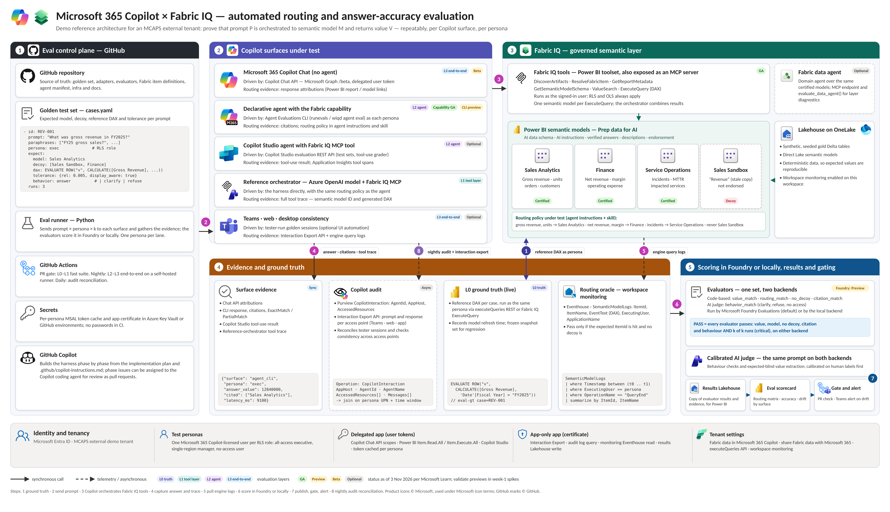
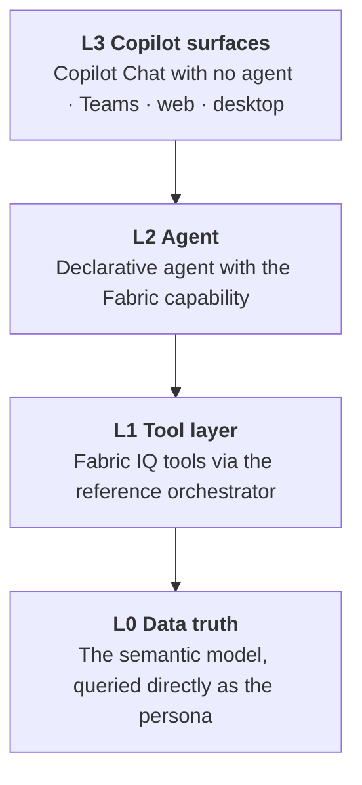
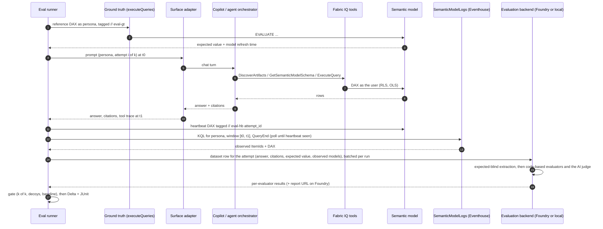
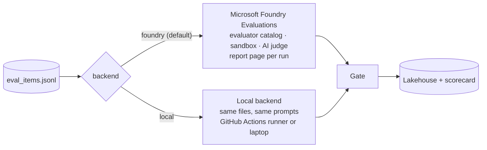

# Architecture

*Select the image for the full-resolution SVG. Status labels (GA, Preview, Beta, Optional) reflect Microsoft Learn as of 3 November 2026.*

The harness asks Copilot a known business question as a known persona, then proves three things from independent evidence: which semantic model answered, whether the value was right, and whether that holds every time. One set of evaluators decides every verdict, run by Microsoft Foundry Evaluations (the default, [ADR-007](../decisions/ADR-007-foundry-evaluations-framework-of-record.md)) or locally in the harness ([ADR-009](../decisions/ADR-009-two-evaluation-backends.md)). Five zones work together (PLAN §3.2).

| Zone | What it contains | Where it lives in this repository |
|---|---|---|
| **1 Eval control plane: GitHub** | Golden set, evaluator source, the thin Python runner and, on the local path, the local evaluation backend, GitHub Actions, secrets via OIDC and Key Vault, GitHub Copilot building the harness | `evals/golden/`, `evals/evaluators/`, `src/copilot_evals/`, `.github/` |
| **2 Copilot surfaces under test** | Copilot Chat API (L3), declarative agent through the Agent Evaluations CLI (L2), optional Copilot Studio agent (L2), reference orchestrator (L1), tester sessions in Teams, web and desktop (L3) | `src/copilot_evals/targets/`, `agents/` |
| **3 Fabric IQ** | Fabric IQ tools; three certified Direct Lake semantic models and one decoy; Prep data for AI; Lakehouse on OneLake; optional data agent | `fabric/` |
| **4 Evidence and ground truth** | Surface evidence (synchronous), engine logs (near real time), Copilot audit (asynchronous), live ground truth | `src/copilot_evals/evidence/`, `src/copilot_evals/ground_truth/`, `fabric/kql/` |
| **5 Scoring (Microsoft Foundry or local), results and gating** | One set of evaluators (code-based checks and the calibrated AI judge), run by Foundry Evaluations (default: a report page per run, results kept in Foundry) or by the local backend; the gate over the results; a copy in the results Lakehouse for the Power BI scorecard; Teams alert | `evals/evaluators/`, `src/copilot_evals/evaluation/`, `src/copilot_evals/foundry/`, `src/copilot_evals/sinks/`, `config/gates.yaml` |

## Who does what

| | Role | Never does |
|---|---|---|
| **GitHub + Python** (thin layer) | Drives each Copilot surface as each persona; gathers the expected value from Fabric and the engine-log evidence; hands one row per attempt to the evaluation backend; applies the gate; publishes results to Fabric | Score an answer |
| **The evaluators** (`evals/evaluators/`) | Decide every verdict: code-based checks and the AI judge, written once | Depend on where they run |
| **Microsoft Foundry Evaluations** (default backend) | Runs the evaluators over one dataset row per attempt; keeps every verdict with a report page per run | Talk to Copilot: no evaluation framework can |
| **Local backend** (no Foundry needed) | Runs the same evaluators in the harness process, on the GitHub Actions runner or a laptop | Add checks of its own |
| **Microsoft Fabric** (truth and business view) | Semantic models that produce the expected values; engine logs that show which model answered; the Lakehouse and Power BI scorecard | Decide pass or fail |

## Evaluation layers

Each layer isolates one part of the stack, so a failure points at what to fix (PLAN §3.1).

| If this passes… | …and this fails | Fix |
|---|---|---|
| L0 | L1 | The semantic model's AI readiness: names, descriptions, Prep data for AI, ambiguous measures |
| L1 | L2 | The agent: instructions, skill or orchestration |
| L2 | L3 | General Copilot needs an agent or prompt guidance for this question class |

The L1 reference orchestrator is a **controlled proxy, not a replica**: public documentation does not describe Copilot's internal tool calls. It uses the same routing policy as the agent, so differences between L1 and L2 come from orchestration, not instructions. It runs in the harness, calling an Azure OpenAI model, rather than as a Foundry agent, because Fabric IQ MCP accepts only delegated user sign-in and a cloud evaluation run has no persona to sign in as.

## One attempt, end to end

From PLAN §3.3. Ground truth runs *before* the attempt window and is tagged `eval-gt`; the heartbeat runs *after* it and is tagged `eval-hb`. Both tags are excluded from routing evidence. Scoring is batched: one evaluation run covers every attempt of an `evals run`, on either backend.

## Scoring: one set of evaluators, two backends

One evaluation run scores every attempt of a suite, on the backend the run is configured for ([ADR-009](../decisions/ADR-009-two-evaluation-backends.md), [choosing a path](../evaluation-paths.md)). Each dataset row carries the question, Copilot's answer and citations, what a correct answer looks like (computed live from Fabric) and the routing evidence (from the engine logs). The backend then:

1. asks the judge model which figure the answer gives, **without** showing it the expected value (the extraction step);
2. runs the code-based evaluators `value_match`, `routing_match`, `no_decoy`, `citation_match` and, for joint Work IQ + Fabric IQ cases, `work_source_match`, which are deterministic and have no network access;
3. runs the AI judge `behavior_match` for answer, clarify, refuse and no-access behaviour;
4. returns one result per attempt and evaluator, with the evaluator's content-addressed version.

On the Foundry backend, Foundry keeps every result with a report page for the run. On the local backend, the run's `evaluator_results.jsonl`, the job summary and the artifacts are the record. On both, the gate applies the same rule: any failed evaluator fails the attempt; an evaluator that raised (incomplete evidence, surface error) makes it INCONCLUSIVE; critical cases must pass k of k. Details: [evals/evaluators](../../evals/evaluators/README.md), PLAN §9.11 and §9.12.

## Why engine logs are the routing oracle

Copilot-side APIs expose answers and, at best, agent identity and citations; none documents which semantic model a DAX query hit. Fabric workspace monitoring writes `SemanticModelLogs` with the model (`ItemId`, `ItemName`), the query (`EventText`) and the user (`ExecutingUser`). No documented value marks a query as Copilot-generated, so the harness correlates on:

- a **dedicated persona** per lane, run serially, so time windows never overlap for one user;
- a tight **time window** around each attempt;
- **heartbeat completeness**: once the attempt's heartbeat query is visible in the logs, earlier rows are assumed ingested (validated by spike S2); if it never arrives, the row says the evidence is incomplete and the routing checks raise, so the attempt is INCONCLUSIVE, never FAIL;
- **both** monitoring Eventhouses, because a decoy hit appears only in the sandbox workspace's logs.

Foundry's built-in tool-call evaluators don't support Fabric data agent calls, so the routing and decoy checks are our own code-based evaluators over this evidence.

## Identity

| Identity | Used for | Flow |
|---|---|---|
| Personas `exec`, `east`, `noaccess` | Chat API, Fabric IQ MCP, executeQueries, Agent Evaluations CLI | Delegated; one-time device-code bootstrap, MSAL token cache in Key Vault; never ROPC |
| `copilot-eval-public` app | The delegated scopes in PLAN §9.3 | Public client |
| `copilot-eval-daemon` app | Interaction Export, audit query, monitoring reads, results writes | App-only, certificate in Key Vault |
| GitHub OIDC federated credential | Azure sign-in from GitHub Actions: Key Vault, the model deployment (L1 orchestrator, the local backend's AI judge) and, on the Foundry path, Microsoft Foundry (register evaluators, upload datasets, run evaluations) | No stored client secrets; Cognitive Services OpenAI User on the model resource; Foundry User at the Foundry account scope on the Foundry path |

Details: PLAN §11.

## Diagram source

[`copilot-fabric-iq-eval-architecture.svg`](copilot-fabric-iq-eval-architecture.svg) is the master; the PNG is rendered from it at 2× for the README. Update both together: edit the SVG, then render it at 6800 pixels wide with any SVG renderer that has the Carlito and DejaVu Sans Mono fonts.
