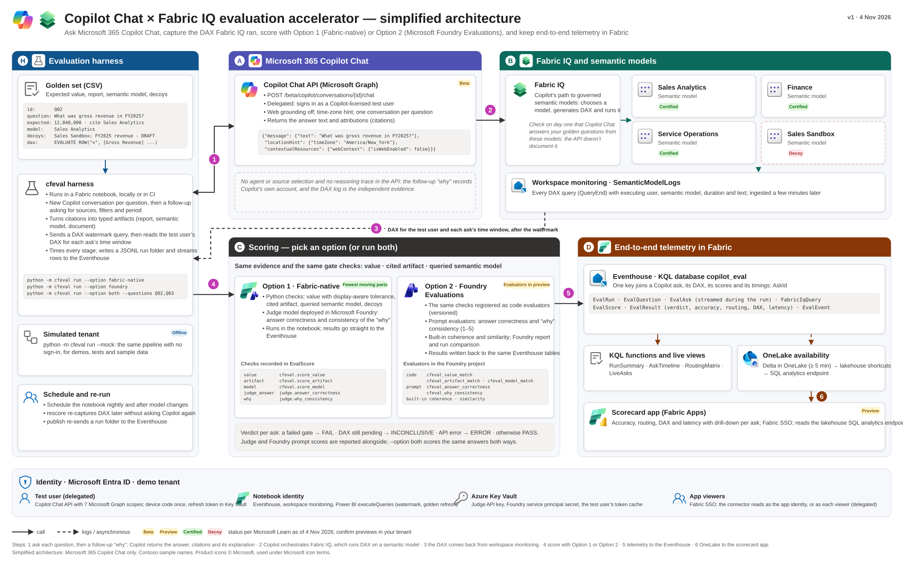

# Architecture

`cfeval` separates **target execution**, **telemetry collection**, **scoring**, and **reporting/publication** behind small, composable protocols so the same golden suite and scoring engine work identically offline, in CI, and against live cloud tenants.



## Four-Stage Pipeline

```
Golden Suite v2 (YAML / CSV)
        │
        ▼
1. EvalTarget (ask_turn)
   ├── copilot-chat       (M365 Copilot Chat Graph API — Fabric IQ & Work IQ)
   ├── fabric-data-agent  (Fabric Data Agent REST endpoint)
   ├── mcp-agent          (OpenAI-compatible model + MCP tool loop)
   ├── transcript-import  (Offline CSV / JSONL transcript replay)
   └── mock               (Deterministic offline simulator: tuned / untuned)
        │
        ▼
2. TraceCollector (collect)
   ├── kql                (Fabric Workspace Monitoring SemanticModelLogs)
   ├── built-in tool log  (MCP tool_call payloads)
   └── none               (Chat attributions / citations only)
        │
        ▼
3. Scoring & Statistical Aggregation
   ├── Option 1 (Local):  Deterministic v2 scorers + optional calibrated LLM judge
   ├── Option 2 (Foundry): Azure AI Foundry Evaluation service (code + built-in evaluators)
   └── Trial stats:       pass@k, pass^k, Wilson 95% CI, paired McNemar significance
        │
        ▼
4. Sinks & Deliverables
   ├── Local JSONL bundle (runs/<run-id>/*.jsonl)
   ├── Self-contained HTML scorecard, JSON summary, JUnit XML
   └── Optional Fabric Eventhouse + OneLake Lakehouse shortcuts + Scorecard App
```

## Core Protocols (`src/cfeval/interfaces.py`)

| Protocol / Dataclass | Responsibility |
|---|---|
| `EvalTarget` | Accepts a prompt (and optional follow-up why prompt) and returns a `TargetTurn` with `answer_text`, `attributions`, `artifacts`, `latency_ms`, and optional `tool_calls`. |
| `TraceCollector` | Correlates a completed batch of asks against backend engine logs (such as `SemanticModelLogs` in Fabric Workspace Monitoring) and returns matched `DaxTrace` records. |
| `GoldenQuestion` | Canonical representation of a Schema v2 test case (`case_type`, `expected` / `expect`, `gates`, `tolerance`, `persona`, `paraphrases`). |

## Telemetry Data Model (`SCHEMA_VERSION = 2`)

Every run writes seven normalized tables (as local `.jsonl` files and optionally to Fabric Eventhouse) joined on `RunId` and `AskId`:

1. **`EvalRun`** — Run-level metadata, target/collector configuration, pass rates, Wilson CIs, latency `p50`/`p95`, and optional Foundry portal URL.
2. **`EvalQuestion`** — Snapshot of the golden expectations evaluated in the run.
3. **`EvalAsk`** — Raw turn response, attributions, follow-up explanation, trial index, and turn latency.
4. **`FabricIqQuery`** — Correlated engine query traces (semantic model name/ID, DAX text, `DurationMs`, time offset).
5. **`EvalScore`** — Individual check rows (`value`, `artifact`, `model`, `judge`, Foundry evaluators).
6. **`EvalResult`** — Denormalized wide row per ask × scoring backend consumed by HTML reports and the Fabric scorecard app.
7. **`EvalEvent`** — Stage-level execution timings (`ask`, `why`, `trace_wait`, `score`, `publish`).

Full column specifications are generated directly from `src/cfeval/schema.py` in [Telemetry Schema Reference](../reference/telemetry-schema.md).

## Related Decisions

- [ADR 0001: Two Scoring Backends, Not Two Harnesses](../decisions/0001-two-backends-not-two-harnesses.md)
- [ADR 0002: Deterministic-First Scoring](../decisions/0002-deterministic-first-scoring.md)
- [ADR 0003: Target-Neutral Routing Evidence Tiers](../decisions/0003-target-neutral-evidence-tiers.md)
