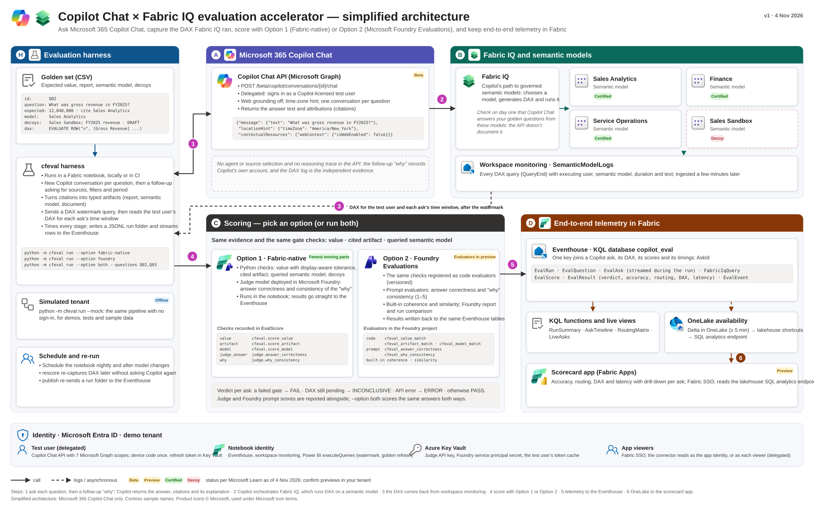

# How It Works

`cfeval` evaluates analytical and workplace answers across Microsoft 365 Copilot Chat, Fabric IQ, and Work IQ by separating **target execution**, **independent telemetry collection**, and **deterministic multi-layer scoring**. Rather than trusting prose fluency or surface citations alone, the harness checks whether the returned value matches ground truth, whether citations point to certified artifacts, and—when Fabric Workspace Monitoring is enabled—whether the semantic model engine actually ran clean DAX against the expected model.

*(See [Architecture Assets](../architecture/README.md) for PNG and SVG diagram sources.)*

## End-to-End Pipeline

Every `cfeval run` executes five decoupled stages defined by small Python `Protocol` interfaces in `src/cfeval/interfaces.py`:

1. **Golden Suite & Calibration (`GoldenQuestion`)**: Loads versioned YAML (`schemas/golden.schema.json`, v2) or legacy v1 CSV cases containing the prompt, analytical intent, numeric or structured expectations, tolerances (`rel_tol`, `abs_tol`, `display_tol`), certified artifacts/models, decoys, and optional `reference_dax`.
2. **Target Execution (`Target` protocol)**: Sends each prompt in an isolated conversation turn (`copilot-chat`, `fabric-iq-mcp` / `mcp-agent`, `fabric-data-agent`, `transcript-import` / `import`, or offline `mock`) and captures `Answer` text, Graph/MCP citations, tool calls, and UTC request/response timestamps.
3. **Evidence Collection (`EvidenceSource` protocol)**: Queries Fabric Workspace Monitoring (`SemanticModelLogs`) after an ingestion buffer, joining `QueryEnd` DAX queries, `DatabaseName` / `SemanticModelId`, `DurationMs`, `CpuTimeMs`, and `StatusCode` to each turn via `CorrelationId` or bounded user/time windows.
4. **Five-Layer Scoring (`Scorer` protocol)**:
   * **Layer 1 — Deterministic Value Gate (`value`)**: Unit-aware scalar extraction (`exact_match`, `display_rounded`, tolerance) plus structured graders for `ranked_list`, `set`, `table`, `record`, `direction`, `clarification`, and `abstention`.
   * **Layer 2 — Citation & Artifact Gate (`artifact`)**: Verifies expected report/document attributions and flags decoy citations.
   * **Layer 3 — Engine DAX & Model Gate (`model` / `dax`)**: Confirms engine DAX ran on `expected_model`, avoided decoy semantic models, and finished with `DaxErrorCount == 0`.
   * **Layer 4 — Reliability & Paired Statistics**: Computes `pass@1`, `pass^k`, Wilson 95% confidence intervals, and exact paired McNemar $p$-values across baseline vs. candidate runs.
   * **Layer 5 — Calibrated Judge (`judge`, optional)**: Runs an LLM-as-judge (`foundry` / Azure OpenAI) calibrated against human-labelled turns (`Cohen's kappa >= 0.70`) for narrative completeness and `why_consistency`. Judge scores are advisory and never turn a failed deterministic gate into `PASS`.
5. **Artifacts, Gate, & Telemetry Store**: Writes deterministic local JSONL/Markdown bundles (`runs/<run_id>/`), evaluates CI release thresholds (`cfeval gate`), and publishes idempotently (`RowId`) to a Fabric Eventhouse powering the HTML report and optional Fabric App scorecard.

## Unified Source-Type Evidence and Gate Matrix

Different Microsoft 365 and Fabric grounding surfaces expose different telemetry channels. `cfeval` adapts active gate assertions to the evidence actually observable for each source type and reports the resulting `RoutingEvidence` tier explicitly instead of assuming engine proof where none exists:

| Source Type | Target / Surface | `RoutingEvidence` Tier | Evidence Available | Active Gate Assertions | What Remains Unproven / `INCONCLUSIVE` |
|---|---|---|---|---|---|
| **Power BI semantic model with monitoring** | `copilot-chat` (`fabric-iq`) + Workspace Monitoring KQL | `engine+citations` (or `engine-only` if Copilot omits visible link) | Answer text, Graph report/model citations, and `SemanticModelLogs` `QueryEnd` rows (`QueryText` DAX, `SemanticModelId`, `DurationMs`, `CpuTimeMs`, `StatusCode`, `CorrelationConfidence`). | `value`, `artifact`, `model` (engine routing + decoy model avoidance + zero DAX engine errors), `abstention`. | Under concurrent queries by the same identity without a propagated `CorrelationId`, `CorrelationConfidence` drops to `medium`/`low`. |
| **Power BI semantic model without monitoring** | `copilot-chat` (`fabric-iq`) or `transcript-import` without KQL logs | `citations-only` (or `unverified` if no attributions) | Answer text and Graph response citations (`webUrl`, display title, artifact GUID parsed from Power BI links). | `value`, `artifact` (citation match + cited-decoy check), `abstention`. | Engine DAX text, un-cited background model touches, and `CpuTimeMs` are unavailable; strict `model`/`dax` gates resolve to `INCONCLUSIVE` rather than `PASS`. |
| **Fabric IQ MCP server** | `fabric-iq-mcp` / `mcp-agent` (`https://fabriciq.svc.cloud.microsoft/v1/mcp/fabriciq`) | `tool_call` (upgradeable to `engine+citations` when paired with Workspace Monitoring) | Answer text, structured MCP tool invocations (tool name, target semantic model/item arguments, returned payload), plus optional `SemanticModelLogs` DAX traces. | `value`, `artifact` / tool-target check, `model` (MCP target item ID + decoy avoidance; engine DAX check when monitoring attached), `abstention`. | Without Workspace Monitoring attached, server-internal VertiPaq sub-queries and `CpuTimeMs` outside the MCP response payload are not observed. |
| **Work IQ documents/sites/messages** | `copilot-chat` (`work-iq`) or `import` (`@microsoft/m365-copilot-eval`) | `citations-only` | Answer text and Microsoft Graph grounding attributions across SharePoint sites, OneDrive files (`.docx`/`.pptx`/`.xlsx`), Teams meeting recaps/chats, and Exchange messages. | `value` (scalars, lists, tables, facts, abstentions), `artifact` (`expected_artifact` / `artifact_aliases` + stale-draft `decoys`). | Semantic model `model` and `dax` engine gates do not apply to unstructured workplace artifacts (`DaxCaptured = false` by design). |

## Related Concepts

* [Evidence Tiers and Verdicts](./evidence-and-verdicts.md) — exact rules for `RoutingEvidence`, `CorrelationConfidence`, and `PASS` / `FAIL` / `INCONCLUSIVE` / `ERROR`.
* [Metrics and Statistical Tests](./metrics.md) — formulas for `pass@1`, `pass^k`, Wilson 95% intervals, McNemar $p$-values, and `MatchKind`.
* [Known Limitations](./limitations.md) — API preview constraints, KQL ingestion lag, and correlation caveats.
