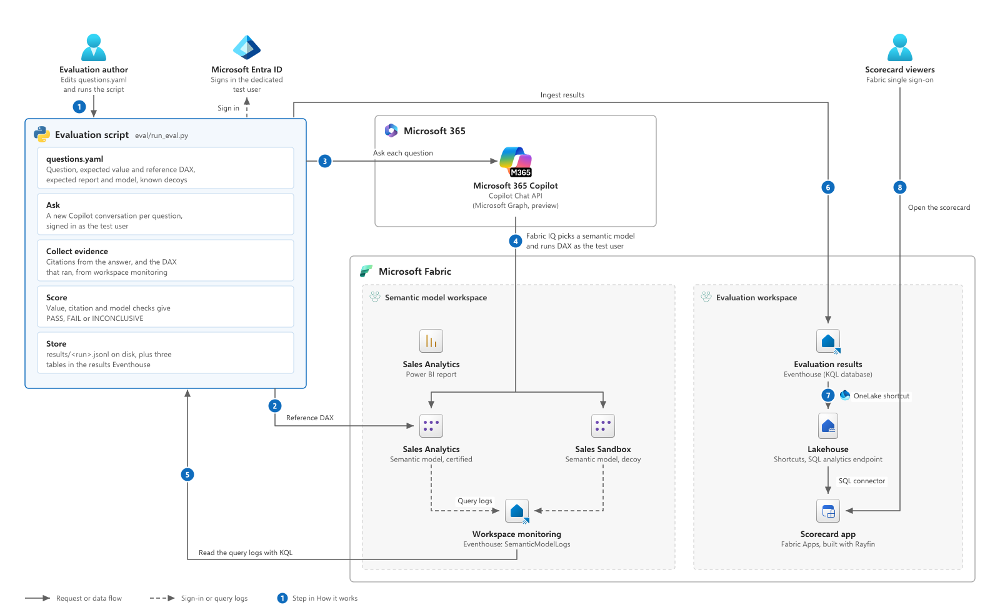
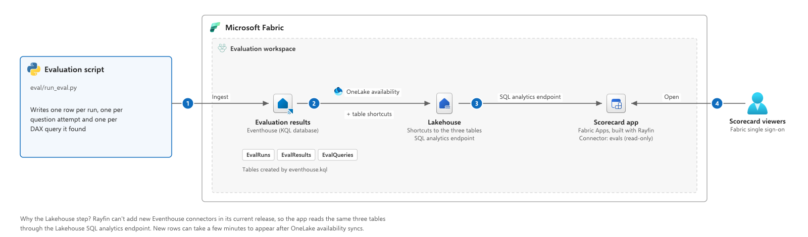

# Deployment guide

To learn the scoring method without a tenant, start with the [saved-answer Replay lesson](../README.md#replay-the-saved-answers). It uses local files and the checked-in scorecard screenshots; none of the setup below is required.

This guide is for a **live evaluation in a demo tenant**. It sets up a test user and sign-in app, the Sales Analytics and Sales Sandbox models and reports, workspace monitoring, and a results Eventhouse. The optional scorecard reads those results through Lakehouse shortcuts. The Python runner stays on your machine. Allow about two hours the first time.



| You'll need | Why |
|---|---|
| A Microsoft Entra administrator | To create the test user, register the sign-in app and grant consent |
| A Fabric capacity (F2 or larger) and a Fabric administrator | To host the workspaces and to check the Copilot and Fabric Apps tenant settings |
| A Microsoft 365 Copilot licence | For the test user |

## 1. Create the test user

1. In the Microsoft Entra admin center, create a user just for evaluation, for example `eval.tester@contoso.com`.
2. Assign it a Microsoft 365 Copilot licence and a Power BI licence that lets it read the semantic models in your capacity.
3. Don't use this account for anything else. The script matches query logs by this user and by time window, so any other activity from it adds noise.

> [!IMPORTANT]
> Never run the evaluation as a real employee. The Copilot Chat API needs broad read permissions, so Copilot can draw on everything the account can see.

## 2. Register the sign-in app

The script signs in with a device code, so it needs a public client app registration.

1. In **App registrations**, select **New registration**. Name it, for example, `Copilot evaluation script`. Choose **Accounts in this organizational directory only**.
2. Under **Authentication**, set **Allow public client flows** to **Yes**.
3. Under **API permissions**, add these delegated permissions:

   | API | Delegated permissions |
   |---|---|
   | Microsoft Graph | `Sites.Read.All`, `Mail.Read`, `People.Read.All`, `OnlineMeetingTranscript.Read.All`, `Chat.Read`, `ChannelMessage.Read.All`, `ExternalItem.Read.All` (all required by the [Copilot Chat API](https://learn.microsoft.com/microsoft-365/copilot/extensibility/api/ai-services/chat/copilotconversation-chat)) |
   | Power BI Service | `Dataset.Read.All`, for the reference DAX |
   | Azure Data Explorer | `user_impersonation`, to read query logs and write results with KQL |

4. Select **Grant admin consent**.
5. Copy the **Application (client) ID** and the **Directory (tenant) ID** into `.env` as `CLIENT_ID` and `TENANT_ID`.

## 3. Build the demo semantic model and a decoy

The golden questions in [questions.yaml](../questions.yaml) match a small synthetic Contoso dataset in [sample/contoso](../sample/contoso).

1. Create a workspace on your Fabric capacity named, for example, `Contoso sales`. This is the semantic model workspace.
2. Create a Lakehouse in it. Upload the four CSV files from `sample/contoso` and use **Load to Tables** for each one.
3. Create a semantic model from the Lakehouse named **Sales Analytics** with all four tables. Give the tables and columns friendly names, because the reference DAX and Copilot both use them:

   | Table in the Lakehouse | Name in the model | Columns to rename |
   |---|---|---|
   | `fact_sales_summary` | `Sales` | — |
   | `dim_date` | `Date` | `fiscal_year` to `Fiscal Year`, `fiscal_quarter` to `Fiscal Quarter` |
   | `dim_region` | `Region` | — |
   | `dim_product` | `Product` | — |

4. Create the relationships from `Sales[period_key]` to `Date[period_key]`, from `Sales[region_code]` to `Region[region_code]` and from `Sales[product_code]` to `Product[product_code]`.
5. Add these measures to `Sales`:

   ```dax
   Gross Revenue = SUM ( Sales[gross_revenue] )
   Net Revenue = SUM ( Sales[net_revenue] )
   Units = SUM ( Sales[units] )
   Product Returns = SUM ( Sales[returns] )
   Gross Margin % = DIVIDE ( SUM ( Sales[gross_profit] ), [Gross Revenue] )
   ```

   For FY2025, gross revenue is 12,840,000, net revenue is 11,950,000 and gross margin is 41.6%.
6. Create a report on the model named **Sales Analytics** with a few visuals that use these measures.
7. Create the decoy. Build a second semantic model on the same tables named **Sales Sandbox**, with the same measures except `Gross Revenue = SUM ( Sales[gross_revenue] ) * 0.96`. Create a report named **Sales Sandbox** on it. The decoy gives answers that look plausible but are about 4% low.
8. Give the test user access to the workspace, with Build permission on both models.
9. Ask a Fabric administrator to confirm that the Copilot tenant settings let the test user use Copilot with Power BI and Fabric data. See [Fabric IQ in Microsoft 365 Copilot](https://learn.microsoft.com/fabric/iq/connectors/microsoft-365-copilot-overview).
10. Copy the **Sales Analytics** semantic model ID from its URL into `.env` as `SEMANTIC_MODEL_ID`.

For the baseline run, leave the models as they are: no descriptions, no synonyms, no endorsement. The improvements come later, in [step 8](#8-run-the-demo-story).

## 4. Turn on workspace monitoring

1. In the semantic model workspace, open **Workspace settings** > **Monitoring** and turn on **Log workspace activity**. Fabric creates a monitoring Eventhouse that records `SemanticModelLogs`. See [Workspace monitoring](https://learn.microsoft.com/fabric/fundamentals/workspace-monitoring-overview).
2. Open the monitoring KQL database. Copy its **Query URI** into `.env` as `MONITORING_QUERY_URI` and its database name into `MONITORING_DATABASE`.
3. Give the test user read access to the monitoring KQL database.

Monitoring keeps logs for 30 days and uses a little capacity while it runs.

## 5. Create the results Eventhouse

1. Create a second workspace named, for example, `Copilot evaluation`. This is the evaluation workspace, and it keeps the results apart from the data being tested.
2. Create an Eventhouse in it. Its KQL database holds the results.
3. Open a KQL queryset on that database, paste in [eventhouse.kql](../eventhouse.kql) and run it. This creates the `EvalRuns`, `EvalResults` and `EvalQueries` tables and two helper functions. It's safe to run again.
4. Copy the database's **Query URI** into `.env` as `EVENTHOUSE_QUERY_URI` and its name into `EVENTHOUSE_DATABASE`.
5. Give the test user permission to write to the database, for example the Contributor role on the workspace.

The script appends rows with [inline ingestion](https://learn.microsoft.com/kusto/management/data-ingestion/ingest-inline). Inline ingestion suits a demo's few hundred rows, but don't use it for production volumes.

## 6. Run the evaluation

1. From the repository root, install the dependencies with `pip install -r requirements.txt`. Copy [.env.example](../.env.example) to `.env` and fill in the values.
2. With the results Eventhouse configured, run the saved answers first to check publishing. These commands omit `--no-publish`; sign in as the test user when prompted. A published replay does not test live Copilot grounding.

   ```bash
   python eval/run_eval.py --answers sample/answers-before.jsonl --label "Sample: before"
   python eval/run_eval.py --answers sample/answers-after.jsonl --label "Sample: after"
   ```

3. Run the golden questions live:

   ```bash
   python eval/run_eval.py --label "Baseline"
   ```

   The script does these steps in order:

   1. Signs in with a device code.
   2. Works out each expected value from the reference DAX.
   3. Asks the eight questions, five seconds apart.
   4. Waits `MONITORING_WAIT_SECONDS` (120 by default) for the query logs.
   5. Prints the scorecard, then saves it to `results/` and to the Eventhouse.

4. Add `--repeats 3` to ask each question three times. Copilot doesn't always answer the same way twice, and the scorecard shows which questions passed every time.

Validate grounding in your tenant. A Graph beta Copilot Chat API response does not guarantee that Fabric IQ was used. The runner stores the attribution's `providerDisplayName` as its title; it may name a provider rather than a report. Inspect the answer, attribution URL when available, and model logs for that test user and time window. The logs are correlated evidence, not a per-response trace.

## 7. Make the results readable by the scorecard app

The scorecard's connector reads the Lakehouse SQL analytics endpoint, not the Eventhouse directly. A successful CLI publish does not validate schema discovery, hosted sign-in or a viewer's access to live rows.



1. In the results KQL database, turn on **OneLake availability**. See [Eventhouse OneLake availability](https://learn.microsoft.com/fabric/real-time-intelligence/event-house-onelake-availability).
2. In the evaluation workspace, create a Lakehouse named, for example, `EvalLakehouse`.
3. In the Lakehouse, select **New shortcut** > **Microsoft OneLake**. Choose the results KQL database and add shortcuts for `EvalRuns`, `EvalResults` and `EvalQueries`.
4. Open the Lakehouse's **SQL analytics endpoint** and check that the three tables appear. New rows can take a few minutes to arrive after OneLake availability syncs.
5. Follow [app/README.md](../app/README.md) to create and publish the scorecard app.

### Non-production check: follow one run from the CLI to a viewer

Use the same `RunId` throughout (`run_id` in the local JSONL). A passing answer is not required to verify the data path.

- [ ] In `results/<run-id>.jsonl`, inspect the live Q02 answer, citations and any logged DAX. A missing model log cannot pass the model check.
- [ ] Find that `RunId` with `Mode` = `live` in `EvalRuns`. Match the Q02 row in `EvalResults` and any rows in `EvalQueries` by `RunId`, `QuestionId` and `Attempt`.
- [ ] After OneLake sync, confirm that the Lakehouse SQL analytics endpoint returns the same run and Q02 verdict.
- [ ] Sign in to the deployed app as an intended viewer, using live data. Match the run's label and start time on Overview, select it on Questions, and compare Q02 with the SQL result. Confirm the connector's owner or delegated permissions are appropriate for this viewer.

## 8. Run the demo story

1. Run the baseline: `python eval/run_eval.py --label "Baseline"`. Look for unnamed questions that land on the sandbox, or net revenue and margin answers that use the wrong measure. Your tenant need not reproduce the saved sample's verdicts.
2. Improve the **Sales Analytics** model:
   - Add descriptions and synonyms to the measures. For example, make clear that **Gross Revenue** is revenue before discounts and returns, and that **Net Revenue** is after them.
   - Hide raw numeric columns so Copilot uses the measures.
   - Endorse the model as **Certified**, and take the sandbox out of the test user's reach.
   - Add AI instructions that define the fiscal calendar and what "latest quarter" means, and that tell Copilot not to forecast beyond the data.
3. Run again: `python eval/run_eval.py --repeats 3 --label "After model fixes"`.
4. Open the scorecard and compare the two runs.

## Troubleshooting

| Symptom | What to check |
|---|---|
| "Signed in as … but TEST_USER is …" | The device code was completed with a different account. Delete `.token_cache.json` and sign in again as the test user |
| HTTP 401 or 403 from the Copilot Chat API | The test user has a Microsoft 365 Copilot licence, admin consent was granted for every Graph permission, and the tenant allows the Copilot Chat API |
| Copilot says it can't find the data | The test user can open the report and model, Copilot is allowed to use Power BI data in your tenant, and the question names something in the model |
| Every model check is INCONCLUSIVE | Workspace monitoring is on for the semantic model workspace, `MONITORING_QUERY_URI` points at the monitoring database (not the results one), and the test user can read it. Then raise `MONITORING_WAIT_SECONDS` and run again |
| Model checks show unexpected models | Someone else used the test user during the run, or two runs overlapped. Run one evaluation at a time |
| The scorecard shows no rows | OneLake availability is on, the shortcuts exist, and the SQL analytics endpoint lists the three tables. Allow a few minutes after a run |
| The first questions time out after the capacity resumes | The model is still loading. Run the reference DAX once, or ask one warm-up question, before the run |

## Clean up

Pause the Fabric capacity when you're not using it. When you've finished with the demo, delete the two workspaces, the app registration and the test user.
