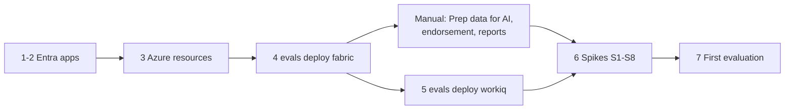

# Deploying the demo environment

This guide builds everything the evaluation harness tests against: the identities, the Azure resources, the Fabric estate with its semantic models, and the Microsoft 365 documents for the joint Work IQ + Fabric IQ questions. Each step is a script or a command that is safe to re-run, and each ends with a way to check it worked.

> **Status.** The deployment code is unit-tested against in-memory fakes and written against the documented APIs recorded in [`config/contracts.yaml`](../config/contracts.yaml). It has not yet been run against a live tenant: expect to confirm a few details on the first run, which is what the Phase 0 spikes and the `TODO(spike-Sx)` markers are for. Report anything that differs with the *Bug* issue form.

## What you get

| Component | Built by | Where |
|---|---|---|
| Four app registrations: `copilot-eval-public` (personas), `copilot-eval-setup` (deployment), `copilot-eval-daemon` (telemetry) and `copilot-eval-ci` (GitHub OIDC) | [`infra/entra/New-EvalAppRegistrations.ps1`](../infra/entra/New-EvalAppRegistrations.ps1) | Microsoft Entra ID |
| A Microsoft Foundry resource with a project and a `gpt-5-mini` deployment (or an Azure OpenAI resource for the local path only), a Key Vault, and optionally the self-hosted runner VM | [`infra/azure/deploy.sh`](../infra/azure/deploy.sh) (Bicep) | Your Azure subscription |
| Three workspaces and lakehouses, workspace monitoring, synthetic Contoso data, four Direct Lake semantic models with row-level security, persona permissions, and a validation run | `uv run evals deploy fabric` | Microsoft Fabric |
| Three documents (approved targets, service objectives, the draft decoy) on two SharePoint sites | `uv run evals deploy workiq` | Microsoft 365 |
| The Phase 0 spike results, one ADR each | [`spikes/`](../spikes/README.md) | `docs/decisions/` |



Plan on about half a day for steps 1 to 5, most of it waiting for notebook runs and admin consent, and a day of indexing before the joint cases (step 5).

## Before you start

**Tenant.** Use a demo or test tenant, never production. You need:

- **Licences:** Microsoft 365 Copilot for the three personas and for you; Power BI Pro for the personas if the capacity is smaller than F64 (PLAN §6 T1, T2).
- **Fabric capacity:** F2 or larger (F8 recommended for nightly runs) on which you are a capacity admin or contributor (T3).
- **Tenant settings:** Fabric data in Microsoft 365 Copilot, sharing Fabric data with Microsoft 365 services, the Execute Queries REST API, and service principals for Fabric APIs (T6–T10).
- **Personas:** three test users, `eval.exec`, `eval.east` and `eval.noaccess` at your domain, licensed and with MFA registered (T16). Their UPN pattern is in [`evals/golden/personas.yaml`](../evals/golden/personas.yaml).
- **Optional:** Work IQ enabled with usage-based billing, only for the Work IQ API surface of spike S8 (T21).

**Your roles.** Application Administrator (or Cloud Application Administrator) in Entra ID, plus someone who can grant admin consent; Owner, or Contributor plus Role Based Access Control Administrator, on an Azure resource group; Fabric capacity admin or contributor; SharePoint site owner for two new sites.

**Tools.** Python 3.12 and [uv](https://docs.astral.sh/uv/); Azure CLI 2.61 or later with Bicep (`az bicep install`); PowerShell 7 with `Microsoft.Graph.Applications` and `Microsoft.Graph.Identity.SignIns`; the GitHub CLI for the runner and the backlog; Node 24 for spike S3.

## 1. Clone and configure

```bash
git clone https://github.com/<owner>/copilot-fabriciq-evals.git
cd copilot-fabriciq-evals
uv sync --extra setup                    # harness, dev tools and azure-identity for sign-in
cp config/settings.example.toml config/settings.toml
```

In `config/settings.toml`, set `[tenant] tenant_id` and `tenant_domain`. The file is gitignored and holds no secrets. Each later step prints the values to add.

**Check:** `uv run evals validate --strict` prints `OK`.

## 2. Create the app registrations

```powershell
./infra/entra/New-EvalAppRegistrations.ps1 -TenantId <tenant-id> -GitHubRepository <owner>/copilot-fabriciq-evals
```

The script creates or updates the four apps, resolves every permission by name, and adds the GitHub OIDC federated credential for the `eval-demo` environment. It prints the client IDs for `[apps]` in your settings, the GitHub variables, and the `--ci-principal-id` for step 3.

**Admin consent** is deliberately separate: re-run with `-GrantAdminConsent` (Privileged Role Administrator or Global Administrator), or grant it in the Entra admin center under *App registrations > API permissions*. A warning that a resource "is not in this tenant" for Work IQ means Work IQ is not enabled; that only affects spike S8's `workiq` surface.

**Check:** the four apps exist in the Entra admin center, each with *Granted for <tenant>* on its permissions.

## 3. Deploy the Azure resources

```bash
az login
infra/azure/deploy.sh --resource-group rg-copilot-evals --location eastus2 \
  --ci-principal-id <from step 2>        # add --runner to deploy the self-hosted runner VM
```

Choose a region where `gpt-5-mini` (GlobalStandard) and Foundry evaluations are available, for example `eastus2` or `swedencentral` ([region support](https://learn.microsoft.com/en-us/azure/foundry/concepts/evaluation-regions-limits-virtual-network)). `--kind OpenAI` deploys an Azure OpenAI resource instead, for teams that only use the local evaluation path. Run with `--what-if` first to preview the changes.

The template assigns least-privilege roles: Foundry User (or Cognitive Services OpenAI User) for the CI identity, for you and for the runner; Key Vault Secrets User for CI and the runner; Secrets and Certificates Officer for you. Copy the printed `[azure]`, `[foundry]` and `[azure_openai]` values into your settings.

Then create the daemon certificate in the new Key Vault and attach it to the app:

```powershell
./infra/entra/New-EvalAppRegistrations.ps1 -TenantId <tenant-id> -GitHubRepository <owner>/copilot-fabriciq-evals -KeyVaultName <vault>
```

With `--runner`, register the VM with GitHub (no SSH or inbound port needed):

```bash
infra/azure/register-runner.sh --resource-group rg-copilot-evals --vm cfiq-runner --repo <owner>/copilot-fabriciq-evals
```

**Check:** `az resource list -g rg-copilot-evals -o table` lists the Foundry (or OpenAI) account, the project, the Key Vault and, with `--runner`, the VM; the runner shows *Idle* under *Settings > Actions > Runners*.

## 4. Deploy the Fabric estate

Set `[fabric] capacity` to your capacity's display name, then preview and run:

```bash
uv run evals deploy fabric --dry-run     # prints the plan; no sign-in, no changes
uv run evals deploy fabric               # signs you in with a device code (copilot-eval-setup)
```

It takes 20 to 40 minutes, most of it the three notebook runs. In order, it:

1. resolves the personas and the daemon app to Entra object IDs;
2. finds the capacity and checks it is active;
3. creates (or finds) `ws-eval-certified`, `ws-eval-sandbox` and `ws-eval-results` on it;
4. makes each persona a **Viewer** of the workspaces `personas.yaml` lists (row-level security only applies to Viewers) and gives the daemon its roles;
5. creates `lh_gold`, `lh_sandbox` and `lh_eval`;
6. turns on workspace monitoring for the certified and sandbox workspaces (preview API);
7. imports the notebooks from [`fabric/notebooks/`](../fabric/README.md);
8. runs **nb_01** (synthetic data, calibrated to the cent) and **nb_02** (the four semantic models, measures, relationships and RLS roles, with the personas as role members);
9. grants each persona Read and Build on the models in its workspaces;
10. runs **nb_03**, which checks the calibrated figures **as each persona** (FY2025 gross revenue $12,840,000.00 for `exec`, $4,200,000.00 for `east`, which proves RLS, and a 7.2-hour Sev1 mean time to resolve) and snapshots the expected value of every golden case; the snapshot is downloaded to `runs/deploy/expected_snapshot.json`.

Every step finds what exists by name and only creates what is missing, so re-running is the way to repair a partial deployment. `--no-run` stops after importing the notebooks; `--sign-in azure-cli` reuses `az login` instead of the setup app.

**Then, by hand** (the command prints this list; none of it has an API):

1. **Prep data for AI** on Sales Analytics, Finance and Service Operations: an AI data schema, the AI instructions in [PLAN §4.2](PLAN.md#42-semantic-models-direct-lake) and three to five verified answers each.
2. **Endorse** the three certified models (Certified, or Promoted if certification isn't enabled for you); leave Sales Sandbox unendorsed.
3. **One report per model**, named as in [`models.yaml`](../evals/golden/models.yaml). Copilot discovers data through reports as well as models.
4. **Monitoring:** copy each workspace's monitoring Eventhouse query URI and database name into `[evidence.monitoring.<workspace>]`.
5. **Optional:** freeze the expected values with `cp runs/deploy/expected_snapshot.json evals/golden/expected_snapshot.json`. It names personas by key, never by user name, so it is safe to commit.

**Check:** the command ends with *Fabric deployed* and no warnings; in Fabric, open Sales Analytics and use *Security > Test as role* with `RegionScope` and an East user: only East appears.

## 5. Seed the Work IQ content

The joint cases ask questions that need a certified figure and a document ([PLAN §4.4](PLAN.md#44-work-iq-content-joint-work-iq--fabric-iq-cases-adr-010), [ADR-010](decisions/ADR-010-joint-work-iq-fabric-iq-evaluation.md)).

1. **Create two SharePoint sites** (T20), with the members [`workiq/content.yaml`](../workiq/content.yaml) lists: *Contoso Planning* with `exec` and `east`; *Contoso All Company* with all three personas. `noaccess` must not reach the planning site.
2. **Add their URLs** under `[workiq.sites]` in your settings (`planning` and `all_company`).
3. **Upload the documents:**

```bash
uv run evals deploy workiq --dry-run     # lists every upload
uv run evals deploy workiq               # creates the folders and uploads (or replaces) the files
uv run evals deploy workiq --verify      # checks the uploaded files are present and current
```

**Allow time for indexing.** Copilot only finds a new document once the Microsoft 365 semantic index has processed it, and there is no published service level. Seed at least a day before a demo; spike S8 (`--search`) measures the delay in your tenant.

**Check:** `--verify` prints *All Work IQ documents are uploaded and current*; signed in as `exec`, Microsoft 365 search finds "FY2025 Revenue Targets - APPROVED".

## 6. Run the Phase 0 spikes

```bash
uv sync --extra setup --extra spikes
```

Each spike answers one open question and ends in an ADR ([spikes/README.md](../spikes/README.md)). A sensible order: S6 (Fabric IQ MCP tools), S1 (Chat API), S2 (engine logs, with S1's time window), S7 (Foundry path only), S3 (after the declarative agent, P4.1–P4.2) and S8 (joint questions, a day after step 5). Record each result with sanitised evidence and update `config/contracts.yaml` as the ADR template describes.

## 7. Your first evaluation

Today, `uv run evals score evals/evaluators/samples/eval-items.jsonl` runs every evaluator on seven sample attempts with no Azure resources. Live runs against Copilot arrive with the runner (P2.6) and the surface adapters; the [backlog](backlog/README.md) shows the order, and [getting-started.md](getting-started.md) turns on the workflows when they are ready.

## Tear down

```bash
az group delete --name rg-copilot-evals                   # Foundry, Key Vault, runner VM, network
az keyvault purge --name <vault>                          # only to reuse the vault name before 7 days
```

Then delete the three Fabric workspaces (*Workspace settings > General > Remove this workspace*), the two SharePoint sites (SharePoint admin center), and the four app registrations (Entra admin center). Pause the Fabric capacity when you are not demoing.

## Troubleshooting

| Symptom | Likely cause | What to do |
|---|---|---|
| `capacity ... not found` | The name is misspelt, or you are not a capacity admin or contributor | Check the name in the Fabric admin portal; `[fabric] capacity` also accepts the capacity ID |
| `capacity ... is Paused` | The capacity is paused | Resume it in the Azure portal, then re-run |
| 401 or 403 from Fabric with `--sign-in azure-cli` | The tenant blocks the Azure CLI app for Fabric scopes | Use the default device-code sign-in with `copilot-eval-setup` |
| nb_02 stops: *semantic-link-labs ... inline installation did not work* | Inline `%pip install` is blocked for non-interactive runs | Attach a Fabric environment with `semantic-link-labs==0.18.0` to nb_02, or run nb_02 once by hand; then re-run the command ([fabric/README.md](../fabric/README.md#troubleshooting)) |
| nb_03 fails the East-only check | The `east` persona is above Viewer, is not a `RegionScope` member, or permissions have not propagated | Check its workspace role and the role members; Power BI permission changes can take a few minutes; re-run |
| A persona's query fails but yours works | Direct Lake single sign-on cannot read the data for a Viewer | nb_02 uses the SQL analytics endpoint by default (`direct_lake_mode`); check the persona can read the lakehouse's SQL endpoint |
| Warning: *workspace monitoring could not be turned on by API* | The preview API is unavailable to you or changed | Turn it on in *Workspace settings > Monitoring*; the deployment continues without it |
| `evals deploy workiq`: *site ... not found or not accessible* | The site does not exist yet, or you are not a member | Create it (T20) and make sure you can open it |
| Joint cases fail because the memo is not cited | The documents are not indexed yet, or the surface cannot reach them | Wait, then check with spike S8 (`--search`); ADR-011 records which surfaces support joint answers |

## Cost

Everything here is pay-as-you-go. The main costs are the Fabric capacity (pause it when idle), AI judge and orchestrator tokens on the `gpt-5-mini` deployment, Copilot credits for the Agent Evaluations CLI, and, with `--runner`, the VM and NAT gateway (deallocate the VM when idle). Delete the resource group when the demo is over.
