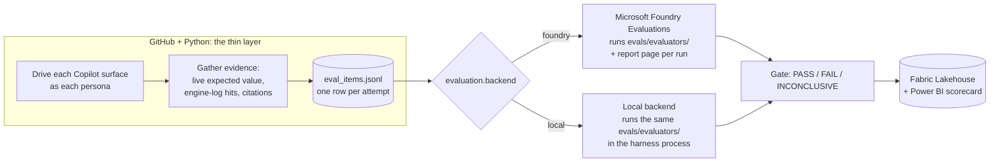

# Choosing an evaluation path: Microsoft Foundry or local

This harness is a reference for **two ways to evaluate** Microsoft 365 Copilot over Fabric IQ: with **Microsoft Foundry Evaluations**, or **locally**, with only GitHub and Fabric. Both paths use the same evaluators and give the same verdict for the same evidence. What you choose is where the evaluators run and where the verdicts are kept.

> [!TIP]
> Try the local path now, with no Azure resources: `uv run evals score evals/evaluators/samples/eval-items.jsonl`. It scores seven sample attempts and explains every result.

## What never changes

Whichever path you pick, the harness does the same three things ([ADR-009](decisions/ADR-009-two-evaluation-backends.md)):

- **One set of evaluators** in [`evals/evaluators/`](../evals/evaluators/): `value_match`, `routing_match`, `no_decoy` and `citation_match` (code), and the `behavior_match` AI judge (prompt).
- **One result shape.** Both backends return the same `EvaluatorResult` rows, with the same evaluator names and the same content-addressed versions (`cfiq_<key>_<sha8>`).
- **One verdict rule.** Any failed evaluator fails the attempt; otherwise an evaluator that couldn't decide makes it INCONCLUSIVE; otherwise it passes (PLAN §3.4).
- **One gate, one Lakehouse, one scorecard.** The `eval_run` table records which backend produced each run.
- **The same guardrails.** `evals validate` holds every evaluator to the Foundry sandbox rules and keeps the expected answer away from every prompt an LLM sees, on both paths.

## The two paths at a glance

| | **Foundry** (`foundry`, the default) | **Local** (`local`) |
|---|---|---|
| Where the evaluators run | Microsoft Foundry Evaluations, in your Azure subscription | In the harness process: the GitHub Actions runner or your machine |
| Code-based evaluators | Registered in the Foundry evaluator catalog and run in Foundry's sandbox | The same files, executed the way the sandbox runs them |
| AI judge | A Foundry prompt-based evaluator | The same prompt, sent to your model deployment through the Azure OpenAI v1 API |
| Where verdicts are kept | The Foundry project, with a report page per run; copied to the Lakehouse | GitHub Actions run artifacts and the job summary; copied to the Lakehouse |
| How you explain a verdict | The run's Foundry report page, and the scorecard's Evidence page | `evals score` output, the job summary and artifacts, and the scorecard's Evidence page |
| Azure you need | A Foundry project in a region with batch evaluation; a judge deployment; the Foundry User role (PLAN §6 T18) | A model deployment for the AI judge and the Cognitive Services OpenAI User role (T19). Without a judge, only the AI judge's results are INCONCLUSIVE |
| Service status | Foundry custom evaluators are **preview, with no SLA** | Generally available APIs only |
| Cost | Judge tokens; Foundry reports an estimated cost per run | Judge tokens; runner compute |
| Scale | Rows run in parallel in the cloud; up to 100,000 rows per run | Judge calls run in parallel from the runner (`azure_openai.judge_max_workers`) |
| What you can add later | Red-teaming, continuous monitoring and evaluation dashboards in Foundry | Your own reports in Power BI |
| Status in this repository | Foundry backend client: task P2.7, after spike S7 | In-process runner delivered; Azure OpenAI judge client: task P2.8 |

Both paths still need a model deployment for the L1 reference orchestrator (`[azure_openai]` in settings), because the orchestrator is a surface under test, not part of evaluation.

## How to choose

**Choose Foundry** when the customer already standardises on Microsoft Foundry, wants a managed results store with a report page for every run, plans to add red-teaming or monitoring, and accepts a preview service for the evaluators.

**Choose local** when there is no Foundry project or no supported region yet, preview services aren't allowed, you're developing evaluators offline, or you want to show the whole harness with only GitHub and Fabric.

**Use both** to show that the paths agree (score the same `eval_items.jsonl` on each and compare), or to migrate: start local, move to Foundry later without changing a single check.

## Switching paths

| Where | How |
|---|---|
| Your machine | Set `backend = "local"` or `"foundry"` under `[evaluation]` in `config/settings.toml`, or pass `--backend` to `evals run` and `evals score` |
| GitHub Actions | Set the repository variable `EVALS_BACKEND` to `local` or `foundry` (default `foundry`). The workflows register Foundry evaluators only on the Foundry path |
| Re-scoring a past run | `uv run evals score out/eval_items.jsonl --backend local --out rescored/` |

Prepare the path you choose with [getting-started.md](getting-started.md#6-choose-and-prepare-an-evaluation-path).

## Known differences

The local backend copies Foundry's semantics deliberately. These are the places where they can still differ, and how each is handled:

| Difference | Handling |
|---|---|
| Threshold semantics and how non-string values are rendered into templates | Unconfirmed for Foundry until spike S7; the local backend uses "at or above passes" and JSON rendering, and follows ADR-008 once it is recorded |
| The extraction step | Foundry runs it for every row; the local backend only for `answer` rows, the only rows `value_match` reads it for. Verdicts can't differ |
| Sandbox limits | Foundry enforces no network, 2 GB memory and 2 minutes per call at run time; the local backend checks the time limit after each call and relies on `evals validate` for the rest |
| The judge model | Each path calls the deployment you configure. Calibrate the judge on the path you use (P10.1) |
| Run records | Only Foundry runs have a `report_url` and a Foundry run ID |

## In the demo

1. Run the same three cases on each backend (`evals run --case-filter ... --backend foundry`, then `--backend local`).
2. Open the Foundry report page for the first run, and the job summary for the second.
3. On the scorecard, filter by backend: the verdicts match evaluator by evaluator, because the evaluators and their versions are identical.

See [the runbook](runbook.md) for the full demo script.
