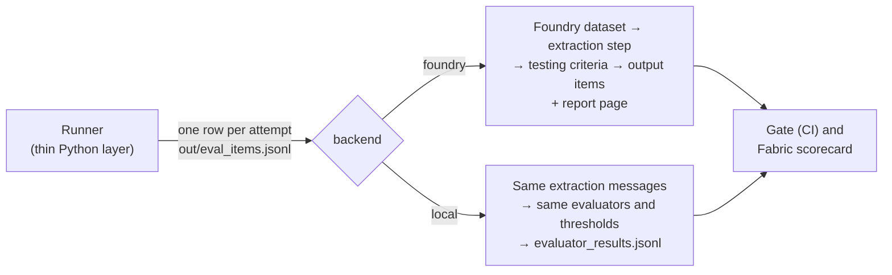

# Evaluators: one set, two backends

Every verdict in this harness comes from the evaluators in this folder (PLAN §9.6). They are written once, in Microsoft Foundry's own formats, and either evaluation backend runs them unchanged ([ADR-009](../../docs/decisions/ADR-009-two-evaluation-backends.md), [choosing a path](../../docs/evaluation-paths.md)):

- **Foundry backend** (the default, [ADR-007](../../docs/decisions/ADR-007-foundry-evaluations-framework-of-record.md), PLAN §9.11): Microsoft Foundry Evaluations registers them in its evaluator catalog, runs them in your Azure subscription and keeps every result with a report page per run.
- **Local backend** (PLAN §9.12): the harness runs the same files and prompts in its own process, on the GitHub Actions runner or your machine, with no Foundry project.

| File | What it is |
|---|---|
| [`evaluators.yaml`](evaluators.yaml) | The evaluator catalog: each evaluator's type, source file, the row fields it reads and its metric |
| [`eval-definition.yaml`](eval-definition.yaml) | The evaluation, in the OpenAI Evals format: the dataset row schema, the testing criteria (thresholds and data mappings) and the extraction step. Foundry receives it as it is; the local backend applies the same criteria |
| [`code/`](code) | Code-based evaluators: one self-contained `grade(sample, item)` file each |
| [`prompts/behavior_match.md`](prompts/behavior_match.md) | The AI judge: does the answer answer, clarify, refuse or report no access, as expected? |
| [`prompts/value_extraction.md`](prompts/value_extraction.md) | The expected-blind extraction step: which figure does the answer give? |
| [`samples/eval-items.jsonl`](samples/eval-items.jsonl) | Seven sample rows (fictional Contoso data) to try the evaluators with, no Azure needed |

## Try it

```bash
uv run evals score evals/evaluators/samples/eval-items.jsonl
```

This runs every evaluator on the sample rows on the local backend and prints each attempt's verdict with every evaluator's result and reason: a clean answer, an answer from the decoy model, an attempt whose engine logs aren't complete yet, an answer from the draft document, a clarifying question, a no-access reply, and a joint answer that cites both the certified model and the approved targets memo (ADR-010). Until `value_match` (P2.5) and the judge client (P2.8) exist, their results are INCONCLUSIVE, never a false pass. Add `--out out/` to write `evaluator_results.jsonl` and `evaluation_run.json`.

## The checks

| Evaluator | Kind | Passes when | Status |
|---|---|---|---|
| `value_match` | Code-based | The stated value is within tolerance of the live expected value (display-aware, PLAN §9.6.1) | Skeleton; built in P2.5 |
| `routing_match` | Code-based | The expected semantic model(s) were queried, per `route_mode` | Implemented |
| `no_decoy` | Code-based | No decoy model was queried, no document decoy was cited, and no figure came from a non-Fabric source | Implemented |
| `citation_match` | Code-based | The answer names its certified source when the case requires it | Implemented |
| `work_source_match` | Code-based | Joint cases: the answer cites every seeded document it relies on, such as the approved targets memo (PLAN §4.4) | Implemented |
| `behavior_match` | Prompt-based (AI judge) | The answer shows the expected behaviour: answer, clarify, refuse or no access (1–5 scale, 4 or more passes) | Drafted; calibrated in P10.1 |

Code-based evaluators return 1.0 or 0.0. When the evidence can't decide, because the engine logs are incomplete or the surface call failed, they raise `InconclusiveError`. The backend records that row as an error, and the gate reports the attempt as **INCONCLUSIVE** rather than failing it.

## One run, on either backend



1. **The runner builds the rows.** Code-based evaluators have no network access, so each row (`copilot_evals.schemas.EvalItem`) already holds everything a check needs: the question, the answer and citations, the expected value computed live from Fabric, and the semantic models seen in the engine logs.
2. **The backend runs the evaluation.** The extraction step first asks the judge model which figure the answer gives, without showing it the expected value. `value_match` uses that extraction only when its own parsing finds several candidates, and only if it matches one of them. Then every testing criterion is applied to every row.
3. **The results come back** as one `EvaluatorResult` per attempt and evaluator, in the same form from both backends. The gate decides the pull request or nightly run; the results sink copies the results to Fabric for the Power BI scorecard. On Foundry, every run also keeps its report page in the Foundry portal.

## Rules that keep the verdicts trustworthy

- **The AI judge never sees the expected answer.** `judge_blind_fields` in `eval-definition.yaml` lists `expected_value`, `expected_table` and `tolerance`; no prompt, data mapping or template shown to an LLM may reference them, on either backend.
- **Evaluators fit the Foundry sandbox, on both backends.** Standard library or the sandbox packages only, no network, no imports from `copilot_evals`, under 256 KB, under 2 minutes per call. That's what lets the same file run in Foundry and locally.
- **Every field read is declared.** An evaluator may read only the row fields listed under `reads` in `evaluators.yaml`, and those must exist in the item schema.
- **Every result names the evaluator version that produced it.** The version is a content-addressed name (`cfiq_<key>_<sha8>`) from the source and its catalog entry, identical on both backends. On Foundry, `evals foundry sync` (P2.7) registers each evaluator under that name, so a pull request that changes an evaluator never changes what `main` runs.

`uv run evals validate --strict` checks all of these offline, and CI runs it on every push. The unit tests in `tests/unit/test_evaluators.py` execute each evaluator file the way the sandbox does, and `tests/unit/test_local_backend.py` checks that the local backend applies the definition as Foundry does.

## Changing an evaluator

1. Edit the evaluator, and update `reads` in `evaluators.yaml` if it reads a new field. A new field also means changing `EvalItem` in `src/copilot_evals/schemas.py` and the item schema in `eval-definition.yaml`.
2. Add or update unit tests in `tests/unit/test_evaluators.py`.
3. Run `uv run evals validate --strict && uv run pytest && uv run evals score evals/evaluators/samples/eval-items.jsonl`.
4. Open a pull request. Once the live workflows are on, the PR gate runs the L0–L1 suite with the new evaluator version on the configured backend, so the effect shows in the pull request.

Judge prompts are behaviour too: recalibrate them against [`../judge/`](../judge/README.md) before relying on a change.

## Contracts and open questions

The Foundry calls, limits and field names are in [`config/contracts.yaml`](../../config/contracts.yaml) under `foundry_evaluations`; the model calls the local backend makes are under `azure_openai_v1`. Both come from Microsoft Learn (3 November 2026). Foundry custom evaluators are in preview with no SLA. Spike **S7** confirms the remaining Foundry details in our project and region before the Foundry backend depends on them: how errors appear in output items, whether `item` carries the whole row, version pinning, threshold semantics and cost. The local backend follows what S7 records ([evaluation paths: known differences](../../docs/evaluation-paths.md#known-differences)).
